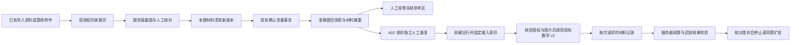
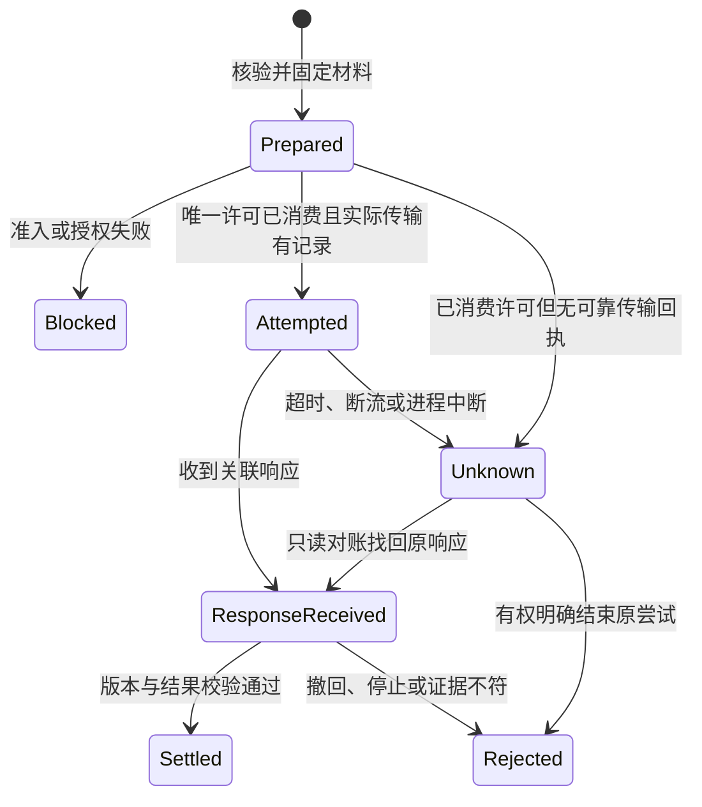

# A01 参考图参与 AI 试改：详细设计

日期：2026-10-19。2026-10-20 已实施核心代码并进行合成验收，实际交付范围、配置与验证边界见 [实施与验收记录](../engineering/a01-reference-materials-implementation-2026-10-20.md)。设计基线已包含 A02 试改及迁移 `000197_subjective_run_snapshot_binding.sql`；既有未提交改动全部保留。本文统一产品范围、接口和状态取舍；附属调研笔记中的备选项不作为另一份接口权威。

## 1. 要解决的具体问题

一道几何题的辅助线只画在参考解答图里。当前文字参考上下文不能把这张图传入数学评分请求，教师看到的完整材料与 AI 实际输入可能不同。A02 已能先保存 5–10 份人工基准、比较样本结果并决定是否扩批；A01 补齐这次试改所依据的图像，并让教师核对发送事实。

首期交付单位是：**本题选图 → 服务端裁图 → 人工核对 → 随考试冻结 → 真实图片请求 → 发送记录 → 教师复核**。单独增加附件上传、材料清单或预览，不算功能完成。

业务用语：`已添加` 表示有材料，`已冻结` 表示本场绑定版本，`已发起图像请求` 表示有实际 transport 记录，`已收到模型响应` 表示收到与该请求关联的响应。发送许可已被领取、但缺少可靠传输记录时只能说“可能已发起，发送结果待核实”。这些状态都不能表述为“模型已看懂”“评分已正确”或“正式成绩已确认”。

## 2. 结合已有功能的复用方案

| 已有功能与代码入口 | 已核实能力 | 本期只增加什么 |
| --- | --- | --- |
| `apps/web-admin/src/features/paper-import/PaperImportWorkspace.tsx`、`usePaperImportMaterials.ts` | 同一入口导入 PDF、Word、图片、Markdown、TXT；已有来源预览与重试 | 在现有题目配置中选择这些来源的可用页面，不新建上传页或一级导航 |
| `services/api-gateway/internal/paper/types.go` 的 `PaperImportSourceRef`、`PaperImportDecodedPage` | 有来源、页码、框与已解码页面身份 | 将候选来源转换为可授权、可校验的题目材料页；不直接执行任意 `bbox:any` |
| `paper/document_visual_loader.go`、`services/page-processing-worker/page_processing/runner.py` | PDF 可产生登记在 files 中的页图；来源与摘要可追溯 | 增加受控来源页查询、裁图和有效解析代次检查，不另建 PDF 解码服务 |
| `questionbank/scoring.go`、`paper/materialize_bank.go` | 题库评分附件已校验；assets 可经 BankContent 物化进考试并进入快照 | 为本题显式选择图像角色和裁图版本，不能声称本地没有附件或冻结材料 |
| `paper/store_postgres_configuration.go` 的 `ConfirmReadiness` | 考试锁内核对配置摘要、转 ready、绑定准确评估快照 | 同一确认事务绑定材料清单，不另建“材料审批发布”系统 |
| `files/store_postgres.go`、`files/downloads.go` | 私有资产、生命周期、范围与题库 ACL 检查、受控二进制读取 | 新用途的裁图归属及任务级材料读取，不另建桶、文件表或公开 URL |
| `taskmaterials/question.go`、`FrozenQuestionReference.tsx` | 按任务快照读取和展示文字答案、解答、细则 | 同一个参考区展示冻结图片；taskmaterials 仍不负责授予文件权限 |
| `subjective/grading_reference.go`、`grading_agent_v2_builder.go`、`app_v2.py` | 冻结文字参考与一份学生数学裁图，服务器结算评分点 | 独立的参考图片数组、角色说明、绑定摘要与发送记录 |
| `TrialScoringDrawer.tsx`、`useScoringTrials.ts`、`subjective/trial_rules.go` | 已有基准、样本结果、理由、停止、同题扩批与恢复 | 试改前材料检查、逐样本发送记录、材料撤回后拒绝扩批 |
| `subjective/idempotency.go`、`worker_execution_service.go`、`worker_completion_atomic.go` | 运行请求身份、Prepare、租约与事务提交检查；000197 已绑定评估快照 | 把材料及实际提示身份接入同一运行事实，拒绝不匹配的迟到结果 |

注意三个已有功能边界：来源预览只是受保护下载后打开文件，不是裁图器；Rubric Assistant 拆分的是文字解答步骤，不是图片；试卷解析的托管模型通道不是评分通道，不能借用解析凭证绕过评分准入。

## 3. 首期范围与可见行为

### 3.1 纳入范围

- 学科/路径：现有数学 v2 的单模型教师建议路径，且部署通过多图能力检查和实际图像调用准入。保留数学证据校验、服务器采分点结算、教师确认和 A02 闸门。
- 图片角色：`question_diagram`（题目图）、`reference_solution`（参考解答图）。每角色最多 2 张，共最多 4 张；学生作答仍是原来的一张 `answer_segment_crop`。
- 来源：本考试已导入 PNG/JPEG、已经服务端解码并保存的有效 PDF 页图、本考试已物化且获准使用的题库图片附件。未解码 PDF 提示先完成现有资料解析；不把浏览器截图或 PDF 链接当评分材料。Word 等来源没有可校验页图时只沿用已有文字流程。
- 查看位置：原题目配置、确认准备摘要、冻结参考区、A02 报告，不增加独立“素材管理中心”。
- 本期所选图全部为必需图，按冻结顺序全部发送；不在调用途中自动删图、切纯文字或改成另一模型。

### 3.2 模式与兼容

每题材料描述有明确 `mode`：`text_only` 或 `reference_images`。新参与 A01 的题目在准备阶段由教师确认模式；选择图片时为 `reference_images`，不得以空数组伪装配置完成。旧考试没有该字段时为 `legacy_unrecorded` 的只读投影，表示历史未记录，不能解释为教师确认无需图片。

不强制所有历史文字题重新配置，不因新增空字段让旧配置摘要变化。题目一旦冻结为 `reference_images`，所选图缺失便阻断该题 AI，人工任务继续。材料变更只能在现有允许编辑的 draft/configured 阶段进行；本期不增加已冻结考试“临时补图并接着扩批”的通道。

### 3.3 后置范围

其他学科、学生跨页多区域作答、评分样例图库、任意文档直接外发、自动判断图内无身份、自动改细则及正式重评均不纳入首期。`dashscope_native` 当前生产评分适配器明确拒绝图片消息；首期如实阻断该路径。原生多模态转换可以另列后续任务，不能把离线原生夹具或试卷解析转换包装成评分生产支持。Panel 入口未一起接通相同材料协议前也须阻断带参考图的调用，不能静默丢图。

## 4. 教师操作流程

| 步骤 | 现有位置 | 新行为与失败恢复 |
| --- | --- | --- |
| 1. 添加资料 | 试卷资料导入 | 使用原上传与解析；来源识别不确定时先人工核对，不自动把某页认定为参考答案 |
| 2. 选择本题材料 | 原题目详情/配置 | “参考图”区域显示来源页、角色和当前版本；点击“从已有资料选图” |
| 3. 裁图 | 本题材料抽屉 | 保留题干条件、图例、字母和辅助线；鼠标拖框与键盘数值调整；框取与学生作答 ROI 分开 |
| 4. 核对实际图片 | 同一抽屉 | 服务端生成实际 PNG 后预览；教师核对题号、角色和必要条件，才能保存完整有序列表 |
| 5. 保存 | 原题目详情 | 原命令、expected_revision、防重复提交；响应未知时保留草稿，只核对/恢复原操作，不生成另一版 |
| 6. 确认准备 | 现有准备确认 | 每题摘要增加材料模式、图数与版本；配置摘要在锁内再核对，另一人换图后旧确认收到冲突 |
| 7. 人工阅卷 | 冻结参考区 | 只显示当前任务快照的图片；普通阅卷员无须因此获得题库浏览权或整页原文件权 |
| 8. 试改前检查 | 本场 AI 试改 | 分别显示材料齐备性、当前可调用性、5–10 份独立样本要求；检查通过不触发模型调用 |
| 9. 运行与核对 | 原试改样本报告 | 每份显示本次准确运行/尝试的图数、角色、版本和请求事实；不混用最新一次任意建议的记录 |
| 10. 决定 | 原停止/扩批区域 | 仍须负责人填写理由；同题扩批继续使用该冻结材料，沿用最多 1000 份及独立样本规则 |

文字示例：“本题参考图已随考试冻结，仅供核对”“本题缺少必需解答图，暂不能生成 AI 建议，人工阅卷可继续”“本次可能已发起图像请求，发送结果待核实”“历史请求未记录图片发送情况”。不把协议名、哈希算法或存储键放进正常教师操作步骤。

## 5. 总体数据流



材料内容版本与当前使用权限分开：内容冻结后不修改；撤回权限改变可用性及授权代次，不能改写历史“发送了什么”。已离开本服务的请求无法通过撤回或停止来追回；已成功提交的历史建议保留其原依据，正式成绩仍按原流程管理。

## 6. 数据模型与唯一权威

复用 `file_asset` 保存来源、页图和派生 PNG，复用 worker runtime 与业务命令收据。新增材料领域表两张、请求材料记录一张；不另建文件、工作流或通用审批表。

### 6.1 `question_reference_manifest`

追加不可变的每题清单版本：`id, tenant_id, exam_id, question_id, revision, previous_manifest_id, schema_version, mode, content_hash, command_id, request_hash, created_by, created_at`。唯一约束为 `(tenant_id,question_id,revision)` 和 `(tenant_id,created_by,command_id)`；命令指纹覆盖操作、考试、题目、期望修订及原始输入。同 ID 异请求返回冲突。

首期不另建 head 表：保存与确认准备复用已有考试行锁，在锁内比较该题最大 revision；读取草稿可以查询当前版本，冻结和运行则必须引用准确 ID，绝不运行时取最新版本。若后续并发量证明考试锁不足，再单独评估 head 指针，避免本期产生双重权威。

内容列只追加。当前使用状态仅开放窄操作：`use_state=active|withdrawn`、`authorization_revision`、撤回时间/原因；这几个字段不进入历史内容摘要，进入运行时授权检查。保存 `exam_use_grant_json`，记录来源已发布版本/用途政策、合法物化操作及获授权考试范围；来源的自由文本版权字段不能自动解释为机器可执行许可。首期许可撤回由显式操作执行，不承诺自动监测外部版权或期限。显式 `text_only` 也保存一个空清单版本；NULL 专供没有历史事实的旧行。

### 6.2 `question_reference_manifest_item`

每项有复合外键关联 manifest 和各资产：`id, tenant_id, manifest_id, ordinal, role, required=true, caption, source_kind, source_reference_json, source_file_asset_id/hash, page_file_asset_id/hash, source_width/height, pixel_bbox, derived_file_asset_id/hash, width/height/size_bytes, transform_version, checked_by/at`。

`ordinal` 按清单唯一；所有文件引用均验证同租户、合法归属、有效生命周期。来源摘要、角色、顺序、实际裁图、变换版本与派生摘要都进入清单摘要。caption 仅用于识别图片，不能替代 Rubric 新增给分规则。参考图不能成为学生得分证据；`evidence_ids` 继续仅引用学生作答的步骤/公式。

文件引用用窄关系行和数据库 FK/删除保护执行，不只把 asset_id 藏在 JSON 后依赖一次应用层查询。源/page/derived 外键列建立引用索引；归档沿用考试只读和保留规则。还须接入现有 files 删除 pin：FK 只能限制登记行删除，不能阻止软删除后移除对象；`BeginDelete`、对象清理和 reconciliation 须按资产 ID 及共享 `(bucket,key)` 检查有效材料引用。安全隔离可以发生，但立即阻断新许可/读取/未提交结算，不能自动换图。物理保留与最终删除仍走现有保留期、legal hold 和引用清理流程。

### 6.3 `subjective_request_material_receipt`

按已有领域 run、runtime attempt 和一次供应商调用序号记录：`tenant_id, run_id, task_id?, runtime_attempt_no, provider_attempt_no, request_id, request_digest, manifest_id/hash, authorization_revision, wrapper_hash, stage, ordered_media_json, wire_payload_hash?, provider_request_id?, usage_state, recorded_at`。

同步调用没有 runtime task 时以领域 run 的执行尝试号定位；唯一键必须显式处理 NULL，不能指望普通 UNIQUE 对 NULL 去重。推荐 `UNIQUE(tenant_id,run_id,execution_attempt_id,provider_attempt_no,stage)`，同一事实重放必须比较内容指纹。发送许可作为该尝试的窄持久状态：`permit_id, request_binding_hash, claimant_id, state, expires_at, consumed_at`；不新建另一套 worker。每次允许的供应商调用独立领取，跨 Agent 实例共享 CAS，不依赖单进程 cache。

只保留白名单摘要、角色、顺序、尺寸和原因，不存 Base64、对象路径、密钥或供应商任意正文。相同运行的模式修复可以产生第二次供应商调用，应分别记录并汇总已有 ExecutionDiagnostics，不能只留最后一次成功。

### 6.4 运行固定身份

在 `subjective_grading_run` 原有 `exam_question_snapshot_id` 旁保存 nullable `reference_manifest_id/hash`、`reference_authorization_revision`、`material_input_profile`、`math_wrapper_hash`。这些值在创建 run 时固定，不等成功后才从 raw_output 反推。

旧运行保持 NULL；其 UI 为历史未记录。新 request ID、入队冻结计划、幂等摘要、Panel 身份（若未来接通）和 worker 提交检查都包含相同材料身份，不允许只在前端补一个版本字段。

## 7. 来源页、裁图与文件授权

### 7.1 来源白名单

服务端列出本考试有效导入代次的直接图片和已解码 PDF 页，以及已物化的题库附件。以服务器生成的 `page_ref` 代表来源，绑定 import/run/generation/source revision 或题库已发布版本、页号、文件摘要；客户端不能传存储路径或任意外链。解析失败、已替换来源或未知页摘要不可选。

PDF 原文件继续走现有导入解码 worker，不把 PDF 整文档送进评分接口；浏览器 canvas 只能帮助预览。直接单幅图可选择全图；多题试卷页默认裁到本题。整页含姓名、水印或二维码不能因“有权限”“裁过图”就被宣称匿名，教师须核对可见内容；一期不承诺自动脱敏。

### 7.2 坐标与派生物

规范化页先按已知方向显示；前端提交该页的整数像素 `x,y,width,height`，左上原点、左闭右开，并携带 page hash/尺寸。服务端拒绝越界、空框、尺寸不符，不从任意 OCR bbox 猜坐标系。

服务端先检查有界字节和尺寸，再完整解码、归一方向、裁图、移除非图像元数据并重编码 PNG；返回实际框及图片，教师确认的就是将发送的派生物。缩放或旋转必须形成可见的新派生图和 transform_version，不在模型请求前偷偷重压缩。源图与派生图各有摘要，不混为同一 SHA。

现有 ActiveCropResolver 能借鉴读前/读后核对、归属及摘要检查，但其 PNG 校验主要是签名/IHDR；不能写成已有完整图像解码保证，也不能借学生裁图的身份权限来读取参考图。

### 7.3 授权决定

- 管理者选择来源时执行现有考试范围及 files 的题库 ACL；拒绝 submission/student 原卷、身份页等来源类型。单凭材料标题不授予权限。
- 对合法物化到考试的题库材料，创建**考试使用授权事实**并生成考试归属派生图。建议个人离职/移除题库浏览角色不自动撤销学校已合法取得的考试使用权；显式考试材料/使用授权撤回或资产隔离/删除则阻断。首期不从版权自由文本推断自动到期；后续如接结构化许可证服务，须另定期限与撤回事件。此为本期明确产品提案，不能从当前 ACL 代码推定已有保证。
- 普通阅卷员通过有效任务读取清单中的派生图；不获得整页来源下载或题库浏览权限。负责人通过评分 run 管理范围读取对应冻结图。新增 `question_reference_crop` owner_type 须同时接入 generic `/files/{id}/download` 的 GetScoped 策略：不能仅因同校/同考试字段就通过；通用口应拒绝此类直接读取，或复用相同任务/清单 resolver。只加窄图片路由不能防止通用口旁路。
- 外发另查图像准入、部署和当前使用状态。允许教师预览不等于允许发送模型；worker 使用服务端绑定事实，不能信任浏览器的“允许外发”布尔值。
- 读对象前后复查摘要、lifecycle、授权代次；不通过“同名文件”修复缺图。接口使用私有缓存策略，撤权后拒绝后续读取，但不能承诺追回已下载到用户设备的字节。

## 8. API 草案与恢复语义

以下均为拟新增或拟扩展接口，不是当前可调用能力。公共 API 路径统一有 `/api/v1` 前缀，权威源仍是 Gateway OpenAPI，再正式生成 SDK。

| API | 复用权限/校验 | 主要结果 |
| --- | --- | --- |
| GET `/exams/{examId}/reference-material-sources` | `exam:manage` + scoped exam + 每项来源权限 | 稳定 page_ref、页号、摘要、尺寸、不可用原因；不输出存储地址 |
| GET `/exams/{examId}/reference-material-sources/{pageRef}/image` | 同上，重新核验来源代次和生命周期 | 受保护来源页，用于编辑；普通任务不能调用它扩大权限 |
| POST `/exams/{examId}/questions/{questionId}/reference-material-crops` | `exam:manage` + 题目归属 + draft/configured | 按 page_ref/hash/整数框创建派生图，返回绑定本题的 crop_ref、实际框和摘要 |
| GET `/exams/{examId}/questions/{questionId}/reference-material-crops/{cropRef}/image` | 同题管理范围，句柄合法及 asset active | 保存前核对的实际裁图 |
| GET/PUT `/exams/{examId}/questions/{questionId}/reference-materials` | 管理范围；PUT 还需考试可变及 revision CAS | GET 草稿/冻结版本；PUT 保存完整有序清单新版本 |
| GET `/exams/{examId}/reference-material-commands/{commandId}` | 当前租户、操作者、考试和目标操作绑定 | 查询 crop/save/withdraw 的原操作收据及结果，区分未接收/处理中/成功/拒绝/未知 |
| POST `/exams/{examId}/questions/{questionId}/reference-materials/{manifestId}/withdraw` | `exam:manage` + scoped exam/题目 + 精确材料范围 | `command_id,expected_authorization_revision,reason`；窄撤回使用授权，冻结内容不变；重放和恢复走同一命令查询 |
| GET `/review-tasks/{taskId}/reference-materials/{itemId}/image` | 现有 review work + 当前任务授权 + 绑定快照 | 只返回该任务清单中的派生图 |
| GET `/scoring-runs/{runId}/questions/{questionId}/reference-materials/{itemId}/image` | `grading:manage` + run/题目范围 | 负责人核对试改冻结图，不接任意 file_id |

扩展已有 `GET /review-tasks/{id}/workspace` 与 `GET /scoring-runs/{runId}/ai-trials` 的受控 DTO：前者返回冻结材料描述/当前可用性，后者返回该试改的清单身份和每个 sample.result 的准确发送摘要。历史明细可用同一授权下的按 run/attempt 查询，不能给普通教师增加泛化的运行浏览能力。

保存请求示意（这里为合法 JSON 结构示例，UUID/摘要等占位值在正式调用时须替换）：

```json
{
  "command_id": "uuid-of-original-operation",
  "expected_revision": 3,
  "mode": "reference_images",
  "items": [
    {"crop_ref": "server-bound-crop-ref", "role": "question_diagram", "ordinal": 1},
    {"crop_ref": "server-bound-crop-ref-2", "role": "reference_solution", "ordinal": 2}
  ]
}
```

服务端从 crop_ref 重建真实源/派生摘要和归属，不接收客户端指定的最终摘要作为事实。返回 `manifest_id, revision, mode, content_hash, items, saved_by/at`。同命令同请求返回同结果；同命令换目标/框/清单返回 409；同 revision 并发保存只允许一版成功。明确错误包括 `reference_material_revision_conflict`、`reference_material_source_stale`、`reference_material_incomplete`、`reference_material_unavailable`、`reference_material_input_too_large`、`reference_material_capability_unavailable`；教师端均提供中文及下一步。

撤回入口置于原题目材料管理详情，显示会停止该材料的新调用并影响未提交建议，要求理由但不新增审批系统。它允许在已冻结场次停用，不能解冻、替图或恢复先前批准。更新授权代次与撤回收据同事务提交，之后按既有取消机制关闭相关任务。首期不开放一键重新授权；需要恢复时按明确的新授权/试改流程另设计，不能将状态手动切回 active 后复用旧许可。归档内容仍只读；平台文件隔离/外发政策停用继续通过现有维护通道生效。

复用现有业务命令收据模式，浏览器只持久化不透明 command ID，范围键为稳定 tenant/actor/exam/question；异步 guard 使用完整会话对象和代次。新路由只有补齐业务唯一约束、指纹、恢复和并发验证后才能按精确路径加入 stale takeover 台账。HTTP 幂等 header 不是业务幂等的替代品。

裁图为有界操作，可先同步；若必须后台处理则复用现有 worker runtime。对象先 pending→写入→校验→active，材料保存只接受 active。网络或本地清理失败不把远端成功抹掉。结果未知时先查原命令，禁止重建命令或混入后来编辑的输入。

## 9. 冻结与并发顺序

1. 准备阶段从既有来源生成派生对象，不持数据库长事务等待解码或对象存储。提交绑定前取得考试锁，再核对来源代次、摘要、文件生命周期及本题 expected_revision。
2. 保存新清单和业务收据在同一事务提交；旧清单不改。对象成功而绑定失败时，原命令可恢复；未被清单引用的对象按已有 reconciliation/保留期处理，不能以请求失败为由立即删除可能已成功绑定的文件。
3. `calculateReadiness` 读取本题清单，材料身份进入新分支的配置摘要。`ConfirmReadiness` 取得现有考试互斥/行锁后重算，核对管理员所见摘要；图片对应元数据只在短事务内锁定和重验。
4. 转 ready 时按正式评估快照生成流程写入 `reference_manifest_id/hash`；准备度伴随快照绑定同一个准确 `exam_question_snapshot_id/hash`。提交前比较二者材料身份，任何不一致整体回滚，不能先冻结文字再异步补图。
5. schema 1/2 的旧快照按原规则读取和 hash；只有启用新材料模式的分支增加明确版本。新字段采用可辨认的缺省/省略语义，不批量改旧快照、旧迁移或旧配置摘要。
6. 开始评分后，通过 `taskmaterials`、subjective Context 和 trial Scope 按该快照读取同一清单。禁止将当前草稿、最新题库或最新清单追加到历史请求。

材料写入沿考试锁 → 本题清单 → 按资产 ID 排序的文件锁；worker 提交沿已有 run → runtime task → 材料授权行 → 按 ID 排序的相关资产共享锁，重验生命周期/摘要后才结算，避免单查授权行遗漏并发文件隔离。撤回事务仅更新授权代次/状态并提交，再取消相关任务；不得持材料锁反向等待 run/task 锁。数据库行锁的设计依据见 [PostgreSQL 16 Explicit Locking](https://www.postgresql.org/docs/16/explicit-locking.html)，实际锁序需以并发回归证明。

发送前取得绑定本 run/attempt 的短事务发送许可，核对当时授权代次和资产状态；撤回提交后不能领取新的许可。**撤回之前已获发送许可的 attempt 属于在途，仍可能发出或计费**，网络 I/O 不持 DB 锁；结算再次检查代次并拒绝撤回后的未提交建议。不把“读完状态后立刻调用”描述成无竞态的即时撤回。

## 10. 多图内部契约与真实调用

### 10.1 保留旧 v2，显式启用扩展

沿用 `/grading/grade-v2`、`schema_version: grading-agent-v2`。旧请求和响应形状保持不变；新请求同时带 `required_features:["material-input-v1"]`、`reference_manifest` 和 `reference_media[]`。三者须共同出现，未知 feature 或缺少必需图即拒绝。权威 schema 通过严格 `oneOf`（或等价条件）表达旧/新两种形状，Go/Python 不靠忽略未知字段兼容。

增加认证后的能力投影，或扩展已有认证运行清单，明确应用 feature、图数/字节/像素限制、实际数学 wrapper/schema 哈希和已验证部署配置修订。`/ready=true` 不能证明视觉能力。每个请求还须自校验；能力缓存不能保证负载均衡后的每个实例都是新版。

新响应必须包含 `accepted_features`、相同 manifest_hash、request_binding_hash 和白名单材料记录。Go 严格核对；缺失/不符即不结算。旧实例收到新字段时允许明确报不兼容，不得客户端删掉图片再重试旧协议。旧请求不返回新字段，避免旧 Go 的 `DisallowUnknownFields` 误收新响应。

成功与错误信封都要定义同一白名单材料/attempt 投影，`parseAgentError`、worker failure 和原子结算路径同步接入。发送/用量事实独立于 Grade 成功落库；模型输出损坏、超时、撤回后丢弃建议时仍保留已知调用事实，不只扩展成功响应。

请求新增部分示意（完整请求仍有现有数学证据、学生图、量规和输出约束）：

```json
{
  "required_features": ["material-input-v1"],
  "reference_manifest": {
    "mode": "reference_images",
    "manifest_hash": "lowercase-sha256",
    "assessment_snapshot_id": "internal-snapshot-id",
    "assessment_snapshot_hash": "lowercase-sha256",
    "required_media_ids": ["ref-1", "ref-2"]
  },
  "reference_media": [
    {
      "media_id": "ref-1",
      "role": "question_diagram",
      "ordinal": 1,
      "binding_hash": "lowercase-sha256",
      "encoding": "base64",
      "media_type": "image/png",
      "sha256": "lowercase-sha256",
      "byte_size": 1024,
      "width_pixels": 640,
      "height_pixels": 480,
      "data_base64": "example-not-real-image"
    }
  ]
}
```

上例为节选，`required_media_ids` 中列出的图片必须在完整 reference_media 中全部出现一次，正式正例不能像节选一样只给第一张。服务端业务资产 ID、来源页、文件名和存储位置留在本地；对供应商仅发“题目图 1 / 解答图 1 / 学生作答”标签、必要任务文字及对应图片数据。

### 10.2 顺序与摘要

发送顺序为题目图 → 参考解答图 → 学生作答，各组遵守冻结 ordinal，每图前有明确角色文字。参考图片内容视为数据；题内或解答图中的指令不得覆盖服务端评分规则。

新材料摘要建议沿用项目已有的 SHA-256 长度前缀方式，命名 `material-manifest-v1`：规范化 token 序列包含 mode、按序每项的角色/必需标记/说明、来源版本/页摘要、整数像素框、transform_version、派生图片摘要与尺寸/字节。固定十进制整数、UTF-8、顺序和缺值规则，提供 Go/Python 同一组 golden vectors；不把一般 `json.dumps` 和 Go Marshal 误称为相同规范化算法。新算法不替换旧请求 hash。确定性序列化的参考原则见 [RFC 8785](https://www.rfc-editor.org/rfc/rfc8785.html)，本提案不宣称当前代码已实现 JCS。

每图 binding 还绑定 request、question、answer segment、准确评估快照、manifest 和图像角色/顺序；整体幂等摘要同时覆盖学生媒体与完整参考媒体。最终供应商 wire_payload_hash 计算于实际编码后的 HTTP 请求体，只保存 hash，不保存正文。

### 10.3 生产适配范围

先确认当前学校实际使用的适配器及有效能力元数据，不读取或复制密钥。默认沿现有兼容 Chat Completions 的数学路径扩展 content 数组，必须用合成多图请求验证实际部署；`LocalLlamaCppAdapter` 的类名不代表所配模型支持视觉。

若首个目标部署只能使用 `dashscope_native`，生产原生多模态转换就是启用该校 A01 前的必需子任务：同步扩展 role 白名单、生产 request_structured、multimodal-generation 路径、响应解析、计量和 wire 记录。不得建议换供应商来绕过，也不得仅设置 `supports_native_visual_wrapper=true`。未完成时如实显示不支持并保留人工路径。阿里云官方描述了单/多图输入及 Base64 方式，但不能据此推断本地原生适配器已支持。[阿里云图像与视频理解](https://help.aliyun.com/zh/model-studio/vision)

`managed_model.py` 的托管解析配置和 48 MiB 上限仅属试卷解析，不能拿来替代评分通道。`dashscope_native_transport.py` 的 fixture seam 也不能证明实际联网评分可用。

### 10.4 实际提示、准入与证据

数学 `math_candidate_messages` 在 app_v2.py 内构造，当前普通 PromptRegistry 的 bundle hash 不自动覆盖它。实施时将数学角色提示、候选 schema、wrapper 转换纳入准确版本 manifest，正式更新运行提示权威源及哈希；本次设计不修改提示词运行输入。

准入以最终媒体清单判定 `image`，有 OCR 文字也不能用 text 审批。单模型/未来 Panel 各次调用均检查当前图像授权、精确部署/版本、区域、实际提示与契约能力；sandbox 的 shadow/native 准入不是这一生产评分检查的替代品。参考图只帮助理解标准，得分候选仍须引用学生实际作答证据，不因参考答案里出现一个步骤就判学生已完成。

## 11. 图片与调用资源限制

以下数值是**本地首期建议**，不是供应商最大值，也不是已实测最佳画质；经合成图及授权学科样本验证后才能调整。任何更严格的部署/租户/HTTP 限制优先。

| 限制 | 首期值 | 与现有功能的关系 |
| --- | --- | --- |
| 学生作答 | 1 张，原上限 5 MiB / 1200 万像素 | 保留 active crop 规则，不改变跨页契约 |
| 参考图 | 共 0–4 张，每角色最多 2 张 | `reference_images` 至少一张且所有所选图必需 |
| 单参考图 PNG 文件字节/像素 | ≤1 MiB / 400 万像素 | 服务端生成的实际 PNG；不按 Base64 字符数代替原字节 |
| 本次所有 PNG 文件字节之和 | ≤5 MiB（含学生图） | Base64 约增加 1/3，再检查实际 JSON，不能保证各单图上限同时取满 |
| 本次所有图的像素总和 | ≤1200 万 | 首期资源预算，超限请教师确认新的可读派生图 |
| 内部评分请求实际 JSON | ≤8 MiB | 当前 Go builder 和 Python v2 route 上限；不扩大所有解析/上传接口 |
| 供应商实际 wire 请求 | ≤8 MiB 且满足该部署更小限制 | 角色/提示/封装后再次计算，防内外两层开销差异 |
| 单次尝试修复 | 不扩大已有最多 2 次模型调用规则 | 已收到明确可修复响应才按原策略处理；每次单独记录 |

来源页按现有导入限制读取，新增裁图服务必须在完整解码前做额外像素/内存/超时检查；导入允许读的格式并不自动等于评分允许发送的格式。超限时保留旧材料，提示重新裁图或明确确认下采样后的新预览，不能静默漏图。OpenAI 官方确认多图可作为独立 content 项、图片占用 Token；也列出小字、旋转和图形空间判断的局限，因此不能把传图成功视为评分质量保证。[OpenAI Images and vision](https://developers.openai.com/api/docs/guides/images-vision)

费用继续复用现有 Token/请求用量事实，未知不当零。图像 Token/金额不从 PNG 字节直接推算；展示金额需要另有价格版本和计费口径。本期不承诺整考金额原子硬封顶：若已有预算字段没有余额预留/扣减执行链，必须如实列为未验证，不能把配置字段存在当实际扣款保证。

## 12. 发送记录、网络未知与重试



| 持久化阶段 | 教师看到的事实 | 不得推导 |
| --- | --- | --- |
| `prepared` 且许可未消费 | 材料已核验，尚未发起 | 供应商已接收、产生费用 |
| `provider_request_attempted` | 已发起图像请求，等待回执 | 每张图均送达、已被理解 |
| `provider_response_received` | 已收到本次模型响应；请求包含 N 张参考图 | 供应商逐图确认已阅读、内容正确 |
| `failed_before_send` | 未发起，展示受控原因 | 没有可靠发送前事实时不能用此状态 |
| `unknown_after_attempt` | 可能已发起，发送结果待核实 | 未发送、未收费、可安全自动重推 |
| 历史无记录 | 历史未记录发送情况 | 当前图片曾被发送或当时无需图片 |

发送前在现有 run/attempt 范围耐久记录 permit 与材料身份。内部 feature 请求携带 `execution_attempt_id` 与绑定 request_digest 的 permit 引用/一次性凭据；不传给供应商、不记明文凭据。真实 Agent dispatch 前，通过认证内部回调或等价共享持久化操作 CAS 消费许可，核对绑定、当前授权、过期和唯一 claimant；共享库不可达就拒绝外调，不能退回内存去重。只允许首次成功消费者进入 transport，重复消费只能查询既有事实；失联不能凭相同 claimant 再发送。

该内部 claim/record 能力沿现有 worker 服务认证边界实现，按 permit 定位服务器保存的 run/租户，不接受任意 tenant；在 D0 补入内部路由及认证契约。它只管理一份已存在执行尝试的发送权，不另建通用调度器。实际 transport 阶段记录 wire 图数/顺序和摘要，响应/错误与原 provider_attempt 关联；这些记录用同一窄认证能力耐久回报。

许可消费成功后、transport 前后任一中断而缺可靠记录，都归 unknown；不能因数据库仍只有 prepared 就认定没调用。调用已发出但审计持久化失败也属于未知，不能因日志失败重推模型。审计是白名单事实，任意错误正文不进入教师 DTO。

当前 Python v2 的 cache/inflight 为进程内，不提供跨实例或重启后的“一次调用”保证。A01 扩展请求发生未知时，关闭仅因传输失败自动再次推理的路径：Gateway 外层 HTTP 重试、runtime 租约接管以及 UI 继续安排，均先核对已有材料 attempt。原结果可只读找回时恢复；无法证明未调用则保留未知，人工阅卷继续。明确再次调用需要有权人员主动操作，保留原尝试并生成新执行身份，提示可能重复费用；不覆盖原人工基准或把它当新盲评。

原设计允许对已知模型响应沿用有限次 schema 修复。首期实现进一步收紧为带参考图请求仅一次供应商调用，不自动 repair 或重发；旧文字/单学生图路径保留原规则。以后增加第二次调用必须另行实现独立许可、attempt、wrapper 和用量记录。取消不能擦除发送或 AI 暴露事实。worker 仍先验证租约和终态，迟到结果即使有正常材料回执也不能复活已停止的 run。

## 13. 接入 A02 与成绩边界

- 试改创建、prepareTrialEnqueue、authorizeTrialBatch、扩批决定均调用同一材料检查，fingerprint 加准确 manifest_hash、授权代次及实际数学输入 profile；不是仅给按钮加 disabled。
- material-input-v1 的成功样本要求严格的材料回显与绑定一致；报告不能用全场分数或别的运行的发送记录填空。
- 在队列中撤回：拒绝领取新许可，关闭后续任务。已在途撤回：拒绝提交为当前建议，保留调用与用量事实。
- 图片内容不允许在活跃冻结考试热换；若某合法后续修订改变依据，旧试改不能跨版本批准扩批，必须重新走有权限的评估与试改流程。
- 同版学生答卷只要已有 AI 运行/成绩仍属于 A02 Covered；补图、换图、停止、重新登录或新建评分 run 都不能把它洗成独立人工样本。未接触 AI 的同题作答不足五份时转人工。
- 参考图不会新增自动正式评分权限。试改样本继续 `trial_sample`、完整人工复核；数学/图形高风险门禁、双评、仲裁、发布与申诉事实保持原流程。

## 14. 代码改动边界与并行分工

下列路径均为拟改动点，具体新增文件名在实施时确定。共享文件指定唯一维护者，避免多个智能体同时写 types/schema/router。

| 工作包 | 复用/拟扩展文件 | 交付与依赖 |
| --- | --- | --- |
| D0 契约与基线 | 现有 OpenAPI、`contracts/grading-agent/v2/`、本文及命令恢复台账 | 冻结 DTO、摘要 vectors、状态/错误、范围、当前部署能力；先于并行写代码 |
| D1 数据与裁图 | `paper/types.go`、`readiness_snapshot.go`、`store_postgres_configuration.go`、新增材料 repo/service、files scope/lifecycle/reconciliation | 两表与资产引用、来源页、裁图命令、revision、冻结/历史兼容；不复制上传/decoder |
| D2 模型与记录 | `subjective/types.go`、`grading_reference.go`、`math_grading.go`、`idempotency.go`、builder/adapter、`app_v2.py`、`contract_v2.py`、`model.py` | material-input-v1、实际多图消息、prompt/wrapper 身份、发送记录与未知恢复；依 D0，按 D1 DTO 并行 |
| D3 教师端 | 原 paper-import/题目配置容器、拟新增 ReferenceMaterialEditor/CropDialog、`FrozenQuestionReference.tsx`、`TrialScoringDrawer.tsx` | 原位置选图/预览/保存、公共冻结图组件、状态/错误/只读；复用现有业务 command/session guard |
| D4 运行集成 | `trial_rules.go`、`trial_postgres.go`、worker prepare/atomic complete、review workspace DTO、route guards | A02/任务图授权、撤回/迟到、准确样本记录；由主代理统一集成 |
| D5 验收与文档 | 现有 Go/Python/React/PG/Playwright 体系及正式生成脚本 | 针对性测试、真实请求结构、数据库并发、合成浏览器与部署矩阵 |

推荐顺序：D0 → D1/D2/D3 并行 → D4 集成 → D5 验收。D1 可先提交数据/API 与合成裁图，D2 可用同一契约夹具推进，D3 可用同一 DTO 夹具推进，但三者完成前只允许合成环境，不把半链路开放给实际教师评分。

不估计固定天数：当前为跨 Go/Python/数据库/React 的 L 级功能。是否必须一起实现 native 生产转换由 D0 的实际首个部署确认；除此之外不增加未知供应商、价格服务或通用工作流。

## 15. 验收矩阵与完成定义

| 组别 | 场景 | 必须得到的证据 |
| --- | --- | --- |
| 复用流程 | 从已有 PNG/JPEG、已解码 PDF 页和已物化题库图各选一次 | 同来源身份，经服务端真实裁图；无第二上传系统，未解码页明确提示 |
| 准备冻结 | 保存清单后另一教师换图，旧配置摘要确认 | 数据库冲突并回滚；ready 与 assessment/readiness 清单准确一致 |
| 多图正常 | 题目图+解答图+学生图完成 A02 五份试改 | 实际生产 transport 夹具捕获顺序/标签/图片字节摘要；UI 和服务端记录同版本 |
| 图片正确性 | 假 MIME、截断 PNG、越界、旋转、像素/字节超限 | 两端校验及服务端完整解码拒绝；没有悄悄丢图或隐式新截图 |
| 角色与证据 | 参考答案图出现正确步骤，学生图无该步骤 | 候选不能引用 reference media 充当学生证据；沿既有人工门禁 |
| 能力兼容 | 新 Gateway 对旧 Agent、新 Agent 对旧请求、混合实例 | 明确接受/拒绝，不能静默退为无图；旧 schema/摘要回归保留 |
| 原生边界 | native 当前生产路径、离线 seam、解析托管入口 | 未接通即明确不支持；夹具成功不能冒充实际评分支持 |
| 授权 | 跨 tenant/school/exam、无效任务、源题库无权限、任意 file_id/URL | 直接 HTTP 亦拒绝，任务权限不放大为整页/题库下载权 |
| 撤回竞态 | 排队前、permit 前、permit 后、响应后/提交前撤回 | 分别阻断新许可或最终提交；记录真实在途事实，不伪造撤销外部传输 |
| 幂等恢复 | crop/PUT 响应丢失、同命令异内容、对象写成功绑定失败 | 原命令查询/恢复、无额外版本事实、不删除已绑定图 |
| 未知模型请求 | 超时、Agent 重启、多实例、lease 接管 | 原 attempt 待核对；无无授权自动重复推理，费用/用量未知不归零 |
| A02 独立基准 | 停止后补图，再选同版已接触 AI 答卷 | Covered 拒绝；不足五份继续人工；不虚构独立样本 |
| 旧历史 | 旧 NULL run、旧快照、题库后续更新 | hash/读取兼容，历史未记录不回填，活跃考试不热换材料 |
| 前端作用域 | tenant/actor/exam/question/session/permission 切换，旧 Promise 迟到 | 旧图片/错误/busy 不串入新页面，旧回调不发新写请求，卸载释放 object URL |
| 可访问性 | 320px、768px、200% 缩放、键盘完成裁图与保存 | 无横向溢出，数值调整可达，错误可感知，焦点恢复明确 |
| 成绩边界 | 正常试改与同题扩批结束 | 只有建议；人工分、双评与发布无自动改变 |

实施时分层执行有意义测试：Go 领域/API、Python 精确字段与实际消息构造、跨语言摘要 vectors、真实 PostgreSQL 的迁移/RLS/锁/外键/撤回时序、React 会话与命令恢复、Playwright 合成教师流程。使用已有 runtime/HTTP 夹具，不创建与实现逐行镜像的测试。新表须在实际 `edugrade_tenant_runtime` 角色下验证 RLS/权限，不能只跑 superuser；RLS 与对象/任务授权是不同层。[PostgreSQL 16 Row Security](https://www.postgresql.org/docs/16/ddl-rowsecurity.html)

发布完成要求：权威 schema 与实现一致、SDK 正式生成、旧路径回归、真实 transport 结构证据、数据库与浏览器流程通过，且目标部署实际声明/验证支持；界面截图或 fixture native alone 均不够。真实评分效果需再用有授权的图文题和独立教师基准比较，无授权样本时不宣称准确率或节时提升。

## 16. 迁移、灰度与回退

- 当前最大号为 000197，新迁移号在实施合入前重新检查，不修改历史迁移。新增表及 nullable run 绑定、RLS、同租户 FK、引用索引和归档/删除保护；没有历史回填。
- 先部署能读旧/新协议的 Agent、Gateway 和 schema，再开启指定部署/考试的 feature；UI 只在服务端返回可配置/可调用能力时展示对应动作。数据库升级不自动授权外发。
- 先用不含学生身份的合成图完整演练，再在学校既有授权下选择小范围新考试，通过 A02 运行；不调用付费模型来“验证设计文档”。
- 关闭 feature 后停止新的图像调用；已冻结必需参考图的考试不能无声退为文字评分，转人工。保留材料和请求审计，不删除正在被历史任务引用的资产，不执行破坏性 down migration。
- 回退旧 Agent 前先停止新 feature 请求，等待/标记在途结果；不能让旧实例返回的无图响应通过新 run 的回显校验。

## 17. 联网参考与设计采用点

检索并实际读取正文日期：2026-10-19。下表区分官方说明与本地提案，不使用搜索摘要证明能力，也不采纳厂商宣传准确率。没有为本方案复制第三方代码、图片或提示词。

| 来源 | 读取到的事实与采用点 | 不据此承诺 |
| --- | --- | --- |
| [OpenAI Images and vision](https://developers.openai.com/api/docs/guides/images-vision) | 独立多图项与 Base64 输入、图像计 Token、文字/空间等限制；采用角色分明的多图及画质验收 | 指定兼容部署必然支持、模型看懂每图或固定费用 |
| [阿里云图像与视频理解](https://help.aliyun.com/zh/model-studio/vision) | 支持图像输入方式，原生与兼容格式不同；高分辨率可能被缩放；限制随模型/方式不同 | 当前本地原生适配器已经接通，或照搬官方最大图数 |
| [Crowdmark Adding questions to an assignment](https://www.crowdmark.com/help/adding-questions-to-an-assignment/) | 题目内容附近组织图片/附件；借鉴本题位置展示及来源预览 | 附件一定进入 AI 请求，或具有本地冻结/回执保证 |
| [CoGrader Source Documents](https://intercom.help/cograder/en/articles/11106148-how-to-use-source-documents-in-cograder) | 区分参考资料及格式支持；借鉴解释哪些内容可实际读取 | DOC/PDF 被导入就表示图像已进入本地评分 |
| [RFC 8785](https://www.rfc-editor.org/rfc/rfc8785.html) | 稳定内容表示、保留数组顺序的哈希原则 | 当前 Marshal 已实现 JCS，或本期必须重写既有 hash |
| [PostgreSQL 16 RLS](https://www.postgresql.org/docs/16/ddl-rowsecurity.html)、[Explicit Locking](https://www.postgresql.org/docs/16/explicit-locking.html) | 行策略与事务锁的职责；指导实角色测试及锁序 | RLS 自动解决学校/任务/文件 ACL 或外部 I/O 原子性 |

Gradescope 旧官方 Help 的题区设计仅作历史交互参考；迁移后的目标页本轮工具无法读取，不据其推断当前功能。采用点和受限情况详见教师端笔记。

## 18. 2026-10-19 设计交付基线

2026-10-19 的交付为本文及三份源码核对笔记，当时尚未新增业务接口、数据库迁移、提示词或生成产物，未运行评分/付费模型，也未把上述验收矩阵标为已通过。2026-10-20 的实现与实测另见实施记录。原 A02 的测试结果属于上一个功能，不能代替 A01 验收。

- [数据、冻结与授权核对](../research/competitor-review-2026-10-18/a01-data-design-notes.md)
- [模型契约、发送事实与适配器核对](../research/competitor-review-2026-10-18/a01-model-design-notes.md)
- [教师操作与联网产品参考](../research/competitor-review-2026-10-18/a01-ux-design-notes.md)

三份笔记保留审读位置与备选取舍。实施以本文确定的角色、首期全必需、现有 PDF 页图复用、无独立 head 表、发送记录语义及模式兼容为准；正式开发前在 D0 将其同步为机器可校验契约。
