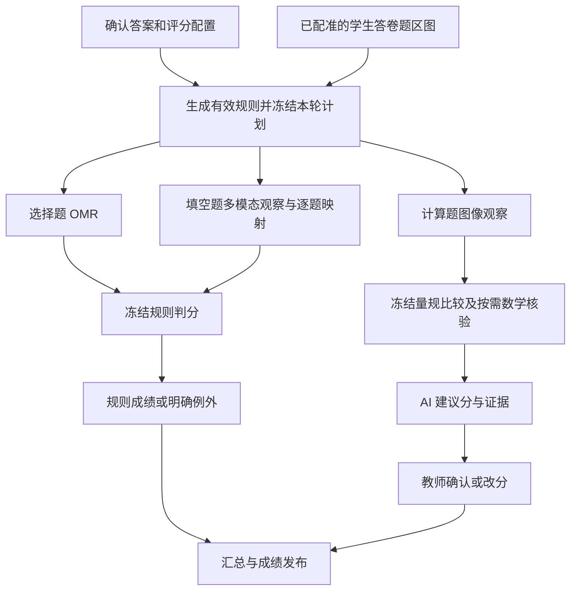

# 自动阅卷链路修复与简化设计

日期：2026-10-21。性质：基于实际代码和本场运行事实的实施方案，尚未实施本文的业务改动。

## 1. 结论与目标

项目已有答卷归组、配准切题、OMR、文字/数学识别、规则引擎、AI 适配器、人工阅卷和任务租约。当前主要问题是这些能力之间没有完整、持久化的接续关系，前端还把“已分流人工”显示成“已识别”。

建议在现有 Go 网关、PostgreSQL 和 Worker Runtime 上补一个考试评分协调器，使用现有 Python 工作节点。教师确认一次答案和评分配置，点击一次“开始阅卷”，系统自动完成可执行的识别、判分和建议生成。人工只处理真实歧义、明确采用人工路线的题目，以及现有 AI_ASSIST 策略要求的最终成绩确认。

保持三个边界：

- 模板建立时可使用多模态理解版面；学生答卷上传后复用定位、模板和题目位置，不再逐张重新猜题型。
- 多模态是学生作答理解的主路径，OCR/公式工具用于辅助和确定性核验；缺 OCR 正文不能阻止合法的图像输入。
- 学生作答、教师标准答案和最终成绩是不同事实。不能用标准答案补齐学生内容，不能把 AI 建议直接写成教师确认分数。

## 2. 本场实际发生了什么

研究基准：实际部署的 `output/capture-quality-fix-20261020/api-source`、`web-source`、`page-source`；同时核对当前工作树，单独标记未发布能力。

本场考试 `c38ceeb3-3880-4314-b883-fb78e340efa7`，评分运行 `e7ef1a0f-3800-4836-abfa-250fd3b957ae`：

| 事实 | 已核实的结果 |
| --- | --- |
| 答卷输入 | 同一学生两张图已合为一份答卷，视觉页码为第 2 页、第 1 页；两页 ready，19 个有效题目切片 |
| 评分运行 | total=19，queued=0，auto_confirmed=0，review=19，failed=0 |
| 选择题 1–11 | 各有 4 个 option_regions，有标准答案；没有 published 规则，原因是 scoring_rule_missing |
| 填空题 12–14 | 没有评分可消费的逐题作答记录，原因是 rule_review_required |
| 计算题 15–19 | AI_ASSIST；没有逐题作答记录，创建 AI 批次时返回 409 |
| 规则记录 | 本场 14 条规则均为 retired，没有生效版本 |
| 已有识别 | 19 个 math-understanding 任务全部 succeeded；当前 artifact 均停在 recognition，含文字块，formulas 数量均为 0 |
| 识别到评分的桥接 | answer_segment_answer 仍为 0；识别任务成功不等于已经形成可靠的评分输入 |
| AI 拒绝的复现 | 对当前 5 个计算题执行正式 LoadContexts，只读复现 ErrAnswerMissing；此时尚未进入模型调用 |

不能把这次问题归因为“模型识别差”，也不能把 19 个识别任务成功当作 19 题答案已正确识别。文字块准确性和答案归属还需要后续检查，recognition 也不等于 verified 数学证据。

## 3. 实际代码落点

以下 API/前端路径相对于已部署发布快照；工作节点路径另列。

| 代码 | 现有行为与缺口 |
| --- | --- |
| `api-source/internal/paper/objective_scoring_rule.go:19,104` | 可从答案/分值生成默认规则，但只建 draft |
| `api-source/internal/paper/store_postgres_configuration.go:378` | 确认准备度、冻结配置，没有同时补齐和发布规则 |
| `api-source/internal/grading/rules.go:141` | 发布草稿、退役旧版本；不能直接复活 retired |
| `api-source/internal/grading/scoring_run_routing.go:35` | 选择题必须有 published 规则和选项位置；填空必须已有答案；缺条件直接转人工 |
| `api-source/internal/grading/scoring_run_routing.go:75` | 只有整区来源的成员无条件转人工 |
| `api-source/internal/grading/scoring_run_start.go:384` | 建立 OMR 或人工任务，缺少等待识别、识别完成后继续判分的路线 |
| `api-source/internal/grading/scoring_run_start.go:541` | 将页面坐标转为题目裁图内选项坐标，可复用 |
| `api-source/internal/grading/scoring_run_omr.go:253` | 自动确认只接受 selected 且仅一个选项，多选不能直接沿用 |
| `api-source/internal/mathunderstanding/recognition_runtime.go:109` | 已有识别产物和后续核验的原子提交；没有投影到逐题答案/当前评分计划的闭环 |
| `api-source/internal/subjective/store_postgres_batch.go:196` | 没有 answer ID 就拒绝，后面的图像引用无法帮助无正文输入 |
| `api-source/internal/subjective/adapter_http.go:187`、`grading_agent_v2_builder.go:284` | 多处继续要求非空正文，不能只改 LoadContexts |
| `api-source/internal/subjective/validation.go:147` | 证据主要依赖正文摘录，需要增加图像/观察证据类型 |
| `api-source/internal/subjective/math_evidence.go:89` | 现有数学 v2 强依赖同题、同快照、同裁图的 verified artifact |
| `web-source/.../hooks/useExamScoring.ts:119,208` | AI 批次接续由浏览器发起；异常统一提示可重试 |
| `web-source/.../components/ExamScoringDialogs.tsx:27` | 原因未映射则统一显示“处理异常” |
| `web-source/apps/web-admin/src/components/ScoringPaperMonitor.tsx:199,219` | 将离开排队的条目当作已识别，待人工也算识别完成 |

`scoring_run.rule_snapshot` 列已存在，但部署代码没有形成完整的本轮规则冻结及按冻结版本判分闭环。现有回调仍可能读取当时最新 published 规则，应与本次改动一起固定。

## 4. 教师看到的简化流程

### 准备阶段

在现有评分配置页完成一次“确认答案与评分配置”，展示题型、满分及实际采用的规则摘要：单选如何匹配、多选是否有少选分、填空有哪些等价答案、主观题采用哪份细则。学段和学科沿用已经自动匹配的有效配置。

确认动作同时完成默认规则生成、教师显式规则保存、生效版本创建、配置冻结。普通教师不再逐题点击“发布规则”，也不需要为了满足接口先手工填 OCR 正文。

多选部分分、多空分配或容差不能从缺失信息中猜测。已有明确配置自动继承；语义确实缺失时，只在对应题显示需要补充的项，不用 19 条泛化错误拦住全卷。

### 阅卷阶段

保留一个“开始阅卷”入口。旁边展示服务端计划，例如“11 道选择题 OMR，3 道填空识别判分，5 道计算题 AI 建议”。启动后可关闭页面，任务继续。

每份答卷按题号排列，默认显示：学生作答、标准答案、得分/建议分、处理状态、下一步。原始 UUID、模型版本和技术日志放在详情中。

识别结果正常时自动进入下一步，不要求教师逐题确认识别。AI_ASSIST 的最终分数确认沿用现有业务含义；不额外叠加逐题 OCR 确认、模板框确认或默认试改审批。

## 5. 后端统一编排



协调器负责判断下一步，Worker 负责一次具体计算。复用 `agent_worker_task` 的领取、租约、心跳、幂等键、重试和 attempt 记录，不另建一套通用工作流引擎。

启动事务应完成：锁定考试/评分命令 → 核对计划摘要 → 保存本轮规则与输入版本 → 创建逐题计划 → 创建首批运行任务 → 提交。HTTP 成功仅表示运行已建立，不能暗示识别或判分已完成。

每个完成回调在同一事务中保存产物、推进条目、创建已满足依赖的后续任务，并完成当前 runtime 回执。外部模型调用不放在数据库事务里。

另有定时恢复扫描，唤醒“依赖已齐但尚未排队”的条目，避免回调后 API 重启丢失接续。浏览器只查询、展示和发送操作命令，不承担创建全部 AI 批次的职责。

## 6. 规则如何自动生效并保持版本正确

复用现有 `objectiveRuleConfig`、生成摘要和发布校验：

1. 当前 published 与本次确认的题型、满分、答案和策略一致时保留。
2. 教师已经编辑的草稿、少选分、扣分及容差优先，不能用默认模板覆盖。
3. 没有有效规则时，从当前已确认的答案/分值生成并发布新版本 vN+1；补齐 numeric 默认配置。
4. retired 保留历史身份，不改回 published。历史来源无法证明仍有效时，不将旧配置悄悄作为默认值。
5. 预览后资料发生变化，以配置哈希/revision 检测，返回准确的变更原因，不部分发布。

本轮保存每题的 rule_id/version/hash、answer_key 身份及内容摘要、assessment_snapshot_id/hash、满分、容差与来源。判分消费本轮快照，不再临时查询“最新规则”。

默认生成适用于 RULE_AUTO；不能把 HUMAN_PRIMARY、DUAL_HUMAN、MANUAL_ONLY 或 AI_ASSIST 改成另一条路线。

## 7. 选择题：先识别，再按题型判断是否能自动确认

保留已有页面归一化坐标到裁图坐标换算，统一记录 coordinate_space、裁图真实尺寸和输入哈希。验收查看 overlay 是否准确覆盖填涂点，不能只检查 option_regions 数量。

OMR 正常输出选项集合、填涂测量、擦改/多涂等风险、置信依据及 overlay。选择结果与已确认标准答案由服务器比较。

单选和多选采用不同判定：

- 单选要求唯一有效选项且与其它选项有足够区分；清晰选错也应正常记 0 分。
- 多选评价每个选项的状态和整个集合的确定性。两个清晰涂点不能因 top-second 接近就被当成单选歧义。
- 多选得分遵循已确认的全对、少选、错选和最低分策略；不能擅自把缺失策略解释成少选给分。
- blank、多个涂点、擦改和 unreadable 分别表示。多选的多个涂点可能是正常作答，单选多个涂点才按单选规则处理。

现有自动确认仍有模板、参考图、校准批准及阈值约束。无校准不应阻止提取选项和形成建议分，但不能伪造正式自动确认资格。现有单选条件不可直接用于多选，应补集合质量指标和真实标注回归。

校准应由后台建立可复用的有效配置，普通教师的默认阅卷流程不增加“先标 100 张才能开始识别”的步骤。现行校准要求是否调整，需依据真实测量单独决定，不能以合成样本冒充验证。

教师上传有字迹的模板仍可用于几何配准，但不能自动当作干净差分参考图。只有经验证的空白参考才走模板差分；其它情况采用已经验证适用的填涂提取配置或输出建议/具体例外。

## 8. 填空：把现有产物接成可消费的学生答案

已有 19 个识别产物应先核对当前 crop、snapshot、来源范围及识别质量，符合条件的产物复用。不能因为 runtime succeeded 就把其中所有文字拼接为答案，更不能将 recognition 改成 verified。

增加服务器端答案投影器，将可信观察转换成逐题结构化答案和 `answer_candidate`，在兼容旧接口时再写有出处的 `answer_segment_answer`。候选绑定输入版本、原始观察、证据位置、归属置信和异常，不只保留一个 confidence 数字。

多模态读取学生作答时不发送标准答案和参考解法，防止将教师答案补成学生答案。输出可区分文本、LaTeX、数值、单位、区间及多空答案；题号和印刷提示不算学生作答。

规则引擎负责比较。现有 fill_blank 是归一化字符串/配置等价答案匹配，不是任意数学等价求解；numeric 才有数值、单位及容差逻辑。`0.5` 与 `1/2` 是否等价需按配置或经过确定性数学核验；负号、单位、定义域和区间开闭端点不能被格式清洗抹掉。

观察成功后继续同一评分条目，不等教师重新点击“开始”。

### 12、13、14 共用一个整区

保持现有 `grading_groups` 和共享裁图，不要求教师为了自动阅卷补出三个模板子 ROI。

整区观察一次，返回严格的成员映射：

```json
{
  "group_id": "fill-group",
  "input_version_id": "immutable-input-id",
  "members": [
    {"question_id": "q12", "presence": "present", "answer": {"type": "latex", "value": "..."}, "association": "matched", "evidence_ids": ["obs-12"]},
    {"question_id": "q13", "presence": "present", "answer": {"type": "text", "value": "..."}, "association": "matched", "evidence_ids": ["obs-13"]},
    {"question_id": "q14", "presence": "uncertain", "answer": null, "association": "unresolved", "evidence_ids": []}
  ]
}
```

每题各有 candidate、规则结果、分数和人工任务。一题无法归属只影响该题，其余成员继续；不能把共享图复制成三份同样的答案，不能为满足接口伪造子 ROI。

复用现有整区多行录分界面：同看一张整区图，12、13、14 分别录分、分别保存。一行失败保留其它行输入。观察证据 bbox 是本次作答的位置，不是要求教师维护的新模板子框。

## 9. 多模态主观题：真正允许图像优先输入

不能只删除 LoadContexts 的 ErrAnswerMissing。Go 普通适配器、v2 builder、Python 契约和证据校验均要同步支持明确的新协议版本。

新增图像优先输入契约，保留旧文本契约兼容：

- `input_mode = image | text | image_text`，由实际输入决定。
- 必须存在合法学生裁图或人工/识别文本，二者都没有才是缺输入。
- AnswerVersion 绑定不可变输入版本。不能插入“请看图”“空白答案”等占位文本冒充学生答案。
- 学生图、题目图、参考解法图有明确角色与哈希；参考内容不能被引用为学生完成的步骤。
- 证据支持 image_region、observation、math_artifact、text_excerpt；不能只允许正文子串。

逻辑上分为“观察学生作答”和“与冻结量规比较”。观察模型不看标准答案；评分模型或确定性结算器只根据学生观察证据及必要原图，对每个评分点给出 supported/contradicted/uncertain。服务器按冻结量规结算、检查上限及扣分。

不强制每题叠加 OCR、多模态和多个复核模型。复用有效观察与核验产物；只有模糊、冲突、截断或无法归属时，才自动做一次有预算的局部重裁、二次观察或专用核验。

### 数学通路

旧 v2 继续要求 verified artifact，保持其既有保证。新图像评分通路可接收原图和观察，按评分点使用可用的符号、数值、单位核验；不能因为所有公式尚未完成核验就永远无法产生图像阅卷建议。

缺少符号证明的图形、几何过程和替代解法应保留未决项或形成可供教师判断的建议。未核验不得写成核验通过，不能把旧 v2 的强保证偷偷放宽。

AI_ASSIST 自动生成建议及证据，教师最终确认仍沿用现有策略。学生作答观察无需教师逐题点确认；“建议待确认”应与“识别失败”分开。

### 模型与 Provider

实际 grading-agent 镜像为 `local-fill-grading-20261019-frozen`，对应 build-result 的镜像 ID 已核对。其兼容适配器存在真实 image_url 通路，但原生 DashScope 评分适配器仍使用 text-generation 路径；模板分析专用视觉包装不会自动用于普通评分。

抽取共用的视觉 transport 转换，验证原生多模态 endpoint、图片字段和真实 HTTP body。不能仅凭模型名称或结构化 JSON 探测认定支持图像。按模型配置版本缓存视觉能力检查，已有批准的视觉备选绑定可恢复；没有可用视觉模型时显示具体配置项，不反复重试或随机换模型。

提示词按“选择观察、填空观察、整区映射、步骤/图形观察、量规比较”分任务和版本，覆盖手写、涂改、空白、不清晰、分式、区间、单位、图表、子问及替代解法。不得用一句通用“请批改”承担所有任务。

## 10. 数据与状态：最小增量落地

首批建议新增两类领域记录，复用现有运行与产物，避免再造大量重复状态表。

| 对象 | 作用与关键字段 |
| --- | --- |
| `answer_input_version`（新增） | 不可变输入：tenant、segment/group、成员题目、crop asset/hash、registration/correction、scope、可选人工正文/观察引用、输入摘要 |
| `scoring_run_item`（新增） | 每题的持久计划：run、segment、plan_generation、input_version、assessment snapshot、冻结规则引用、route、stage、processing_status、decision_status、runtime/产物引用、reason、next_action、revision |
| `answer_candidate`（扩展） | 保存观察得到的逐题答案；增加 input_version、presence、证据/产物引用和归属状态，保留原始与规范值 |
| `scoring_run.rule_snapshot`（填实） | 按题冻结规则、标准答案、量规及来源，不只保存当前可变对象指针 |
| `subjective_grading_run`（扩展） | 明确 input_version、input_mode、snapshot、模型/提示词/契约/结算版本；兼容旧 answer_version |
| 现有 runtime/attempt、math artifact、OMR run、grade | 继续作为实际执行、产物和成绩事实来源，不额外复制一套租约和计费记录 |

条目执行阶段：`prepare → observe → verify（按需）→ score → done`。

执行状态：`waiting_dependency / queued / running / retry_wait / succeeded / blocked / failed / superseded / cancelled`。

结果状态另列：`undecided / auto_confirmed / suggestion_ready / review_needed / human_confirmed / manual_only`。

例如 AI 建议生成成功是 `processing_status=succeeded, decision_status=suggestion_ready`；缺模型配置是 blocked；识别服务耗尽重试才是 failed；缺识别依赖不是模型失败。

对于固定的这几条路线，以条目和 runtime 引用保存依赖即可。将来出现真实复杂动态依赖，再扩展步骤表，首批不为通用 DAG、全新审批或全局计费账本扩大范围。

## 11. API 与页面改动

### API

- 扩展 `GET /exams/{examId}/scoring-readiness`：返回只读计划摘要、plan_hash、各路线数量、可自动补齐项、真正阻塞项；GET 不发布规则。
- 扩展现有 `POST /exams/{examId}/scoring-runs`：保留幂等语义，增加 expected_plan_hash；接受后由服务端排队全部步骤。201 只表示运行已建立。
- 扩展 `GET /scoring-runs/{runId}`：返回逐题阶段、执行/结果状态、已生成证据、是否调用模型、最后错误、retryable 和 next_action。
- 新增 `POST /scoring-runs/{runId}/resume`：检查依赖与版本，幂等推进可恢复条目。
- 扩展 `POST /scoring-runs/{runId}/retry-failed`：覆盖识别与 AI 步骤，而不只恢复 OMR；支持逐题范围并保留成功结果。
- 旧 subjective batch API 保留；新考试入口无需浏览器先造完所有批次。

权限复用现有 grading:manage、考试学校作用域及任务资产授权。OpenAPI 是权威源，新增契约正式生成 SDK，不手改 generated 文件。

### 页面

主面板用一条进度摘要表示“已识别、已生成分数/建议、待确认、需处理”，每项来自真实对应事实。直接转人工、配置阻塞或失败不能算“已识别”。

逐卷查看按 submission_id 归组，使用同一份答卷稳定的展示码；目前缺 candidate_no 时使用 segment UUID，会使同一学生看起来像多份答卷，需同时修正。

说明展示具体状态：

| 原因 | 用户说明与动作 |
| --- | --- |
| 有 crop、尚无观察 | 正在识别学生作答；系统等待依赖，无需刷新 |
| 无有效规则但可生成默认值 | 待完成当前已确认配置的规则生成；由服务端推进 |
| 规则语义缺失 | 第 N 题需要确认少选分/容差等具体项，定位到该题 |
| 视觉模型配置不支持 | 当前阅卷模型不支持图像，打开对应模型配置 |
| AI 建议生成完成 | 建议已生成，等待确认；显示建议分与证据 |
| 暂时故障 | 正在自动重试，并显示最近阶段 |
| 输入不清晰/归属不明 | 指出题号及问题，展示原图与可修改位置 |

后台返回受控 reason/next_action，前端统一翻译。保留错误码用于详情定位，但不把任意 Provider 原文直接展示为产品提示。对确定性缺项，不展示无效的“刷新后重试”。标准答案和学生公式用项目已有数学渲染组件，避免暴露 LaTeX 原串。

## 12. 恢复、并发和版本

- 评分命令、逐题输入摘要和各阶段任务有稳定唯一身份。重复点击、回调和 resume 不重复造任务/成绩。
- 完成提交核对租约、输入摘要及活跃 generation；旧裁图或旧规则结果只留历史，不能覆盖当前结果。
- crop 变更重做观察及后继；量规/标准答案变更只重对应评分；修改一题不重传两页答题卡。
- 原始观察的缓存身份不混入标准答案；比较/结算身份必须包含标准答案、规则、量规和模型/提示词版本。
- 429、临时 503、未派发故障按预算退避；401、协议/能力不支持等配置故障停止重复调用，给出对应动作。
- 供应商请求可能已接受但连接断开时，先查持久回执；没有供应商幂等或查询能力就记录派发结果未知，不能承诺外部调用严格恰好一次，也不能无限重发。
- 教师已认领/编辑的任务保留，其草稿和最终分数优先。后台可补建议，不能悄悄取消教师工作或覆盖已确认成绩。
- 未满足依赖时，不因一个片段缺答案就拒绝整个 AI 批次；其余题独立推进。

### 本场旧运行如何恢复

现有代码拒绝在 needs_review 旁直接新开运行，也拒绝有活跃 review 的单题重跑，因此补配置后再点“开始”不能自愈。

首批修复可在确认无人认领、无草稿和已确认分数后，通过现有正式取消流程关闭旧运行，再以新命令建立持久计划；保留历史，不直接 SQL 改计数。本场只读检查时 19 项均为 pending，实施前仍须重新核对实际状态。

长期由 resume 支持同一冻结计划的依赖补齐。若标准答案或评分语义已经变化，必须建立明确的新计划版本或重评命令，不能以“续跑”为名给旧运行混入新规则。

## 13. 实施顺序与交付

| 阶段 | 工作内容 | 可观察的交付 |
| --- | --- | --- |
| A：有效规则与真实状态 | 确认配置时补齐新版本规则；冻结本轮规则；准确原因、进度、稳定答卷归组 | 选择题真实建立 OMR 任务，页面不再把 19 个人工任务叫已识别 |
| B：持久化接续 | 增加逐题计划、输入版本、观察投影器；复用已有识别/核验；服务端接续与恢复 | 关闭浏览器仍继续，填空有实际答案和规则结果，依赖等待不再变成整个批次 409 |
| C：图像评分协议 | 图像优先 Go/Python 契约、证据类型、Provider 视觉转换、分任务提示词 | 15–19 无 OCR 正文也能进入合法图像任务，生成有出处的 AI 建议 |
| D：多选与共区自动化 | 集合质量/校准、共区一次观察成员映射、局部不确定处理 | 多选按已确认政策判分；12/13/14 共用图但答案和分数独立 |
| E：真实验收和小范围启用 | 当前答卷回放、故障恢复及实际视觉模型验证 | 每题都有可解释结果，具备条件的自动确认，不能确认的具体呈现原因 |

这些阶段属于同一闭环，A 不是完整修复完成标志。前端可与 B/C 的契约实现并行；规则编译与 Provider 视觉适配也可并行。最终集成集中验收，不重复建立多个无关审查任务。

发布沿用已发布基线加明确增量的方式。工作区未提交代码不等于未部署，也不能全量带入发布；未发布的 trial、参考材料和诊断强化分别核对依赖，尤其不把“至少 5 份人工试改样本”变成当前仅一份答卷的默认前置。

使用新的未占用迁移编号；保留已应用迁移校验和，不修改历史 SQL。新输入模式先由服务端兼容接收，再启用生产者；旧运行保持可读，回滚应用时保留新增事实。

## 14. 本场与回归验收标准

1. 仍为一份答卷、两页、19题，页码正确；不重新上传、不重复建立题块。
2. 有效规则来自当前确认的答案和分值，旧 retired 不复活；已有教师部分分和容差不丢失。
3. 11 道选择题真实建立 OMR 运行，overlay 对齐；无自动确认资格时仍有候选/建议及具体原因。
4. 单选选错与真正空白按规则正常处理；多选全对、漏选、错选、擦改分别符合题型策略，不能沿用单选 len=1 条件。
5. 3 道填空出现有出处的逐题答案与规则结果；任务 succeeded、artifact recognition 与答案已可评分分别验证。
6. 共区12/13/14只读一次图，分别生成答案/分数；一题不确定或保存失败不影响其它两题，不要求补造子 ROI。
7. 5 道计算题无 OCR 正文但有合法图像时可建立任务；请求体包含真实学生图，所用 Provider 的 endpoint 和消息格式确实支持视觉。
8. 模型观察不接收标准答案；评分证据不能引用教师解法冒充学生步骤。
9. 清晰空白、看不清、识别空输出、缺图四种情况分开；空白不靠空字符串推断。
10. 分式格式、负号、区间端点、单位、定义域、多空和替代解法有针对性样例。
11. 页面关闭、API/Worker 重启、重复点击、部分失败和迟到回包均可恢复；成功结果不重复收费重算或覆盖人工成绩。
12. 阅卷规则、量规或某个输入版本变化，仅失效受影响的后继，旧结果保留来源。
13. 所有异常有阶段、明确原因和有效动作；没有“缺学生答案却让教师不断刷新重试”。
14. 最终确认分数与 AI 建议分别统计；AI_ASSIST 继续要求现有的教师最终确认，不把它显示成自动识别失败。

先做离线契约/真实 PostgreSQL 与回放测试，再在实际选定的视觉模型上小范围验收。不能从一份答卷宣称普遍识别准确率，也不硬性承诺 19 题全部自动终审；应保证这 19 题均进入正确路线并形成真实、可解释的处理结果。
