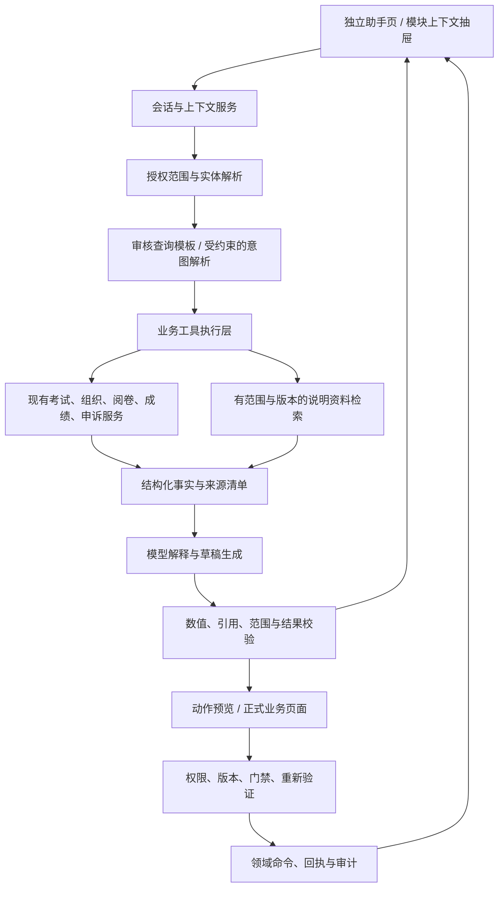

# 学校管理员 AI 助手升级设计

日期：2026-10-01（北京时间）。状态：设计方案，尚未实现。

2026-10-02 补充：[可立即开工的设计与实施规格](2026-10-02-school-admin-ai-assistant-implementation.md)，包含首期范围、具体交互、接口协议、代码落点、工作包和验收用例。首期排期与范围以实施规格为准。

本方案依据当前工作区代码、项目已有设计说明和公开产品官方资料。工作区包含已有未提交修改，因此“现状”指本次读取到的实现，不代表生产环境已部署。未进行管理员访谈、真实数据问答测试或竞品账号实测；交互参考来自官方文档及其公开界面说明。文中的示例数据均为合成数据。

## 1. 推荐方向

把学校管理员的“AI 对话”升级为“学校 AI 助手”：管理员用自然语言查本校数据、解释阻断事项、比较成绩、整理报告，并从回答直接进入对应业务工作区。它与左侧功能栏双向联动，接收页面上下文，返回带范围、时间、版本和来源的结果。

优先完成四个高频任务：

1. 今天哪些考试被什么事项阻断，应该先处理什么。
2. 某场考试为什么还不能发布，对应问题在哪里。
3. 某场考试、班级和题目的成绩表现如何，有哪些可核实的差异。
4. 把核实过的数据整理为可编辑的管理报告草稿。

首期建议提供可信查询、解释、草稿和业务页面跳转。成绩发布、改分、仲裁裁决、申诉终审继续在现有正式流程中执行。以后开放对话内操作时，必须接入同一套权限、版本校验、业务门禁和操作回执。

### 1.1 能力分层

| 层级 | 管理员得到的能力 | 产品形态 |
| --- | --- | --- |
| 找到 | 找考试、班级、学生、题目、申诉、操作记录 | 实体选择、搜索结果、带筛选的跳转 |
| 看懂 | 解释状态、统计口径、数据缺失和阻断原因 | 简短结论、指标、来源、业务规则 |
| 分析 | 比较班级、题目、阅卷质量，串联多个模块 | 表格、简单图表、可核实的分析步骤 |
| 准备 | 整理报告、考试配置、意见和处理清单草稿 | 可编辑草稿、差异预览、人工复核 |
| 办理 | 执行已开放、已确认的业务动作 | 服务端动作计划、校验、回执、审计 |

## 2. 当前项目已经有什么

### 2.1 AI 对话现状

已读取 [SchoolAiChatPage.tsx](../../apps/web-admin/src/pages/SchoolAiChatPage.tsx)、[schoolAiChat.ts](../../apps/web-admin/src/api/schoolAiChat.ts)、[schoolAiChatMessages.ts](../../apps/web-admin/src/pages/schoolAiChatMessages.ts)、[managed_chat.go](../../services/api-gateway/internal/modelgovernance/managed_chat.go) 和相关路由。

| 项目 | 当前实现 | 升级含义 |
| --- | --- | --- |
| 访问身份 | 前端及服务端入口限定学校管理员 | 保持身份边界；查询各模块时还要检查资源权限和数据范围 |
| 模型 | 使用当前租户默认托管模型，读取可用状态 | 复用连接、密钥管理和用量记录；对话能力需另行验证 |
| 输出 | 流式正文、模型返回的推理字段、复制、停止、重试 | 增加结构化结果与可验证的查询进度 |
| 历史 | 个人设备 localStorage，最多保存 20 个会话、每会话 50 条消息 | 当前没有在此对话链路中看到服务端会话存储；升级需要账号级会话服务 |
| 附件 | 每次最多 3 个；PDF 10 MB、文本 512 KB；单文件文字上限 60000 字 | 支持文本型 PDF；扫描件 OCR、Word、Excel 和图片需要新增处理流程 |
| 持久化边界 | 保存聊天消息；附件正文写入 localStorage 前清空；公共电脑不保存此处历史 | 刷新后的附件内容不可直接复用；应展示不可用状态或重新上传入口 |
| 并发 | 页面最多 5 个在途对话；后端在当前进程按租户与用户计数 | 业务查询要增加学校总额度、工具调用额度及多实例协调，不能把现有限制当成全局保证 |
| 业务连接 | 请求主要是用户/助手消息与附件文本，转发给模型 | 此链路尚未接入考试、成绩、组织等业务工具，不能回答真实校内状态 |
| 结果协议 | reasoning/content/done/error 事件 | 增加 scope、工具进度、指标、表格、引用、动作计划和回执事件 |
| 审计与用量 | 记录模型用量和托管聊天完成事件 | 新增“读了什么范围、依据什么版本、执行什么动作”的业务追踪 |

主要不足是业务数据入口和工作流衔接。仅调整提示词无法让当前消息转发链路自动获得校内实时数据。

### 2.2 学校管理员实际导航

依据 [routes.tsx](../../apps/web-admin/src/router/routes.tsx)、[AppLayout.tsx](../../apps/web-admin/src/components/AppLayout.tsx) 和工作区注册表，当前学校管理员菜单按权限显示，分组顺序为：

- 工作台：工作台、AI 对话。
- 成员管理：学生管理、年级与班级、阅卷教师。
- 考试管理：考试列表。
- 题库与组卷：题库。
- 阅卷与成绩：阅卷管理、复核与异常、成绩发布、成绩分析、申诉处理。
- 设置：操作审计。

考试资料、学生范围、小题与分值、答题卡设置、答卷导入、识别处理等在考试工作区内承接，不应在 AI 中虚构为已经存在的独立左侧菜单。学校初始化是隐藏入口。平台学校管理、平台模型管理、模型质量治理和系统运维属于平台权限，学校助手的入口和回答必须遵守现有可见范围。

### 2.3 可复用的业务基础

| 已有能力 | 实现依据 | 使用方式及边界 |
| --- | --- | --- |
| 全校可信聚合 | dashboard/summary；[dashboard.ts](../../apps/web-admin/src/api/dashboard.ts)；[STORY-064](../stories/STORY-064-trusted-school-dashboard.md) | 读取统计、阻断事项、进行中考试、最近活动及 warnings；展示前先判断来源是否完整 |
| 单场考试工作区 | [workspace.ts](../../apps/web-admin/src/api/workspace.ts)；考试工作区页面 | 读取环节、数量、阻断、下一步动作；后端返回的状态优先于模型推断 |
| 考试与多学科场次 | [exams.ts](../../apps/web-admin/src/api/exams.ts) | 区分 exam_session_id 与学科 exam_id；状态变更带 revision |
| 考试资料与配置检查 | [papers.ts](../../apps/web-admin/src/api/papers.ts) | 读取资料解析、题目、评分规则、结构预览与校验；采纳解析结果仍需人工检查 |
| 采集与识别 | [submissions.ts](../../apps/web-admin/src/api/submissions.ts) | 分开质量异常、学生未匹配、OCR 失败和分割失败 |
| 阅卷任务与评分运行 | [review.ts](../../apps/web-admin/src/api/review.ts) | 查询任务和评分汇总；教师负载全量聚合与时效统计需补齐 |
| 成绩版本与发布门禁 | [scoreReleases.ts](../../apps/web-admin/src/api/scoreReleases.ts)；scorerelease | 读取 gate 与 current-published；不能用最大版本号代替当前发布指针 |
| 成绩分析 | [reports.ts](../../apps/web-admin/src/api/reports.ts)；report 包 | 已有总览、班级、题目、阅卷质量报告；已发布数据是正式分析基础 |
| 成员及学籍 | [org.ts](../../apps/web-admin/src/api/org.ts) | 复用学校、学年、届别、班级和学生查询；名单完整性需按服务端全量统计 |
| 申诉 | [appeals.ts](../../apps/web-admin/src/api/appeals.ts)、[questionAppeals.ts](../../apps/web-admin/src/api/questionAppeals.ts) | 保留教师意见、管理员终审及题目申诉的不同流程 |
| 审计 | [audit.ts](../../apps/web-admin/src/api/audit.ts) | 按动作、对象、考试、时间检索；全量趋势需要服务端聚合 |
| 失败恢复 | [businessCommand.ts](../../apps/web-admin/src/api/businessCommand.ts) | 部分业务已有命令与回执；不能假设所有接口都有幂等恢复能力 |

### 2.4 设计必须遵守的实际规则

1. **两套发布边界。** 旧考试成绩发布与学生门户成绩版本发布影响不同读端。AI 必须询问或明确展示发布对象。已有说明见 [角色界面核实](2026-09-30-role-ui-implementation.md)。
2. **当前版本是指针。** 正式成绩分析使用 report 的权威数据来源；存在门户当前版本时走 current release，旧考试保留已发布成绩回退。发布较早创建的草稿后，当前版本号可能变小。
3. **无数据不等于零。** 阅卷质量 ReportMetric.available 与 reason 已区分不可计算和真实零值；dashboard.warnings 也必须进入回答判断。
4. **单位不能混用。** 待阅题目、涉及答题卡、评分差异和考试数量各自独立；没有去重依据不能相加。
5. **难度定义特殊。** report/stats.go 的 difficulty 等于得分率，数值越大越容易；correct_rate 只计该题取得满分的记录。
6. **及格、优秀沿用当前实现。** 当前报表按保留两位小数的得分率判断及格 0.60、优秀 0.85。助手不能自行改成“优秀 90 分”。调整口径需要正式业务变更。
7. **知识点不能相加还原总分。** 同一题完整计入每个知识点，知识点指标之间有重复覆盖。
8. **历史班级关联需要补核实。** 当前 report/store_postgres.go 的数据集查询读取 student.class_id。开展转班前后或跨学年比较前，要补齐考试时花名册/学籍关联与回归测试；现有读取不足以承诺历史班级冻结。这是分析能力的前置事项，本方案未修改相关逻辑。
9. **分数快照不等于所有分析依据冻结。** 当前报告还关联 question 的题型/知识点及最新答案结构。需要复现历史题目与选项分析时，应核实或补齐题目、知识点映射和答案版本；不能仅凭 release_id 承诺整个报告永久一致。

## 3. 相似产品研究与取舍

本次广泛检索覆盖教育管理员问数、BI 对话分析、企业知识检索、国内表格 AI 和业务动作型助手。核心结论采用官方产品/帮助/开发资料；营销介绍只用于发现方向，不据此承诺能力。以下“项目应用”均是本方案建议。

| 产品及官方依据 | 公开设计中值得参考的点 | 对本项目的应用 |
| --- | --- | --- |
| [Canvas / IgniteAI Ask Your Data](https://community.instructure.com/en/kb/articles/660587-how-do-i-utilize-the-ai-for-ask-your-data) | 面向管理员自然语言问数；有示例问题、问题库、结果区、方法和假设说明 | 建立学校任务问题库；聊天旁展示表格；解释查询范围与假设。官方现将该能力放在 Canvas Next，旧 Intelligent Insights 为历史附加产品 |
| [Power BI Copilot：Verified answers](https://learn.microsoft.com/en-us/power-bi/create-reports/copilot-prepare-data-ai-verified-answers) | 由作者审核的可视化答案、触发语句及筛选；配置随语义模型使用 | 把常见问题绑定到审核过的统计模板和指标定义；每次查询新数据，不缓存固定数值作为事实 |
| [Tableau Agent in Dashboards](https://help.tableau.com/current/pro/desktop/en-gb/dashboard_narratives_overview.htm) | 当前看板概览、图表洞察和继续问数，嵌在看板上下文中 | 成绩分析页提供“分析当前图表”；跟随当前考试和筛选。官方此功能标为 Beta，只借鉴交互模式 |
| [Notion Enterprise Search](https://www.notion.com/help/enterprise-search) | 添加上下文、@ 引用、限定来源，并引用原始资料 | @考试、@班级、@题目；来源支持跳回详情；区分校内数据、操作说明与用户附件 |
| [飞书多维表格 AI](https://www.feishu.cn/content/AsLfwRvl2iUT8lkDYuZcNvQenae) | 数据问答与使用教程问答共存；图表解释；数据变化后可重新生成 | 同时回答“这场考试怎样了”和“下一步怎样操作”；提醒分析数据已变化，可重新查询 |
| [Atlassian Rovo Chat](https://support.atlassian.com/rovo/docs/chat-actions/) | 从检索到业务动作，按用户权限执行；复杂任务可进入完整业务表单 | 将结论衔接为打开阅卷任务、填充草稿、进入发布工作区；保留业务表单的复核与校验 |
| [Databricks Genie Agent](https://docs.databricks.com/aws/en/genie-agents/talk-to-genie) | 可信查询资产、参数及筛选可查看；结果表格/图表；反馈与人工评审 | 查询依据折叠展示；“数据不对/范围不对/解释不对”反馈分类；管理者审核模板后再更新。该产品原名 Genie Spaces |
| [ThoughtSpot Spotter](https://docs.thoughtspot.com/cloud/26.9.0.cl/spotter-business) | 用简化查询解释计算、分组与筛选；追问时提示本次修改的条件 | “只看三班”后提示班级已收窄，考试、学科、版本继续沿用；允许一键纠正 |
| [Salesforce Agentforce Actions](https://developer.salesforce.com/docs/ai/agentforce/guide/ascript-ref-actions.html) | 动作定义包含输入、输出、进度及 require_user_confirmation | 动作确认要落在服务端执行协议；聊天中的一句“确认”不能绕过动作校验 |

这些模式共同指向：业务范围可见、数据有依据、追问能修正、结果能进入工作流。Canvas 的账号范围例外、分析平台的自由 SQL 和外部协作发送能力，不直接沿用到本系统；本校授权与现有业务服务是执行边界。

## 4. 页面与入口设计

### 4.1 独立助手页

保留 /ai-chat 路由，菜单文案建议逐步改为“AI 助手”。首次灰度可显示“AI 对话 · 学校助手”，降低用户找不到入口的风险。

主工作区组成：

1. 顶部：学校助手、会话标题、历史入口；模型只显示“可用/暂不可用”，详细型号折叠到状态信息。
2. 范围条：学校、当前考试/学科、成绩来源。学年、年级、班级、时间范围放在可展开的更多条件中。
3. 新会话区：一句业务引导、四个常用任务及当前可处理事项。
4. 对话区：结论、必要结果、可折叠依据、下一步按钮。
5. 输入区：自然语言、@ 引用、添加文件、查看已附加上下文、发送/停止。
6. 结果详情区：按需展示表格、图表、问题明细或报告草稿。

新会话建议问题：

- 今天有哪些考试需要我处理？
- 检查一场考试的发布条件。
- 分析某场考试的班级与题目成绩。
- 整理一份考试管理简报。

只有实际存在相关数据时才推荐“继续分析最近考试”。模型暂不可用时，仍保留确定性待办和业务跳转入口。

### 4.2 布局规则

现有全局左侧栏为 192px；再常驻对话历史、聊天、证据四列，会挤压 1366px 屏幕。建议默认只保留全局导航和主内容，历史作为抽屉。打开结果详情时使用主内容分栏，详情关闭后恢复聊天宽度。

- 大桌面：聊天约 640–760px；结果详情使用剩余宽度，最小约 340px。
- 普通桌面：详情可扩展为主区域；聊天缩为侧栏或通过“对话/结果”切换，按实际容器宽度判断。
- 小屏及手机：单列；证据、历史与范围以抽屉承接；确认动作独立完整页面。
- 主内容宽度不足时优先关闭辅助栏。全局导航展开、阅读字号增大都计入可用宽度。
- 表格默认显示必要列，长表内部滚动；不让整个页面出现水平滚动。

概念布局（非已实现界面）：

```text
┌ 全局导航 ┐ ┌ 学校 AI 助手       会话标题       历史 ┐
│ 工作台   │ │ 范围：本校 / 九年级数学月考 / 当前发布 │
│ AI 助手  │ ├─────────────────────────────────────┤
│ 成员管理 │ │ 对话与结论         │ 按需结果详情     │
│ 考试列表 │ │ 已查数据与来源     │ 表格/图表/草稿   │
│ 题库     │ │ 下一步业务入口     │                 │
│ 阅卷成绩 │ ├─────────────────────────────────────┤
│ 操作审计 │ │ @引用   添加文件   输入问题   发送    │
└──────────┘ └─────────────────────────────────────┘
```

### 4.3 各模块内的上下文助手

在页面工具栏提供明确入口：工作台“解释这些待办”、考试工作区“问这场考试”、成绩分析“分析当前结果”、申诉详情“整理本次申诉”。入口只在当前学校管理员且有相应权限时出现。

助手打开时展示已带入的对象和筛选。传入业务实体 ID、模块、已保存版本和筛选，服务端重新读取数据。未保存的页面输入只有在用户明确选择“加入当前草稿”时进入助手，并标记为未保存资料。

抽屉与独立页复用同一个会话、结果和权限协议。“在助手页继续”保持会话 ID 与上下文。离开有未保存内容的工作区仍走已有 useUnsavedChangesGuard，不绕过导航保护。

## 5. 左侧模块的详细联动设计

下表中的查询和助手交互是新增能力建议；接口存在不代表已接入 AI。所有全校总数优先使用服务端全量聚合，分页列表只能用于明细展示。

| 实际模块 | 常见问题与带入信息 | 回答形态及业务衔接 | 需要补齐的能力 |
| --- | --- | --- | --- |
| 工作台 | “今天先处理什么？”；学校范围、进行中考试、阻断与最近活动 | 按影响和业务状态排待办；显示数量及单位；从事项进入对应考试环节 | 聚合适配器；warnings 转为数据完整性状态；跨模块去重依据 |
| 考试列表 | “九年级月考到哪一步？”；考试场次、学科、状态、revision | 学科进度表、阻断解释、下一步；进入对应 exam_id 工作区；可生成新建考试表单草稿 | 授权实体解析；多学科汇总；配置草稿传递协议 |
| 题库 | “给这次考试找同知识点练习题”；知识点、学科、年级、已审核版本 | 候选题列表，展示版本、来源、适用性；进入题目详情或组卷草稿 | SDK 搜索与 ACL 适配；当前教材知识点映射；候选质量评估。首期只选已有审核题 |
| 阅卷管理 | “哪场考试还有多少题未阅？”；exam_id、阅卷模式、运行状态 | 待阅题目/答题卡分开；按题目、任务状态查询；进入任务队列和运行详情 | 受权范围内全量任务聚合、教师负载及耗时指标；重试动作的明确恢复契约 |
| 复核与异常 | “哪些异常阻止发布？”；异常类型、复核/仲裁状态、对应题目 | OCR、质量、未匹配、评分分歧分别呈现；查看证据与具体处理入口 | 跨异常去重；异常汇总适配；保持盲评身份和内部意见可见边界 |
| 成绩发布 | “能发布了吗？”“学生看到哪个版本？”；发布对象、gate、当前指针、草稿 | 两种发布状态分别说明；展示阻断项、草稿差异、影响学生范围；进入正式发布确认 | 数据来源 manifest；预览有效期；跨状态复查。首期在正式页面发布 |
| 成绩分析 | “三班哪些题失分多？”；exam_id、class_id、版本、分析指标 | 班级对照、小题得分率、知识点、选项分布、阅卷质量；进入同范围分析页 | 带版本的聚合；筛选深链；班级内小题/选项的交叉聚合；跨考试可比性检查 |
| 申诉处理 | “第 18 题申诉集中在哪些问题？”；申诉类型、状态、证据、教师建议 | 事实摘要、争议点、待补材料、可编辑意见草稿；进入详情继续分派或终审 | 区分旧成绩申诉与发布版本题目申诉；跨题聚合与版本关联；敏感材料脱敏 |
| 学生管理 | “这场考试还有谁没匹配？”；学生、学籍、考生范围、答题卡 | 先给汇总，再按需查看名单；说明未匹配原因与建议；进入匹配或名单校验 | 全量一致性检查；考试花名册与当前学籍区别；导入只做预览，确认在现有表单 |
| 年级与班级 | “哪个班缺名单或老师？”；学校、学年、年级、届别、班级 | 完整性检查及具体空缺；进入班级维护；解释历史学年与当前学籍 | 服务端按学年聚合；历史花名册口径；避免将已加载名单当全校人数 |
| 阅卷教师 | “当前任务怎么分配更合适？”；教师角色、班级绑定、现有任务 | 资格与已有负载表；建议分配草稿；进入正式分配页面 | 可分配资格、可见任务量、预期耗时等聚合。没有可用时间数据时不声称教师空闲 |
| 操作审计 | “这场考试谁发布过，后来为什么变化？”；对象、时间、业务命令、前后值 | 可核实时间线；变更前后与命令回执；进入对应日志、申诉或成绩版本 | 动作类型词典、考试/版本/命令关联；审计敏感字段过滤；全量统计接口 |

### 5.1 考试工作区内嵌模块

| 分区 | 入口及问题 | 助手处理 |
| --- | --- | --- |
| 学生范围 | “检查考生名单是否完整” | 比较已确认范围、花名册与导入答卷；显示影响人数与缺失明细 |
| 考试资料 | “资料解析有什么问题” | 读取已有解析结果、source_refs 与 issues；点击题号定位原页；不重新凭空生成正式答案 |
| 小题与分值 | “检查总分、缺失答案和评分点” | 调用配置检查；区分 confirmed/suspected/unknown；生成待复核清单 |
| 答题卡设置 | “模板为什么无法锁定” | 解释校验错误、revision、区域缺失；进入编辑器。修改坐标继续由原编辑器完成 |
| 答卷导入与识别 | “失败最多的原因是什么” | 按任务状态聚合，保留任务 ID、批次与时间；显示重试前提 |
| 准备检查与确认 | “是否可以进入下一环节” | 读取工作区门禁与下一步；返回真实状态和具体处理入口 |

题库练习推荐作为“成绩分析 → 薄弱知识点 → 已审核题库候选 → 练习草稿”的后续联动。它依赖知识点映射和题库覆盖，不能仅凭成绩下降就生成全新的正式考试题目。

## 6. 跨模块任务流程

### 6.1 发布前排障

用户：检查九年级数学月考能不能发布。

1. 解析具体考试；存在同名场次或多个学科时给候选项。
2. 明确是旧考试成绩发布还是学生门户版本发布，后续范围条保留选择。
3. 读取工作区、评分/阅卷状态及对应发布门禁；必要时补查采集异常和仲裁。
4. 结论以服务端门禁为准，逐项说明影响和处理入口。
5. 管理员点击“查看待仲裁任务”，进入同一考试筛选的复核工作区。
6. 处理后回到会话，点击“重新检查”；保存新旧查询时间，不覆盖旧依据。
7. 门禁通过后进入正式发布页面，重读状态、版本与门禁，并执行现有确认/重新验证。

合成回答示例：

> 当前检查的是学生门户成绩版本发布。这场考试仍有 2 项阻断：3 份答题卡未匹配学生、2 个评分差异待仲裁。查询时间为 2026-10-01 10:20。两类事项可能重叠，不能相加为 5 名学生。下一步可以先查看未匹配答题卡。

按钮：查看未匹配答题卡 / 查看待仲裁差异 / 打开成绩发布。实际按钮及文案由后端门禁映射生成。

### 6.2 成绩分析到教学改进

用户：三班这次数学为什么比其他班低？

1. 确定 exam_id、class_id 和正式成绩来源；展示样本数。
2. 读取班级报告及题目报告；需要“三班各题与其他班”的比较时，使用新增交叉聚合接口。只有全校小题数据时不能冒充三班数据。
3. 后端计算可比差异，模型解释事实；“题目失分差异”与“教学原因假设”分别展示。
4. 用户点击某题，查看评分规则、对应样本及错误线索；只提供授权范围内证据。
5. 从薄弱知识点查询已审核题库候选；用户确认适用性后生成练习草稿。
6. 可整理分析报告草稿，来源保留考试、班级、版本、查询时间。

系统可以指出失分分布与可能需要检查的问题。没有教学过程、出勤等证据时，不能把差异归因于教师能力或学生态度。

### 6.3 成员信息到采集匹配

用户：这些答题卡为什么一直没有学生？

读取同场考试未匹配答题卡 → 核对考生范围与学号 → 检查学籍/导入记录 → 分类展示缺号、错号、重号、范围外等真实可识别原因 → 进入原匹配界面。依据不足时显示“需要核对原始答题卡”，不自动把相似姓名合并为同一学生。

### 6.4 申诉到版本追踪

读取申诉证据与状态 → 整理教师意见和争议点 → 管理员在正式流程终审 → 依据实际改分/发布结果查询回执 → 对照学生门户当前版本 → 生成可编辑说明。终审通过、底层分数改变和学生看到新版本是不同事实，助手分开报告。

### 6.5 管理报告

提供考试组织简报、阅卷进度简报、质量复核简报、成绩分析草稿四类模板。每份报告包括范围、数据截至时间、来源版本、主要事实、待处理事项和建议。草稿可改标题、段落及图表；已有正式报表导出继续使用原导出能力，新增 AI 简报导出需单独实现水印和来源说明。复制文本不应被描述为已经发送或已经归档。

## 7. 提问、追问和结果协议

### 7.1 上下文选择

- 支持 @考试、@班级、@学生、@题目、@申诉和 @资料。检索结果带学校/学年/学科等区分信息，只搜索当前授权资源。
- “这次考试”优先指向当前已确认的考试上下文；独立页面没有考试时先提供候选。SessionUser.currentExam 当前是展示字符串，不能作为业务 ID。
- “九年级”要结合学年及届别；同名学生用授权范围内学号和班级区分，用户完成选择后才固定 ID。
- 支持“本校所有进行中考试”；范围是服务端有效 AccessScope 与所选过滤条件的交集。
- “最近一次”要明确定义是考试时间、创建时间还是发布时间。现有列表仅有创建时间等字段时，说明按该字段筛选，不假定已知考试日期。
- 来源分为校内业务数据、系统操作说明、用户上传资料。首期默认不接入外网搜索；以后提供独立开关，明确外部内容不能证明本校数据。

### 7.2 追问继承

例：先问“这场考试哪个班及格率最低”，再问“只看九年级三班的第 18 题”。每次回答前给出本次条件变化：班级新增为三班、题目新增为第 18 题，考试及成绩版本继续沿用。

当新问题跨考试、跨学年或改为未发布数据时，显式显示范围变更。仅切换页面不会静默把原会话改成另一考试；用户可以选择“加入当前页面对象”或“新建此页面会话”。范围纠正后重新查询，不把前一范围的数字继续用于新结论。

### 7.3 结果的六部分

1. **结论：** 先回答问题，通常 1–3 句话。
2. **范围：** 学校、考试/学科、班级、时间、成绩来源及版本。
3. **事实：** 服务端指标、必要表格或图表；显示单位、分子/分母和样本量。
4. **依据：** 真实接口/业务对象、已保存版本、查询时间、指标定义、资料页码或题号。
5. **限制：** 只在实际出现时说明数据缺失、不完整、不可比或待复核事项。
6. **下一步：** 最多 3 个与结果相关的入口或追问，不展示一排所有模块按钮。

结果块类型建议为 metric、table、chart、entity_list、checklist、timeline、draft 和 action_preview。块内的实体、数值、来源和跳转由服务端协议提供，前端组件渲染；模型负责解释和内容组织。

默认图表只支持班级比较条形图、成绩分布、已有时间序列折线图、题目得分率和处理进度。没有时间序列就不画趋势。人数、题数、分数和比例不能混用一个未标注的轴。

### 7.4 来源与可信标记

每个关键数字/结论关联 source_id 与 fact_id。点击来源打开数据依据，展示字段中文名、已应用条件、统计口径、采集时间和关联业务对象；点击对象进入实际详情。

使用“业务数据”“已审核查询模板”“用户附件”“AI 建议”“尚待核实”标签。已审核查询模板仅表示计算方法被审核，不表示模型的所有解释获得人工背书。不显示缺少校准依据的“回答可信度 98%”。

用“查询依据”替换面向业务管理员的原始“思考过程”。进度只展示实际发生的事件，例如“已读取发布门禁”“正在查询班级报告”，不把模型生成的步骤当成已完成操作。

### 7.5 异常状态

| 状态 | 对管理员的表达 | 处理 |
| --- | --- | --- |
| 没有正式成绩 | 尚无可用于正式成绩分析的已发布结果 | 打开成绩发布/检查准备情况；不输出全班 0 分 |
| 某数据源失败 | 已查询的部分结果及失败来源 | 保留可核实事实；暂不输出依赖缺失源的结论 |
| 数据发生变化 | 本次依据已过期，显示变更对象 | 重新查询；重新生成动作预览 |
| 范围不明确 | 提供考试/班级候选 | 用户选择后继续；不要求管理员抄业务 ID |
| 权限不足 | 当前权限无法完成该查询 | 不回显越权对象名、数量或存在性；提供可用范围 |
| 对话或工具超时 | 哪一步已完成、哪一步未完成 | 只读步骤可有限重试；变更先查询回执 |
| 用户停止 | 已停止生成，已有片段未形成最终答案 | 残缺结果标为未完成，不据此开放动作 |
| 模型不可用 | 助手暂时无法生成解释 | 保留确定性检查结果、待办及页面入口 |

## 8. 数据、指标和知识设计

### 8.1 三种数据路径

| 数据 | 获取方式 | 典型内容 |
| --- | --- | --- |
| 实时业务事实 | 有权限约束的结构化业务工具 | 考试状态、阅卷数量、发布门禁、申诉状态 |
| 有固定版本的分析结果 | 按版本读取或生成的聚合结果 | 已发布成绩、班级/题目对照、阅卷质量 |
| 说明性资料 | 有版本、范围和来源的检索 | 使用帮助、业务规则、学校制度、用户附件 |

不把频繁变化的状态当成知识库中的永久事实。首期使用现有业务查询和中文关键词检索；只有实际召回不足时再引入向量索引。学校制度的检索也需要租户/学校 ACL、有效期和审核状态。

### 8.2 指标词典

建议建立统一 MetricDefinition：指标 ID、中文名、同义词、单位、计算版本、数据来源、分子/分母、过滤条件、空值含义、精度规则和可用范围。由业务代码/正式配置提供定义，助手和 UI 共用。

第一批必须纳入：

| 指标 | 要向模型及管理员解释的口径 |
| --- | --- |
| 待阅题目、涉及答题卡 | 两种单位；同一答题卡可能有多道待阅题 |
| 待仲裁差异、涉及答题卡 | 差异记录数与答题卡数不同；不能等同于人数 |
| 平均分、及格率、优秀率 | 正式来源、样本范围、精度、阈值；不能混入尚未发布样本 |
| 题目得分率、满分率、难度 | difficulty 与 score_rate 当前一致，数值越大越容易；correct_rate 指满分记录比例 |
| 知识点掌握率 | 按当前题目知识点关联计算；多知识点重复计入，不能求和还原总分 |
| AI 采纳率、人工修改率、双评分差 | 使用后端 ReportMetric；先判断 available、reason 和比较样本 |
| OCR 失败率 | 任务数口径；不能改写成答题卡失败人数 |
| 未匹配人数 | 目前直接事实通常是未匹配答题卡数；只有去重学生依据成立时才称人数 |
| 当前发布版本 | 权威指针、发布时间和发布对象；最大版本号并非必然当前 |

“学情风险学生”“教师绩效”“进步幅度”“预计完成时间”不是现有接口可以直接保证的指标。分别需要纵向数据、可比性规则、额外业务依据和校准验证，应作为独立后续设计。

### 8.3 数据完整性与一致性

- 为工具结果增加 complete / partial / unavailable / stale / not_applicable 状态；附缺失来源与原因。
- 列表返回 shown_count、total_count（仅当全量可得）、has_more。没有 total_count 时只说明已加载范围。
- 聚合查询遵循同一 MetricDefinition；不允许模型根据当前页明细自行估计全校总数。
- 多接口调用不自动构成数据库一致性快照。需要新增 query_manifest，记录各源的查询时间及 revision/release_id。
- 同一成绩分析应把 release_id 固定到各项聚合读取。现有 report 接口没有完整公开的版本选择协议，这部分需要新增；仅前后查询 current 指针不足以保证所有读源一致。
- query_manifest 同时记录题目版本、知识点映射版本、考试花名册及答案结构版本。未冻结的关联数据在历史复现时标明限制；只固定成绩版本不能弥补这些来源的变化。
- 发生成绩版本或关键状态切换时，标记结果失效并重新查询。只读分析可以说明时间差；操作预览必须在提交时重新校验。
- 跨考试比较先检查同学科、同届别/范围、总分、发布来源、指标定义及样本。得分率可改善总分不同的展示，却不能消除试卷难度差异。

### 8.4 附件升级

近期优先支持 CSV/XLSX 名单与成绩资料、DOCX/PDF 学校制度及考试说明、图片/扫描 PDF。新格式必须先实现文件处理和来源定位，不能只扩大当前文件选择器的 accept。

文件处理建议：授权上传 → 类型/大小校验 → 分页/分表解析 → 提取结构、页码/行号 → 展示预览与解析状态 → 用户选择用途。较大文件走异步任务；模型读取经过裁剪和脱敏的片段。

附件资料与校内事实冲突时，展示来源差异，例如“附件名单为 48 人，已确认考试花名册为 46 人”。上传不会自动导入学生、覆盖题目或改变正式成绩。附件中的指令不产生业务授权。

## 9. 权限、操作与恢复

### 9.1 每次工具调用的边界

学校助手自身可用，只说明用户可访问助手。读取考试、报告、组织、申诉、审计等资源时仍须检查各模块权限与有效 AccessScope。tenant_id、actor_id 与授权学校范围取自服务端会话和组织范围，不由模型或客户端指定。

模型提供的 school_id、exam_id 和 student_id 只能作为查询候选。工具执行层验证其归属及用户权限；学校选择只能收窄有效范围。组织范围未解析时不能解释为“全机构可见”。内部直接调用业务服务时也需要保留原路由具备的范围检查，不能只传 TenantID 调用存储绕过学校授权。

字段按场景过滤：名单默认用统计；具体姓名/学号仅在授权任务需要时读取；阅卷私有备注、盲评身份、学生不可见意见不自动加入模型输入。不同账号与不同业务身份的会话上下文不能共用。

### 9.2 动作分级

| 类型 | 首期行为 | 后续开放条件 |
| --- | --- | --- |
| 查询、解释、推荐追问 | 自动查询并展示结果 | 既有权限与额度校验 |
| 生成文本或配置草稿 | 生成可编辑预览 | 明确草稿状态及目的页面 |
| 打开页面、填入未提交表单 | 进入授权页面；尊重未保存保护 | 目标字段白名单、版本与校验 |
| 报表导出 | 使用原权限/水印/审计流程 | 明确导出范围，重用已有能力；AI 简报导出单独实现 |
| 创建正式考试、分配任务等写操作 | 在业务页面确认提交 | 预览、幂等、版本/资源校验、回执与审计齐备后逐项开放 |
| 成绩发布、改分、仲裁、申诉终审 | 进入原正式流程 | 每类动作独立评审和验收；保留现有重新验证和质量门禁 |
| 删除、批量身份/权限变更、平台模型修改 | 不纳入学校助手初期动作注册表 | 另行设计；不能因拥有对话权限就开放 |

高影响操作需要具体对象、变更值及影响范围的可复核预览，这与 [Agentforce 动作配置](https://developer.salesforce.com/docs/ai/agentforce/guide/ascript-ref-actions.html) 和 [OWASP Excessive Agency 指引](https://genai.owasp.org/llmrisk/llm062025-excessive-agency/) 的权限与人工控制思路一致。确认点放在动作执行层，查询无需逐步确认。

### 9.3 动作计划协议

服务端生成 ActionPlan，至少含：action_id、tenant/actor 绑定、对象 ID、固定参数、before/after 或预期影响、所需权限、expected_revision、source_release_id、gate_version、expires_at、payload_hash 与状态。

执行顺序：

1. 收集必需参数，调用业务检查，生成具体预览。
2. 用户在预览/正式页面确认；需要近期重新验证的动作走现有机制。
3. 服务端重新检查权限、当前资源、revision、发布来源与门禁；旧预览失效时返回新预览。
4. 使用冻结参数和同一 command_id 执行领域命令；由业务事务保存事实。
5. 返回 succeeded / rejected / processing / unknown 等明确回执，并关联实际业务对象与审计记录。

不能用自然语言“好的”修改已确认计划的参数；参数有变化必须重新生成计划。尚无幂等或恢复协议的业务接口先补契约，再加入助手执行工具。

### 9.4 失败恢复

- 模型说“完成”不是完成依据，成功以领域服务回执为准。
- 连接断开或超时，先按原 command_id 查询结果；结果未知时不创建新命令重复执行。
- 用户停止生成只能停止尚未提交的生成/查询。变更已提交后，停止 SSE 不代表业务回滚。
- 状态冲突、版本变化、权限收回时，保留用户草稿并显示实际原因；不自动退回旧版本再提交。
- 多步写操作只在领域服务有原子事务时承诺整体成功。否则逐步记录结果和剩余事项，不声称“一键事务完成”。

## 10. 技术方案

### 10.1 基于现有技术栈增量建设

前端继续使用 React/TypeScript、Ant Design 和现有路由/工作区。API Gateway 新增 schoolassistant 包，负责上下文、意图解析、工具注册、结果组装和运行记录；业务事实仍由 exam、dashboard、report、scorerelease、review、org、appeal 等领域提供。首期无需独立新增复杂编排微服务。

托管模型连接、供应商适配、用量记录继续使用 modelgovernance。学校助手的编排协议与底层模型传输分开，不改变现有自动评分或三角色阅卷绑定。



### 10.2 模型适配与降级

当前 managedChatProviderMessages 只构造文本消息，适配器没有向供应商发送工具定义或处理 tool_call 的协议。因此不能直接假定当前所有托管模型支持完整工具调用。

建议为学校助手分别检测文本生成、受约束 JSON 输出、工具调用、流式输出等能力。现有“模型可用/能力检测成功”不自动等于助手工具能力通过。

- 固定业务问题优先命中审核查询模板，无需模型生成 SQL。
- 支持工具调用的模型只能选择注册工具及校验过的参数。
- 不支持原生工具调用时，采用“意图 JSON → 服务端校验 → 固定业务查询 → 结果解释”流程。
- JSON 无法稳定解析时返回候选任务/范围选择，退回确定性模板；不能把模型文本当作业务命令。
- 查询规划与事实说明建议使用低随机度并单独评估；普通文本创作仍可保留适合的设置。
- 前端默认沿用平台配置的模型；学校管理员不会因问数而得到平台模型编辑权限。

### 10.3 工具注册表

ToolDefinition 包含 name、中文职责、参数 schema、权限、scope 类型、只读/写入属性、超时、额度、结果 schema、来源映射和恢复策略。注册表是运行输入，按版本管理并走正式变更及测试流程；维护解释放在旁置文档。

首期 10 个逻辑工具建议：

1. resolve_entities：在授权范围内解析考试/场次/班级/题目。
2. get_school_dashboard：可信工作台摘要。
3. list_school_exams：考试列表与实际筛选范围。
4. get_exam_workspace：考试状态、环节、阻断及下一步。
5. get_release_status：两套发布状态与门户当前指针。
6. check_release_gate：明确发布对象后的门禁检查。
7. get_exam_report_overview：正式成绩总览。
8. get_class_reports：班级比较。
9. get_question_reports：题目分析。
10. get_grading_quality_report：阅卷质量。

第二批增加名单完整性、任务负载、异常汇总、申诉证据、题库搜索、审计时间线、帮助检索。读写工具分开注册；模型不能任意组合 URL 或访问数据库。

### 10.4 API 草案

以下是新增接口设计，当前仓库并未实现。保留现有 ai-chat 协议，采用 /api/v1/school-assistant 增量灰度，避免直接破坏既有聊天。

| 接口 | 作用 |
| --- | --- |
| GET /capabilities | 可用任务、当前模型状态、用户范围、服务限制 |
| GET/POST /threads | 列出当前用户会话 / 创建会话 |
| GET/PATCH/DELETE /threads/{id} | 读取、重命名/归档或删除当前用户会话 |
| POST /threads/{id}/messages | 提交问题与实体引用，生成 message_id、run_id |
| GET /runs/{id}/events | SSE 输出，按 event_id 支持续接；续接只重放事件，不重新执行动作 |
| GET /runs/{id} | 获取运行状态、最终结果与失败信息 |
| POST /runs/{id}/cancel | 取消尚未完成的生成/查询，返回实际取消状态 |
| POST /actions/preview | 生成受校验动作计划；初期主要提供业务页面交接 |
| POST /actions/{id}/confirm | 未来开放动作的确认执行入口 |
| GET /actions/{id} | 查询计划及关联领域命令回执 |
| POST /feedback | 提交结果、范围、解释或来源问题 |

消息请求只发送新消息、引用与上下文候选；服务端读取受控历史。event 类型建议为 scope_resolved、clarification、tool_started、tool_completed、result_block、answer_delta、citation、action_preview、action_receipt、warning、done、error。

每个事件携带 run_id、event_id；客户端用线程/运行 ID 和当前账号范围防止旧响应覆盖新会话。正文流式出现不表示答案已验证；结果需经校验后标为完成。

### 10.5 持久化与留存

建议新增 assistant_thread、assistant_message、assistant_run、assistant_source、assistant_action_plan 和 assistant_feedback。关联 tenant、school scope、actor 与版本；计划/回执与业务审计关联，避免另起一套正式业务事实。

会话默认个人可见。学校管理员不因管理学校而自动获得其他人的完整聊天记录；后续分享能力另行设计，并在读取时重新验证接收者权限。审计记录保存必要操作事实与引用，聊天删除不等于删除业务审计事实。

浏览器只持久化必要的会话 ID、界面偏好和可恢复命令 ID。公共电脑不落盘消息、附件正文或结果；锁定/退出时中止读请求并清理内存展示。服务端会话留存与设备是否公用是独立规则，建议先以可配置的 90 天消息留存作为产品草案，最终按学校要求确定；附件及结果缓存使用更短、明确的有效期。

历史回答保留原来的查询时间和来源版本。需要最新数据时执行“重新查询”，不悄悄用当前数字替换原回答。固定发布快照可复现；未冻结的实时状态只能保留当时查询回执，不能承诺任意时点重算一致。

### 10.6 校验、性能与运行追踪

- 数值事实从工具结果绑定；模型文字中的数值、单位、比较对象和引用检查后才形成最终业务答案。无法校验时退回事实表格与确定性结论。
- 来源 URL 与站内跳转由服务端映射生成，前端按真实路由权限检查；拒绝模型生成未登记链接、任意 HTML 或外部图片读取。
- 深链沿用 canonical path、当前 experience 和 hasPathAccess/pathForExperience；需要新增的 query 参数必须在目标页实现解析、范围验证及筛选恢复。仅拼接一个带筛选参数的 URL 不算联动完成。
- 检索资料和附件作为不可信内容，不允许其改变系统权限、调用未注册工具或构成确认。
- 初期普通分析建议最多 6 次工具调用、最多 3 个独立只读任务并发；复杂任务转明确的分步流程。具体额度根据试点压测调整。
- 缓存键包含 tenant、有效 scope/actor、权限版本、实体、revision/release_id 和指标版本，防止跨学校或权限变化后复用。
- 每次记录 request_id、run_id、工具、实际 scope、版本、耗时、模型及 token 用量。用量账本复用现有能力；业务完成由领域回执确认。
- 多实例限流需要共享计数/租约，当前进程内 5 并发限制只能作为现有基础。

## 11. 工程变更范围

| 层 | 建议修改/新增 | 原因 |
| --- | --- | --- |
| 前端助手 | 新增 features/school-assistant，逐步拆分现有 SchoolAiChatPage | 共享抽屉、独立页、范围、结果与会话逻辑 |
| 应用壳/工作区 | AppShell、AppLayout、ExamWorkspaceLayout 的上下文入口 | 带入真实对象，保持原导航和未保存保护 |
| 各业务页 | 工具栏入口、筛选状态序列化、受权详情跳转 | 从页面问到数据，再回到同范围工作区 |
| API Gateway | 新 schoolassistant 包、注册路由与权限边界 | 编排、工具、事实校验、运行与计划服务 |
| 业务领域 | 版本 manifest、班级×题目聚合、全量负载/异常/名单聚合 | 补齐现有接口无法回答的组合问题 |
| 模型治理 | 助手能力探测、传输适配、用量 feature 标签 | 复用现有连接，同时明确工具调用兼容性 |
| 契约与数据库 | OpenAPI 权威源、新迁移、正常 SDK 生成 | 新增会话、运行和协议；不手改生成产物 |
| 帮助及规则 | 学校助手说明与指标词典旁置文档 | 向维护者解释非直观规则，避免复制过时提示词 |

开发须遵循 [代码注释与维护说明标准](../engineering/commenting-standard.md)：权限来源、状态边界、查询版本、幂等恢复、公共设备清理和异步响应归属需在执行位置用简单中文解释。修改行为时同步核对附近已有注释；历史 SQL、生成文件、锁文件和受保护提示词继续遵守正式维护流程。

## 12. 分期实施与验收

### 12.1 P1：可信查询与页面联动

参考周期 2–3 周，假设 1 名前端、1 名后端和持续参与的测试/业务负责人；这是估算，实际以接口补齐和验证结果调整。

交付：独立页/抽屉、会话服务、上下文解析、首期 10 个逻辑工具、指标词典、来源与完整性、受权深链、确定性模板降级。围绕“今天处理什么”“为什么不能发布”“正式成绩表现”验收。先确保上述任务闭环，再扩大模块数量。

P1 不包含新格式附件、跨考试趋势、自动改分、自动发布或教师绩效结论。普通文本对话继续可用，但回答校内事实必须取得业务依据。

### 12.2 P2：跨模块分析与报告草稿

参考周期 2–3 周。补齐班级×题目、全量任务/异常/名单聚合；接入成员、题库、申诉与审计；实现报告编辑、反馈和基础附件解析。

验收发布排障、成员匹配、申诉版本追踪和成绩到练习推荐。跨考试比较须先落实历史班级和试卷可比性；无法补齐时保留单场分析，不用模型绕过数据限制。

### 12.3 P3：有限业务执行与按需主动提示

参考周期 3–4 周。选择低风险且有完整契约的草稿创建/任务分配动作，实现具体预览、版本复查、幂等执行及失败恢复。高影响动作逐类评估，继续保留正式页面。

主动能力先做工作台内的“阻断变化/流程完成”摘要，再考虑用户明确启用的周期简报。新增提醒任务需有取消、去重与频率设置；没有有用变化时保持安静。不得将报告草稿默认发送给教师或家长。

### 12.4 提议的首批验收集

以下是待实施的验证计划，本次没有运行助手测试，也没有完成用户研究。

| 类别 | 建议数量 | 关键场景 |
| --- | ---: | --- |
| 实体及追问 | 15 | 同名考试、多学科、同名学生、跨学年班级、条件继承与纠正 |
| 统计口径 | 25 | 多页列表、真实零值/缺失、重叠异常、优秀阈值、难度、知识点重复、样本范围 |
| 权限与字段 | 15 | 跨租户、同租户跨校、范围未解析、权限撤回、私有备注、盲评身份 |
| 发布与版本 | 15 | 两套发布、旧成绩回退、较早草稿变当前、发布期间切换版本、申诉改分后门户未更新 |
| 故障与动作恢复 | 15 | SSE 断开、取消、限流、模型不可用、旧预览、未知回执、重复确认 |
| 界面与附件 | 15 | 1366×768、大字号、窄容器、手机、未保存保护、解析失败、附件刷新不可用 |

合计 100 个首批场景，使用合成数据并覆盖不同权限身份。断网重试、状态并发和越权为发布门禁用例；这些不是只检查 mock 返回成功的界面测试。

### 12.5 验收指标

| 指标 | 初始建议 | 计量方式 |
| --- | --- | --- |
| 标准统计一致性 | 固定测试集 100% | 在同一来源版本及范围下，与领域接口期望值、单位、精度一致 |
| 业务事实来源覆盖 | 100% | 每项校内数值/状态有可访问来源；无来源的建议明确标注 |
| 越权查询/动作 | 0 | 权限场景全部拒绝；不回显越权对象存在性 |
| 回执真实性 | 100% | 助手成功状态与领域回执匹配，未知结果不得报成功 |
| 核心任务完成率 | 试点目标 ≥85% | 管理员完成选定任务，不需线下补查；按任务分组报告 |
| 完成时间 | 试点目标降低 ≥40% | 相同任务人工基线与助手辅助的中位耗时比较 |
| 解释可用性 | 试点目标 ≥85% | 业务负责人评价事实准确、限制明确、下一步可执行 |
| 普通查询耗时 | 目标 P95 ≤15 秒 | 从问题提交到已验证最终结果；附件和长报告单独计量 |
| 条件误选 | 试点目标 ≤1% | 已完成问答中考试/学科/班级/版本错误选取占比 |

这些是验收建议，不是当前系统的测得表现。首期先采集基线，邀请约 8–12 名学校管理员完成代表性任务；对话数和使用时长作为辅助数据，不能替代任务成功率。

## 13. 先行落地清单

1. 确认 P1 核心问题与指标词典，落实两套发布与成绩来源说明。
2. 建立 source manifest 与范围/实体解析；审查每个业务工具的实际学校授权。
3. 补齐发布状态和版本一致性接口；确定 P1 模板及降级路径。
4. 开发通用结果块与真实深链，并贯通独立页和上下文抽屉。
5. 接入首期工具、会话与运行记录，验证公共电脑和切账号行为。
6. 通过固定统计、权限、版本和故障用例后，按学校灰度。
7. 用试点反馈决定下一批模块、附件类型及可执行动作。

## 14. 本次交付边界

本次新增此设计文档，未修改业务代码、模型提示词、迁移、生成 SDK 或既有未提交内容。功能、周期、数据表、接口、指标目标和验收集均为设计建议。未验证线上服务、真实管理员任务、竞品订阅条件或模型工具能力；实际开发时要针对这些项补证据。
