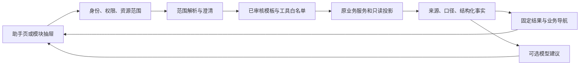

# 学校管理员 AI 助手：可立即开工的设计与实施规格

日期：2026-10-02（北京时间）。状态：历史固定模板实施稿，已由 [统一 AI 对话方案](2026-10-02-school-admin-ai-conversation.md) 替代。

本文保留旧方案及其业务来源研究，不再作为当前界面、模型编排或交付顺序的依据。当前管理员统一在对话中提问，由模型选择内部工具；不使用业务/通用切换或必选查询任务。旧 M0 API 保留兼容。

本文是 [总体研究与设计](2026-10-01-school-admin-ai-assistant.md) 的实施细化稿。总体稿保留完整产品方向；首期范围、交付顺序及接口协议以本文为准。M0 的只读接口、适配器、工作台入口和契约校验已落在当前工作区，仍需按项目环境完成验收与部署。所有界面示例中的考试、人数、成绩均为合成数据。工期按熟悉项目的 1 名前端、1 名后端、测试人员阶段性参与估算，不是完成承诺。

## 1. 先冻结首期决定

**首期产品目标：管理员从真实校内数据中找到问题、理解原因，并准确进入现有页面处理。**

不要等所有模块接完才交付。先完成一条纵向闭环，再扩展查询模板。

| 交付节点 | 具体交付 | 完成标准 |
| --- | --- | --- |
| M0，预计前 3–5 个工作日 | 考试进度 + 学生端发布诊断；考试页面入口；真实数据、来源、业务跳转 | 输入或从页面带入考试，返回真实阻塞项；点击进入正确考试的处理页；无模型也有可读结果 |
| M1，预计累计 12–18 个工作日 | 8 个查询模板；独立助手页；工作台、考试、成绩发布、成绩分析入口；筛选恢复和可编辑报告草稿 | 8 个模板经过权限、口径、故障和页面联动验收；报告的关联统计来自同一读取快照 |
| M2，M1 后预计 2–3 周 | 成员、题库、阅卷任务、仲裁、申诉、审计的专用查询；账号级会话历史 | 每个模块接入其真实查询服务和独立权限；可从详情带入实体并返回带筛选的结果 |
| 后续单独立项 | 对话内创建、分配、发布、改分等动作；扫描件/Excel/Word 解析；历史多场考试比较 | 另行完成动作计划、幂等回执、门禁重查和历史事实版本，不混入 M1 |

M1 明确提供：实时只读查询、事实解释、表格、来源、业务导航、当前会话的报告草稿。M1 不在助手中写入考试、分数、人员、仲裁或申诉状态。业务页面仍按自己的流程提交。

账号级历史从总体稿的早期目标移至 M2，原因是它需要新的持久化、权限变化后的再次授权、保留期限及删除机制。M0/M1 的业务回答保存在当前页面内存，刷新后清除；现有“通用问答”及其个人设备/公共电脑历史规则保持现状。两个模式的消息和附件不相互自动传递。

### 1.1 首期 8 个任务模板

| ID / intent | 用户表达例子 | 必填范围 | 权威数据 | 固定输出 | 首次交付 |
| --- | --- | --- | --- | --- | --- |
| Q01 `dashboard_overview` | 现在学校有哪些事情需要处理？ | 当前授权学校范围 | `dashboard.Service.Summary` | 总览、异常、已有 next actions；明确异常清单是否只覆盖展示中的考试 | M1 |
| Q02 `exam_progress` | 这场数学考试进展到哪一步了？ | 单一学科考试 ID | `workspace.Service.Get` | 阶段、进度、阻塞、警告、下一步 | M0 |
| Q03 `publish_diagnosis` | 为什么这场考试还不能发给学生？ | 单一考试、发布渠道 | 完整 `releasegate` 只读检查 + 当前学生端 release 指针 | 硬阻塞、待确认警告、当前生效发布版本、处理入口 | M0 |
| Q04 `report_overview` | 本次考试整体成绩如何？ | 单一考试 | 新增报告 bundle；复用既有统计构建逻辑 | 样本数、平均分、及格率、优秀率、来源口径 | M1 |
| Q05 `class_comparison` | 比较一下这次考试的一班和三班 | 单一考试、获准班级 ID | 同一 bundle 的班级统计 | 对比表、差值、样本数；不推断教学原因 | M1 |
| Q06 `question_weakness` | 哪些题和知识点需要重点讲评？ | 单一考试，可选获准班级 | 同一 bundle 的小题、知识点统计 | 得分率排序、题目明细、可核实的薄弱点 | M1 |
| Q07 `grading_quality_summary` | 本次阅卷质量怎么样？ | 单一考试 | bundle 的质量统计，按现有定义构建 | OCR 失败率、AI 采纳率、人工修改率、双评差异、样本口径 | M1 |
| Q08 `report_draft` | 按这次考试生成一份管理简报 | 单一考试，可选已授权班级 | 重新获取并校验的 bundle + 当前范围 | 可编辑草稿；每项数据挂事实引用；只提供复制 | M1 |

“今天”不是现有汇总数据的默认时间含义。Q01 初版默认“当前未完成事项”；用户明确要求“今天新增/今天完成”时，必须使用支持时间筛选的来源，否则提示当前模板无法给出该时间统计。

Q03 初版只诊断 `student_portal`。用户说“发布”且渠道不明时展示“学生端成绩发布 / 旧版考试发布”选择，不静默选择；旧版选择进入原考试流程，并说明初版暂不提供该渠道的完整诊断。

## 2. 从当前代码得到的实施约束

| 已核实的实现 | 对设计的约束 | 开发处理 |
| --- | --- | --- |
| [SchoolAIChatPage.tsx](../../apps/web-admin/src/pages/SchoolAIChatPage.tsx) 转发消息及附件文本给托管模型 | 当前对话不能自行读取校内业务事实 | 新增业务查询编排服务；保留原通用问答链路 |
| [managed_chat.go](../../services/api-gateway/internal/modelgovernance/managed_chat.go) 的 provider 请求是文本对话协议 | 不能假定所有已配置模型支持 tool calling | 首期使用受约束的意图 JSON + 服务端白名单模板；执行工具由 Go 服务决定 |
| [routes_exam.go](../../services/api-gateway/internal/server/routes_exam.go) 的 workspace 使用 `dashboard:read` | 不能把所有考试上下文都错误地标为 `exam:manage` | 工具复用对应业务读权限；实体列表另外按实际考试列表权限处理 |
| [router_guards.go](../../services/api-gateway/internal/server/router_guards.go) 的 `withScopedExam` 当前直接返回 handler | 新接口 body 中的考试 ID 不能依赖这个包装完成授权 | 显式调用资源边界检查；每个工具再次使用认证 scope |
| `requireSchoolAdmin` 不套通用幂等回执 | 避免把聊天请求和回答写入通用幂等存储 | 新助手入口沿用该边界；请求 ID 只用于关联、取消和审计，不冒充幂等业务命令 |
| [releasegate/service.go](../../services/api-gateway/internal/releasegate/service.go) 的 `Preview` 会 `AppendEvidence` | “预检”不是纯读；不应每次提问都新增发布证据 | 新增无业务写入的 `Inspect`，共享规则计算；保持 Preview/Publish 的证据流程 |
| 基础 `scorerelease.Gate` 之外还有待重评、有效策略、警告确认/豁免 | 只接基础 gate 会漏掉正式发布条件 | Q03 接完整 releasegate 求值；不能自行拼一份近似门禁 |
| [report/store_postgres.go](../../services/api-gateway/internal/report/store_postgres.go) 的 Overview/Classes/Questions 各自加载数据 | 并行调用现有接口可能把切换发布前后的数据拼在一起 | 新建只读 bundle，一次事务读取并构建所有关联统计 |
| 同文件的 Export 已在 repeatable-read 事务中读取同一 dataset | 有可复用的事务及构建模式，但 Export 会生成记录/回执 | 借鉴读模式，不调用 Export 来为助手获取数据 |
| 报告优先使用 `score_release_current`，没有时走已发布且锁定的旧成绩 | 当前生效版本不等于版本号最大；无版本是明确状态 | 输出来源类型和当前指针；不把缺失发布当作服务失败 |
| 报告仍关联当前学生班级、题目知识点及最新答案结构 | release ID 不能单独保证历史报告永久可复现 | M1 保证本次读取一致；标明元数据为当前读取值，不开放历史因果比较 |
| [AppShell.tsx](../../apps/web-admin/src/AppShell.tsx) 管理 experience 路径和路由；已有未保存修改拦截 | 助手不能直接写 location 跳转并绕过现有导航 | 动作统一回到 AppShell 的 `navigate`；目标页面实现筛选恢复 |
| 报告页现在仅有 `initialExamId` 等有限初始化参数 | 在链接上加任意 class/view 参数不会自动起效 | SA-08 显式增加解析、校验、状态恢复和测试 |

当前工作区有大量已有未提交修改。实施时按工作包选择文件，不格式化全仓、不覆盖正在修改的页面，不手改 generated SDK、历史 SQL 或带哈希提示词。维护注释遵循 [代码注释与维护说明标准](../engineering/commenting-standard.md)。

## 3. 页面与交互：前端可以按此开工

### 3.1 独立助手页

继续使用 `/ai-chat`，菜单文案改为“学校 AI 助手”。仅对 `school_admin` 展示；业务工具仍逐项校验权限。

```text
学校 AI 助手                         学校业务 | 通用问答
范围：本校 > 九年级数学月考 > 全部授权班级      [修改范围]

你可以问：
[查看考试进度] [为什么不能发布] [分析考试成绩] [生成简报]

管理员：这场考试为什么还不能发给学生？

助手：当前学生端发布检查未通过。
      3 份答卷未匹配；2 项待仲裁；1 项重评尚未进入后续发布。

问题              影响范围       处理入口
答卷未匹配         3 份          去匹配
待仲裁             2 项          查看仲裁
重评未形成发布      1 项          打开成绩发布

依据：考试工作区 / 完整发布门禁 / 当前学生端版本
读取：2026-10-02 09:42；不同来源各自标注读取时间
[查看依据] [重新查询]

继续提问……                              [发送]
```

该示例仅说明布局，不是当前项目中的真实统计。阻塞计数不能跨类别相加成“异常学生数”：一份答卷可能同时涉及多类问题。

首屏结构约束：

- 不新增第三条常驻导航栏。左侧沿用项目菜单；会话列表可折叠；内容区域以问题与结果为主。
- 顶部固定当前范围条，发送前始终可见；学校范围由登录权限决定，不能输入租户 ID 切换。
- 首屏先显示 4 个常用任务；“全部问题”展开 8 个模板，不堆叠大段欢迎说明。
- 内容宽度大于等于 1280 px：需要宽表时，聊天与结果可按约 40:60 并排；简单回答保持单列。
- 768–1279 px：聊天、表格、依据依次排列。小于 768 px：模块助手全屏；表格可横向滚动，关键信息仍有摘要。
- 沿用 Ant Design、现有 design tokens、Lucide、Recharts；不引入新的 UI 套件。
- 进度只显示“确认范围 / 读取考试 / 检查发布条件 / 生成说明”等可验证步骤。模型推理文本不作为查询证据展示。

### 3.2 模块内助手

在页面主标题工具区增加“问助手”。考试工作区的上下文由父层统一提供，避免每个子页面重复维护考试对象。

建议 `SchoolAssistantProvider` 挂在学校管理员的 AppShell 分支，承接 `openAssistant(context, preset)` 和业务导航；`SchoolAssistantDrawer` 默认约 520 px 宽，手机全屏。关闭抽屉保留当前页面会话；退出账号清空。

入口与预填问题：

| 页面 | 入口文案 | 自动带入 | 首屏任务 |
| --- | --- | --- | --- |
| 学校工作台 | 问助手 | 当前授权学校范围 | 当前待处理事项、解释总览指标 |
| 考试列表 | 问助手 / 行内“解释进度” | 行内传考试 ID，列表入口不擅自选择第一场考试 | 查看进度、发布诊断 |
| 考试工作区总览 | 分析这场考试 | 学科考试 ID、当前 section、可用 revision | 查看当前阶段、优先处理什么 |
| 成绩发布 | 解释发布条件 | 考试 ID、`student_portal`、当前 release 仅作为提示 | 为什么不能发布、当前学生端版本 |
| 成绩分析 | 分析当前结果 | 考试 ID、view、班级筛选、选中小题 | 整体分析、比较班级、解释指标、简报 |

点击“问助手”只打开界面并带入范围，不自动产生模型费用。点击模板或发送后才读取数据。用户预填了文字时，助手在发送前显示最终范围。

从业务页带入的表格行、数字、release ID 都是提示，服务端重新读取权限和事实；页面截图/前端对象不能成为权威查询源。

### 3.3 范围继承与变更规则

| 情况 | 具体行为 |
| --- | --- |
| 从考试页进入 | 锁定该学科考试；展示考试名、学科；不把整次多学科考试汇总成一个单科事实 |
| 用户说“只看三班” | 保留考试、学科、发布渠道；解析出授权班级 ID；显示“班级范围改为三班” |
| 当前年级有多个三班 | 返回候选选择，不执行查询；候选只来自可访问范围 |
| 用户说“换成上次考试” | 无唯一候选时要求选考试；换考试后清空原班级/小题/release 提示，再解析新范围 |
| 页面切换学科或考试，但已有对话 | 顶部显示“页面已切换”；提供“沿用对话范围 / 使用当前页面范围”；不悄悄改写在途问题 |
| 用户把考试名写得比页面上下文更具体 | 以明确用户选择为先，但服务端仍验证；展示此次变化 |
| 页面正在编辑未保存数据 | 助手说明查询的是已保存数据；业务导航触发原有未保存修改拦截 |
| 查询过程中换账号 | 立即取消请求；旧账号响应不能更新新账号会话、缓存、抽屉 |

第一版支持通过选择器确认考试、班级；`@` 搜索作为选择器入口，不要求第一天实现完整富文本编辑器。

### 3.4 回答组件及可点击行为

| 组件 | 具体内容 | 行为 |
| --- | --- | --- |
| `ScopeBar` | 学校、考试、学科、班级、发布渠道 | 修改后仅影响下一次发送；旧回答保持原范围 |
| `ResultSummary` | 后端模板生成的事实结论；模型建议另标“分析建议” | 缺源时优先显示限制，不能显示“全部正常” |
| `MetricStrip` | 至多 4 个主要指标；值、单位、样本数/分母 | 点击查看定义、取值字段和来源 |
| `ResultTable` | 阻塞、班级比较、小题明细；默认最多显示 10 行 | 展开更多；列排序来自明确字段，不改变统计口径 |
| `SourcePanel` | 来源名称、状态、读取时间、版本、口径及范围 | 跳转到对应已授权页面；无权限不生成跳转按钮 |
| `NavigationAction` | 去匹配、查看质量、进入成绩发布、查看报告 | 通过类型化目标生成 URL；调用现有 navigate |
| `DraftEditor` | 简报标题、已核实事实、限制、建议、引用 | 修改、复制；编辑后的段落标为人工编辑，不伪装为原查询结论 |
| `FeedbackBar` | 有帮助 / 数据不对 / 范围不对 / 解释不对 | M1 记录模板、请求、范围摘要和反馈类别，不默认上传整段敏感文本 |

### 3.5 状态与故障文案

业务请求状态：`idle → resolving_scope → needs_clarification 或 reading → rendering → completed/partial/failed/cancelled`。

- 缺少考试：“请选择要查询的考试。”保留用户文字，展示选择器。
- 无可见数据：“当前授权范围内没有可用于这项统计的数据。”不展示 0% 假指标。
- 工作区成功、门禁失败：“已获取考试进度，暂时无法核实完整发布条件。”隐藏通过/未通过结论，保留真实工作区结果。
- 模型不可用：“数据已读取，以下为系统整理的结果。”显示固定模板、表格、来源与跳转；建议部分不生成。
- 报告无发布源：“本次考试尚无可用的已发布成绩。”可打开发布页；不读取未发布原始成绩代替。
- 权限不足：“当前账号不能查询这类数据。”已知页面上下文可以保留名字；对不可见资源不补充任何探测结果。
- 停止：“已停止本次查询。”保留完整到达且校验过的来源/事实；未完成部分明确标记，不能沿用成下一问事实。
- 流连接中断：“结果传输中断，重新查询将读取最新数据。”M1 不宣称有服务器断点续传；重新发送使用新的请求 ID。

## 4. 左侧所有模块怎样连接：明确每个模块的读取、上下文和回到业务页面

“接入”分成页面入口、数据查询、业务动作三件事。M1 中入口可以覆盖菜单，但只有完成专用查询的模块才能声称在读真实业务数据。未接入的模块显示操作说明和“打开该模块”，不生成虚假的数量或状态。

| 实际菜单模块 | 传给助手的上下文 | 需要读取的详细字段 | 回答与返回页面 | M1 / 后续 |
| --- | --- | --- | --- | --- |
| 工作台 | 学校范围、页面 | 汇总范围、考试状态计数、待处理指标、来源 warnings、活动条目 | 当前事项清单；进入某场考试；说明 top 列表与全校总量区别 | M1 接真实 summary；逐场全量优先级清单 M2 |
| 学生管理 | 学校/年级/班级、选中学生 ID | 当前班级、学籍状态、候选/匹配状态；姓名与学号按身份权限最小返回 | 查某学生是否在本场名单；进入学生详情或考试学生范围 | M1 说明与导航；M2 专用成员读工具 |
| 年级与班级 | 年级/班级 ID、当前筛选 | 年级归属、班级状态、成员计数、班级变更与考试候选快照区别 | 查班级范围；解释当前人数与考试人数差异 | M1 可作为报告筛选实体；人数详情 M2 |
| 阅卷教师 | 教师 ID、考试 ID | 启用状态、角色、可用任教/阅卷关联、实际分配及已完成任务数 | 查看教师任务；进入人员管理/阅卷管理；不依据职称猜测负荷 | M1 说明与导航；M2 跨组织/任务查询 |
| 考试列表 | 学科考试 ID、考试 session ID、状态 | workspace stage/progress/counts/blockers/warnings/next_actions/revision | 进度解释、准备/采集/阅卷/发布问题；跳到对应 section | M0 开始接真实数据 |
| 题库 | subject、knowledge point、question ID、当前筛选 | 来源、题型、知识点、版本、审核/可用状态、授权范围；如有难度，标明实际统计依据 | 按薄弱知识点找可用题；进入题库筛选或小题详情 | M1 只能展示报告中知识点；题库检索及推荐 M2 |
| 阅卷管理 | 考试、批次、题目、任务范围 | pending/completed/status、归属、实际任务计数、退回/异常类型 | 哪些任务未完成、哪个小题待处理；进入任务队列 | M1 进度用 workspace 的既有汇总；教师/任务明细 M2 |
| 复核与异常 | 考试、质量 issue 或 arbitration ID | issue 类型/严重度、待处理状态、差异值、仲裁记录及实际权限 | 区分识别异常、质量问题与仲裁；打开具体问题 | M1 既有 workspace/gate 的问题摘要；明细 M2 |
| 成绩发布 | 考试、渠道、当前 release 提示 | 完整门禁、有效 policy、待确认 warning、regrade 阻塞、current 指针、发布状态 | 为什么不能发布、当前学生看到哪个版本；进入本考试发布区 | M0 开始接真实完整门禁；不在对话提交发布 |
| 成绩分析 | 考试、view、班级/小题 | 同一 bundle 的 overview/classes/questions/quality；发布源、统计定义与样本数 | 整体/班级/小题/质量分析、简报；回到同一筛选视图 | M1 完整接入 |
| 申诉处理 | 考试、appeal ID、状态/类型 | 涉及 release、question、受理状态、最终决定、关联 regrade/后续 release 状态 | 解释“已裁决”与“学生端已生效”的区别；打开申诉/发布页 | M1 操作说明与导航；M2 专用查询 |
| 操作审计 | 时间区间、资源类型/ID、操作者提示 | 权限范围内的事件、时间、资源、动作、结果；敏感 payload 过滤 | 查发布/调整的操作记录；按范围打开审计；推断和事件事实分开 | M1 操作说明与导航；M2 审计工具，要求 `audit:read` |

成员实体查询不能因为用户有 `report:read` 就返回组织管理详情。Q05 的班级名称来自本次报告里可见的班级或新建的最小实体候选端口，不为方便而开放 org:manage 的全部信息。

### 4.1 考试工作区内部 section 的联动

实际 canonical 路由是 `/exams/{examId}/{section}`，由 AppShell 映射为当前 experience 前缀，例如管理员路径。以下目标均经访问检查后生成。

| section | 带入信息 | 能解释的具体问题 | 目标行为 |
| --- | --- | --- | --- |
| overview | exam ID、workspace revision | 当前业务阶段、优先阻塞、下一步 | 保持总览或跳到准确 section |
| students | exam ID、年级/班级筛选 | 参加范围、名册准备规则；专用读工具未接入时不编造候选数 | 返回本场名单；后续支持具体筛选 |
| paper / questions | exam ID、paper/question ID | 材料、题目/分值配置、评估冻结的区别 | 返回对应资料或小题；只使用已保存状态 |
| template | exam ID、template ID | 答题卡设置与采集准备规则；不把页面草稿当已保存 | 返回模板页；原未保存拦截生效 |
| settings | exam ID | 准备门禁、流程设置的作用 | 返回准备检查页；不自动修改配置 |
| capture / processing | exam ID、batch 或 submission 提示 | 未匹配、识别失败、质量问题；M1 展示已有聚合 | 打开导入/识别工作区；有真实筛选消费后再展示“直接定位” |
| grading / quality | exam ID、question/task/issue 提示 | 进度、待复核/待仲裁、质量摘要 | 打开阅卷或质量页；目标组件负责筛选恢复 |
| scores | exam ID、渠道 | 完整发布条件、当前学生端版本 | 打开本考试成绩工作区；正式发布仍重新检查 |
| appeals | exam ID、appeal 提示 | 申诉处理规则；明细在 M2 接入 | 返回该考试申诉页 |
| reports | exam ID、view、class/question | 真实报告统计、定义、差异、简报 | 返回同一报告视图及选中行 |

## 5. 三条完整场景，作为第一版设计验收稿

### 5.1 发布排障

1. 管理员在 `/exams/{id}/scores` 点击“解释发布条件”，带入考试和学生端渠道。
2. 范围条显示“九年级数学月考 · 学生端成绩发布”，发送前可修改。
3. 后端先检查 `school_admin`、`score:manage`、考试访问范围，再读取完整只读门禁。可访问 workspace 时补充进度；不能访问时不读取该源。
4. 系统先给出可核实结论：是否存在硬阻塞、是否有待确认警告；按规则严重度排序，不把不同 issue 的 count 相加。
5. 重评未形成后续 release 必须显示为单独阻塞。没有 current release 只表示学生端尚无当前发布，不能直接认定基础门禁失败。
6. 结果行显示可用入口。只有目标页实现了筛选消费，才写“查看这 2 项仲裁”；否则写“打开质量工作区”并提示需要在页内筛选。
7. 点击后通过现有导航进入同一 exam 的页面；解决问题后回助手点击“重新查询”，不复用旧门禁为新结论。
8. 若检查通过，文案是“本次读取时未发现阻塞，可以进入发布工作区复核”，不能承诺随后一定发布成功。正式发布继续 `RecheckForPublish` 并生成证据。

### 5.2 成绩分析 → 班级比较 → 小题 → 讲评建议

1. 从 reports 的班级视图打开助手，传入已选考试、view、班级。
2. 用户问“比较一班和三班”，服务端确认两班是否都属于此考试且在授权范围内。
3. 一次只读事务取得发布源和 dataset，应用范围过滤，再构建统计；表中列出样本数、平均分、及格率、优秀率及差值。
4. 缺样本的班级显示“无可用样本”，不是 0 分或 0%；不同满分不直接比较分数，使用明确的得分率模板或请求选择同一学科。
5. 追问“只看三班最弱的题”，保留考试，改为该班；重新构建班级过滤后的题目统计，不能拿全校小题指标换一个班级标签。
6. 结果给出题号、得分率、满分率、样本数、知识点。正确率按现有“满分记录占比”解释；difficulty 与 score_rate 同向，不反转。
7. 给出讲评建议时标为模型建议，不断言学生存在某种心理/教师存在某种能力问题。
8. M1 提供“查看这些小题”回到 reports；“寻找相似练习题”在 M2 题库专用查询接入后启用。先按真实题型/知识点/可用状态筛选，再展示可选题，不把知识点相同直接认定同难度。

### 5.3 管理简报

1. 用户在完成分析后选择“生成简报”。重新读同一范围 bundle；旧回答不是当前事实源。
2. 展示范围与来源。如果发布指针或数据读取结果已变，说明“已按最新数据更新简报”。
3. 草稿固定段落：考试范围、成绩概览、班级/小题事实、阅卷质量、待处理事项、建议、数据限制与来源。
4. 事实段落来自后端模板/事实引用；建议段落由模型生成，单独标记。
5. 管理员在编辑器中修改后可复制；M1 不自动生成导出记录、不代为发送。需要原报告导出时打开报告页面并按 `report:export` 执行。
6. 草稿仅在当前页面内存；刷新清除。编辑器退出使用未保存提示；复制后提供明确成功提示。

## 6. 接口和结果协议：可以先写契约再并行开发

以下为拟新增协议，不是当前已存在接口。OpenAPI 按仓库正式流程更新，随后生成 SDK。不要手改 generated 文件。

### 6.1 API 清单

| 接口 | 输入 | 输出 / 要点 |
| --- | --- | --- |
| `GET /api/v1/school-assistant/capabilities` | 无租户输入；认证会话 | model_available、已授权 intents、各模块 read/navigation 能力及禁用原因；服务端仍逐次鉴权 |
| `GET /api/v1/school-assistant/entities?kind=exam&q=...` | kind、搜索词、limit（最大 20）；class 查询必须有 exam_id | 仅可见实体的 id/label/subject/必要父级；分页 cursor；禁止先搜全租户再前端过滤 |
| `POST /api/v1/school-assistant/queries/stream` | 请求 ID、问题/模板、上下文提示 | SSE 的范围、进度、结构化结果、可选建议、完成/错误；业务源读取失败有明确状态 |
| `POST /api/v1/school-assistant/feedback` | request_id、intent、反馈分类；可选用户主动填写说明 | 审计/反馈元数据；再次验证身份，不接受客户端替别人提交 |

首个工作包可以只实现 capabilities 与 queries/stream 的 Q02/Q03；实体选择暂用现有获准考试列表，M1 再补最小候选端口。没有考试列表权限但从获准业务页进入的用户，可以使用该考试上下文，不能因此获得全校考试枚举能力。

### 6.2 请求示例

```json
{
  "request_id": "b17c1bfd-bbf3-4e8e-bd78-9cdac8032c83",
  "question": "这场考试为什么还不能发给学生？",
  "preset_intent": "publish_diagnosis",
  "context_hint": {
    "exam_id": "12c513c8-e6e0-4e35-8aef-82bfd82f00ac",
    "class_ids": [],
    "origin_module": "scores",
    "origin_section": "scores",
    "release_channel": "student_portal"
  },
  "previous_scope_hint": null
}
```

约束：question 初始上限 2000 字符；只接受声明的字段、UUID 资源 ID 和 intent 枚举。tenant_id、actor_id、学校授权列表由认证上下文提供，不接受模型或客户端指定。previous_scope_hint 仅用于帮助解释追问，每次重新校验；客户端不得发送作为“已验证事实”的上轮结果。

学校业务模式不把通用聊天附件自动混入请求。附件分析后续另立来源类型；任何附件文本都不能修改工具白名单或访问范围。

### 6.3 类型化范围

```ts
type AssistantScope = {
  exam_id?: string;
  class_ids: string[];
  subject?: string;
  release_channel?: "student_portal" | "legacy_exam";
  data_basis: "workspace_live" | "report_current";
};

type AssistantSource = {
  id: string;
  kind: "dashboard" | "workspace" | "release_gate" | "report_bundle";
  status: "available" | "empty" | "unavailable" | "forbidden";
  label: string;
  read_at: string;
  revision?: string;
  release_id?: string;
  release_version?: number;
  score_source?: "student_portal_current" | "legacy_published_locked" | "none";
  consistency: "source_local" | "bundle_snapshot";
  metadata_basis?: "current_read";
  scope_label: string;
  note?: string;
};

type AssistantFact = {
  id: string;
  source_id: string;
  metric_key: string;
  label: string;
  available: boolean;
  value: number | null;
  unit: "count" | "score" | "ratio" | "percentage_point";
  numerator?: number;
  denominator?: number;
  definition_id: string;
  reason?: string;
};
```

`available=false` 时新协议用 `value=null`。适配现有 `report.Metric` 时保留 available/reason；没有 numerator/denominator 的指标不能凭空补值。比例传小数，前端格式化为百分数；两比例之差标“百分点”。

既有 workspace/dashboard 分别读取，不能标成同一个数据库快照。ReportBundle 中从同一事务得到的关联统计可以标 `bundle_snapshot`；这只保证本次读取，不承诺历史元数据冻结。

### 6.4 最小 SSE 事件

事件 data 都包含 `request_id`、递增 `seq`、`type`。沿用现有 apiClient 的 POST event stream，不使用无法携带 POST body 的 EventSource。

| type | 主要载荷 | 前端处理 |
| --- | --- | --- |
| `scope_resolved` | 最终 scope、显示标签、继承/变更说明 | 展示本次查询范围；不自动覆盖新问题草稿范围 |
| `clarification_required` | 原因、已授权候选列表 | 停止业务读取；展示选择器；本次请求以 done 结束 |
| `source_started` | source_id、label | 显示真实读取步骤 |
| `source_finished` | source 元数据、duration_ms | 更新来源状态，不直接把原始敏感 JSON 展示给用户 |
| `result` | status、facts、blocks、sources、actions、limitations | 一次输出校验过的完整结构化业务结果 |
| `commentary_delta` | 仅建议说明的增量文本 | 单独展示“分析建议”；不承载主要业务数值和权限决策 |
| `done` | status、duration_ms、模型用量（如有） | 结束请求，允许新问题/重试 |
| `error` | code、用户文案、retryable | 保留已完整校验结果；取消未完成状态 |

status 为 `completed / partial / needs_clarification / failed / cancelled`。`result` 的 blocks 第一版只允许 `summary / metrics / table / issues / draft / notice`；不接受模型返回可执行 HTML、SQL、任意 URL 或业务动作。

### 6.5 类型化业务导航

```ts
type AssistantNavigationTarget =
  | { kind: "exam_section"; exam_id: string; section: string }
  | { kind: "report_view"; exam_id: string;
      view: "overview" | "classes" | "questions" | "quality";
      class_id?: string; question_id?: string }
  | { kind: "module"; module: "students" | "classes" | "teachers" |
      "question_bank" | "grading" | "arbitration" | "appeals" | "audit" };
```

Go 和 TS 都用白名单枚举校验 section/module。section 是现有工作区允许的名称，不是任意字符串路径。后端根据已验证事实生成 target，前端再用现有 `hasPathAccess` 和各页实际权限复核；身份姓名等细粒度权限另查，不能只通过菜单可见性判断。

例如 report_view 转成 canonical `/exams/{id}/reports?view=questions&question_id={id}`。这是拟新增筛选协议，必须完成目标页消费后才生成。客户端用 URLSearchParams 编码，最终由 `navigate` 处理 experience 和已有路由拦截。

错误/门禁的 `action_route` 可能是业务语义值，例如 `regrade`，不是可直接点击的 URL。集中映射到可用目标；未知值显示原因而不生成跳转。

## 7. 后端实现：窄接口、同一业务规则、事实先于模型

### 7.1 新模块和请求链

拟新增 `internal/schoolassistant`，在 `ApplicationModules` 中增加 Assistant，注册单独 routes。模块构造只收窄接口，不接收 `*ExamPreparationModule`、`*ReleaseModule`、`http.HandlerFunc` 或整个 broad `auth.Store`。



请求处理顺序：

1. 从会话获取 user、AccessScope；拒绝缺失 scope、非 school_admin。
2. 对 preset 或模型提出的 intent 检查是否已开放；只允许 8 个枚举。
3. 确认资源 ID。借助 `auth.ResourceBoundaryResolver`、`auth.AllowsResourceBoundary`，或带 scope 的原服务验证；不信任 JSON body 中的资源标识。
4. 验证 intent 的全部必要权限；辅助源无权限时可以省略，但核心源无权限则不执行。
5. 检查考试与班级/小题的归属关系，将请求范围与授权范围求交；不能静默扩大。
6. 执行模板声明的只读源，不让模型任意增加接口、SQL、来源或字段。
7. 适配事实、数据可用状态、来源 manifest、统计定义；模板生成主要结论与导航。
8. 可用时调用租户托管模型生成建议。校验输出格式及引用；失败则保留模板结果。
9. 输出完整 result、可选建议、done；记录最小审计及用量。

### 7.2 8 个 intent 的权限基线

| intent | 核心权限 | 额外规则 |
| --- | --- | --- |
| dashboard_overview | `dashboard:read` | summary 只能覆盖 AccessScope；不能用 top 5 当全量考试 |
| exam_progress | `dashboard:read` | `workspace.Service.Get(ctx, scope, examID)` 验证资源 |
| publish_diagnosis | `score:manage` | 完整考试资源检查；辅助 workspace 再查 `dashboard:read` |
| report_overview / class_comparison / question_weakness / report_draft | `report:read` | 班级/学生范围在聚合前生效；草稿不是 report export |
| grading_quality_summary | `report:read` | 沿用原报告权限和指标；任务/人员明细不随统计一起开放 |

实际跳转到 scores 的前端条件还包括 `exam:manage`、`submission:manage` 等现有组合。用户能读取某项结果，并不一定有权打开完整处理页面；生成 actions 时按目标权限决定，必要时仅展示原因。

### 7.3 已有模块如何暴露读能力

当前 `module_exam.go` 主要向外暴露 WorkspaceHandler、DashboardHandler，handler 私有持有 service。建议在模块装配处构造共享 service，并增加接受 service 的 handler 构造方式。旧 handler 和助手的窄 Reader 使用同一 service，不通过内部 HTTP 回调旧 handler。

拟定端口职责：

| 端口 | 输入 | 返回 | 现有落点 |
| --- | --- | --- | --- |
| WorkspaceReader.Get | context、AccessScope、exam ID | workspace projection | `workspace.Service` |
| DashboardReader.Summary | context、auth.User、AccessScope | summary | `dashboard.Service` |
| PublicationInspector.Inspect | 已授权 context、tenant、exam | 完整 Evaluation | `releasegate.Service` 新只读方法 |
| CurrentReleaseReader | 已授权 context、tenant、exam | current release 或明确 none | `scorerelease.Service` |
| AssistantReportReader.ReadBundle | context、AccessScope、exam/班级范围 | 一致 bundle + 来源 | report 新窄 Reader，不扩散整个 Store |
| EntityReader.Search | context、AccessScope、kind、关键词 | 受限候选 | 复用各业务受限读能力 |
| ExplanationProvider | 最小必要事实、请求、已授权范围 | 建议文字/受约束 JSON、usage | 新窄接口，复用现有模型配置和 provider 适配 |
| AuditRecorder | 动作、身份、资源、状态摘要 | 审计结果 | 已有 `auth.AuditRecorder` |

模型调用抽取独立可复用的运行能力后供旧 handler 与新服务使用。不能为助手从前端拿密钥，不能绕过原模型状态、限额和用量记录。

### 7.4 完整发布门禁的只读接口

在 `releasegate.Service` 增加 `Inspect`；不建议 M0 新增独立公共 gate HTTP API，助手先直接通过窄端口调用。

重构结构：

```text
loadEvaluation(ctx, tenant, exam)
  读取 base.Gate
  读取 BlockingRegradeCount，并补入同一阻塞规则
  读取 ActivePolicy（没有则使用原 defaultPolicy）
  读取 ApprovedWaivers
  调用原 evaluate
  返回 Evaluation，不 AppendEvidence

Inspect -> loadEvaluation -> 返回
Preview -> loadEvaluation -> 保持原 EvidencePreview / Hash / AppendEvidence
RecheckForPublish -> loadEvaluation -> 保持原 EvidencePublish / AppendEvidence / ErrGateBlocked
```

测试必须证明 Inspect 不改变证据、policy、waiver、release 或业务审计记录。助手自己的查询审计可以增加，不能把“无业务写入”误写为完全不记录访问。

初版跨门禁来源不是整体事务快照，manifest 标 `source_local`，保留每个来源的时间；检查结果是当前诊断，不是可重复使用的发布许可。原发布协调器仍在正式提交时重查。

### 7.5 报告一致读取及范围过滤

新增 `report.AssistantReadRequest` / `AssistantBundle` 与窄 reader，避免给助手整个 report.Store 或调用带业务写入的 Export。

Postgres 的读取顺序：

1. 完成考试资源和 report:read 检查，形成有效学生/班级范围。资源授权不等于所有明细可见。
2. 开启 `sql.LevelRepeatableRead` 且 `ReadOnly: true` 的事务；所有查询均用 tx。
3. 在该事务中解析 `score_release_current` 与 published release。没有 current 时按现有已发布且 locked 的旧成绩来源读取。
4. 对请求班级与访问范围在 SQL/基础数据层过滤，再聚合。绝不能先把全校成绩发送模型、再由提示词限制输出。
5. 在同一事务中加载 dataset 和质量统计、源标识、必要元数据；复用 buildOverview、buildClassReports、buildQuestionAnalysis 等现有算法。
6. 完成读取后关闭事务，再调用模型。不能在数据库事务里等待模型或 SSE 用户连接。
7. 输出 source marker：score_source、release ID/version（若有）、read_at、过滤范围、metadata_basis=current_read、bundle_snapshot。

MemoryStore 同步提供可测试的 bundle Reader；其测试 fixture 也先过滤再聚合。关于仅限班级范围的质量指标：无法从当前质量查询按同样范围过滤的指标必须 unavailable，不能以全校值代替班级值。

指标定义固定复用现有代码，不重新写一套近似规则：

- 及格/优秀以现有先四舍五入到两位的得分比例，再与 0.60/0.85 比较；边界和原实现测试保持一致。
- 题目 difficulty 等于 score_rate，值越大越容易；正确率为满分记录占比。
- 知识点会重复分配题目分值，多个知识点的统计不能相加为试卷总分。
- 发布成绩是分数快照；当前班级、题目/知识点、答案元数据不是完整历史冻结。
- 排序、样本数、空值、百分比显示和班级比较全部由明确指标定义支撑；缺失样本不变成零。

### 7.6 模型编排及可信回答

默认点击模板时不需要模型规划，直接绑定 intent。自由问句先匹配同义表达与上下文；不能明确归类时，使用现有租户模型生成限定字段的 intent JSON。

规划输出仅含 `intent / candidate_entity_ids / class_ids / clarification_reason` 等允许字段。服务端重新校验；JSON 无效、资源越权、未知意图、模型不可用时回到选择模板/范围，不能退化为自由 SQL。

业务数值的主结论、指标和表格由后端生成；模型只能解释事实和提出建议。含数据的草稿段落使用事实引用/模板，引用 ID 必须存在于本次 FactSet。建议中出现未经核实的新数字或来源时，不作为事实展示；必要时舍弃建议并返回模板结果。

M1 不保存或展示模型 reasoning 作为业务证据，也不宣称展示了模型真实思考过程。界面显示的是实际工具步骤、指标定义、样本和来源。

### 7.7 取消、缓存、成本和审计

- M1 页面一次只运行 1 个业务查询；其他线程可先不开放并发业务问数。现有通用问答的最多 5 个在途请求限制不能被描述为两条链路的统一总限额。
- 新服务初始预算建议：最多 4 个逻辑数据源、1 次意图模型调用 + 1 次可选解释调用、默认 10 行展示。各源超时、总超时与 token 预算设为配置，并经实际模型验证后定值。
- 数据读取目标初值：单源 8 秒，总读取 15 秒；模型 30 秒；整次 45 秒。这些是调优起点，不是 SLA。共享连接池、取消传播和大考试查询需压测。
- 不缓存业务回答为实时事实。实体候选可以短缓存，但 key 必须包含 tenant、actor、权限/范围指纹及搜索条件；无现成范围版本时使用会话指纹，退出/身份变化时清空。
- React Query 新 key 至少包含账号、范围指纹、intent、exam、班级及数据来源；不能仅用 exam ID 混用不同账号/班级的助手数据。
- 每次发送有独立 AbortController 和 request_id。停止/账号切换后，迟到事件被 request/actor guard 丢弃；服务端 context 传递到读服务和模型请求。
- M0/M1 无数据库保存聊天正文、附件、结果表格和草稿。已有审计记录 request_id、intent、资源标识/范围摘要、source 状态、耗时、token 用量和反馈分类；日志不打印原始敏感消息或完整业务 payload。
- capabilities 只改善界面；不能替代请求时实时鉴权。访问范围撤销后旧结果不自动继续查询，下一次发送重新授权。
- 进程内限流不能保证多实例统一额度。若以多实例上线并对学校总额度作保证，必须先接现有合适的共享限额机制或新增可验证的分布式配额，不把内存 map 当全局保证。

## 8. 代码落点与文件组织

下面“新增”是计划，不是仓库现有文件；已有文件链接经核对。目录尽量沿用当前 features / api / query / internal 模块结构。

### 8.1 前端

```text
apps/web-admin/src/features/school-assistant/             新增
  SchoolAssistantProvider.tsx                            抽屉生命周期、账号边界、导航回调
  SchoolAssistantPanel.tsx                               页内/抽屉共用主体
  SchoolAssistantDrawer.tsx                              页面上下文入口
  components/ScopeBar.tsx
  components/ResultRenderer.tsx
  components/SourcePanel.tsx
  components/DraftEditor.tsx
  hooks/useAssistantRun.ts                               SSE、取消、迟到结果隔离
  context.ts                                             页面提示与范围类型
  navigation.ts                                          白名单目标到 canonical 路径
  templates.ts                                           问题文案，绑定后端 intent
  school-assistant.css                                    沿用 tokens

apps/web-admin/src/api/schoolAssistant.ts                 新增，使用 apiClient
apps/web-admin/src/query/schoolAssistant.ts               新增，仅缓存受限候选/能力
```

已有文件的修改边界：

| 已有文件 | 修改点 | 保留要求 |
| --- | --- | --- |
| [AppShell.tsx](../../apps/web-admin/src/AppShell.tsx) | 学校管理员分支挂 Provider；注入 navigate；工作区 context；报告筛选传入 | 既有身份切换、experience、未保存拦截、其他角色分支 |
| [SchoolAIChatPage.tsx](../../apps/web-admin/src/pages/SchoolAIChatPage.tsx) | 作为模式容器，挂业务 Panel；原聊天移成内嵌组件或保持原主体分支 | 原模型配置、附件限制、公共电脑、本地历史、停止行为 |
| [routes.tsx](../../apps/web-admin/src/router/routes.tsx) | 只改学校 AI 菜单文案；必要的筛选解析入口 | 不新增其他角色可见性，不放宽现有菜单权限 |
| [ExamWorkspaceLayout.tsx](../../apps/web-admin/src/features/exams/workspace/ExamWorkspaceLayout.tsx) | 标题区问助手，带 exam/section/revision | 原考试切换及状态展示 |
| [ScoreManagementPage.tsx](../../apps/web-admin/src/pages/ScoreManagementPage.tsx) | 发布上下文入口；接收必要 focus | 原正式发布、重评、回执与恢复流程 |
| [LearningReportsPage.tsx](../../apps/web-admin/src/pages/LearningReportsPage.tsx) | assistant context、view/class/question 的初始化与变更恢复 | 原查询/导出权限、页面图表和统计文案 |
| [DashboardPage.tsx](../../apps/web-admin/src/pages/DashboardPage.tsx) | 仅 school_admin 入口；实际 SchoolDashboard 分支接 context | 其他角色 dashboard 不受影响 |

不要把业务工具或整个服务器结果缓存在 `SchoolAIChatPage` 的旧 localStorage 结构中。需要保存聊天历史时 M2 新建服务端 schema，再明确保留策略。

### 8.2 后端

```text
services/api-gateway/internal/schoolassistant/             新增
  types.go                                                请求、范围、事实、来源、结果
  handlers.go                                             认证后的输入、SSE、反馈
  service.go                                              编排，不实现领域业务规则
  authorization.go                                        intent 权限和 body 资源范围
  templates.go                                            8 个受审模板定义
  facts.go                                                来源适配、口径、空值
  navigation.go                                           安全业务目标
  planner.go                                              限定 intent JSON 与降级
  model.go                                                最小 ExplanationProvider 接口
  service_test.go / authorization_test.go / handlers_test.go

services/api-gateway/internal/server/module_school_assistant.go    新增装配
services/api-gateway/internal/server/routes_school_assistant.go    新增路由
services/api-gateway/internal/report/assistant_bundle.go           新增契约/纯构建
services/api-gateway/internal/report/assistant_bundle_postgres.go  新增一致读取
services/api-gateway/internal/report/assistant_bundle_memory.go    新增测试实现
```

需改 [application_modules.go](../../services/api-gateway/internal/server/application_modules.go)、[server.go](../../services/api-gateway/internal/server/server.go)、[module_exam.go](../../services/api-gateway/internal/server/module_exam.go)、[module_release.go](../../services/api-gateway/internal/server/module_release.go) 和对应 memory/transactional 装配，新增窄 read 能力。构造函数不传其他 Module 指针；审计消费者使用窄 `auth.AuditRecorder`。

releasegate/service.go 增加 Inspect 并复用求值。模型运行能力从现有 governance 适配中抽取；新旧链路共用受控配置和计量。M1 无需新增数据库表，也不需要更改历史 SQL。若实现中发现既有接口确实缺少必要索引，作为单独正式迁移评估，不悄悄加入查询包。

接口契约在 [edugrade-api.openapi.json](../../services/api-gateway/openapi/edugrade-api.openapi.json) 新增；使用 generate:sdk、generate:route-coverage 和仓库契约检查处理生成结果。未来会话表另立 M2 的迁移与保留规格。

## 9. 可直接进入开发看板的工作包

人日为该角色净投入估算，不能把相依任务简单并行相加。M1 预计前端约 9–12 人日、后端约 12–16 人日、测试约 3–5 人日；复杂范围过滤或模型能力问题会改变估计。

| 编号 | 工作包与交付文件 | 依赖 | 估算 | 完成验收 |
| --- | --- | --- | --- | --- |
| SA-01 | 冻结 Q02/Q03 契约、事实与导航类型；补 OpenAPI 和 fixtures | 无 | 后端 0.5，前端 0.5 | 真实/无发布/门禁失败/无权限 fixture 能驱动同一结果组件；字段和状态无歧义 |
| SA-02 | schoolassistant 入口、capabilities、body 资源范围及 intent 权限 | SA-01 | 后端 1–1.5 | 越权 tenant/exam/class 不产生工具读取或模型调用；角色与业务权限分别测试 |
| SA-03 | releasegate.Inspect 及共享求值重构；完整门禁测试 | 可与 SA-02 同步 | 后端 1–1.5 | 与既有门禁规则一致；Inspect 无业务写入；Preview/Publish 证据行为不变 |
| SA-04 | Q02/Q03 服务端模板、workspace/current release 适配、SSE | SA-02/03 | 后端 1–1.5 | 合成 fixture 与真实 store 两种测试均正确；无模型可完成；部分失败不误报 |
| SA-05 | Panel/ScopeBar/ResultRenderer/useAssistantRun；先接 fixtures 后接 SSE | SA-01 | 前端 1.5–2 | 停止、切账号、流断开、迟到事件均隔离；完整事实/来源/按钮可显示 |
| SA-06 | 考试工作区入口与导航回调；Q02/Q03 联调 | SA-04/05 | 前端 0.5–1；测试 0.5 | 从考试页提问并到同场 scores/quality/processing；原导航拦截生效；完成 M0 |
| SA-07 | report bundle 只读事务、score_source、聚合前范围过滤、memory reader | SA-02 | 后端 2–3 | current 指针变更并发测试、班级范围过滤、旧发布、无样本与元数据口径全部通过 |
| SA-08 | typed navigation 与 reports view/class/question 筛选恢复；目标页必要 focus | SA-05 | 前端 1–1.5 | URL 与页面筛选一致；非法/越权筛选不扩大；前进后退与未保存状态正确 |
| SA-09 | Q04–Q07 模板、指标定义、班级/小题/质量结果 | SA-07 | 后端 1–1.5；前端 1 | 比例与百分点、正确率/difficulty、样本分母、班级重新聚合可核实 |
| SA-10 | Q01 dashboard 源、学校工作台入口、Top 列表范围说明 | SA-02/05 | 后端 0.5；前端 0.5 | 全量汇总与有限展示列表不混淆；source warning 不被当零值正常 |
| SA-11 | 受限实体候选、追问范围继承/重置与澄清 | SA-02/07 | 后端 1；前端 1–1.5 | 同名班级/考试展示授权候选；换考试清理旧班级/小题；模板不读越权范围 |
| SA-12 | 租户模型窄 provider、受限 intent planner、解释降级、用量计量 | SA-04 | 后端 1.5–2 | 无 tool calling 模型可用；错误 JSON/未知工具/越权 ID 被拒绝；模型失败仍有事实结果 |
| SA-13 | Q08 简报模板、事实引用、DraftEditor、复制/退出提示 | SA-09/12 | 后端 0.5；前端 1 | 最新事实可溯源；建议与事实分开；编辑不伪造原引用；复制后内容完整 |
| SA-14 | 业务/通用模式整合、菜单文案、四个入口、响应式和键盘操作 | SA-05/08/10 | 前端 1–1.5 | 通用问答功能保留；公共电脑不新增业务持久化；窄屏与键盘可用 |
| SA-15 | 最小审计/反馈、配置预算、取消传播、源故障与大考试验证 | SA-04/07/12 | 后端 0.5–1；测试 1 | 无敏感 payload 日志；超时可解释；连接取消释放；无回执误存聊天 |
| SA-16 | 契约/架构/角色回归、6 个 E2E、试用样本和灰度开关 | 全部必要包 | 前后端各 0.5；测试 1.5–2 | M1 验收通过；可按学校关闭业务模式，原通用聊天仍可用 |

### 9.1 第一周按这个顺序开始

| 工作日 | 前端 | 后端 | 当天可审查产物 |
| --- | --- | --- | --- |
| 第 1 日 | SA-01 类型与 4 类 fixture；Panel、ScopeBar、结果布局 | SA-01；启动 SA-03 规则抽取与 Inspect 测试 | 可点击的结果样例、API 契约、门禁测试草案 |
| 第 2 日 | SA-05；考试上下文入口；SSE/取消 | 完成 SA-03；启动 SA-02 范围和权限 | 模板 UI、无业务写入的完整门禁、权限用例 |
| 第 3 日 | SA-06 导航联调；基本窄屏 | SA-02/04；Q02/Q03 接共享原服务 | 单接口真实查询；条件成熟时先演示一个考试 |
| 第 4–5 日 | 完成 M0 联调；启动 SA-08 报告筛选恢复 | 完成 M0 回归；启动 SA-07 一致 bundle | M0 发布排障完整演示，可进入正确处理页；报告接口设计 |

随后完成 dashboard、实体追问、简报、模式整合与回归。模型编排可后置；它不阻塞第一条真实数据闭环。

### 9.2 建议按小变更包交付

1. 契约与只读门禁：SA-01/03。变更小、可独立评审，先保护正式发布语义。
2. 真实业务闭环：SA-02/04/05/06。含范围检查、SSE、结果 UI 和导航；这是第一份可用交付。
3. 一致报告与过滤：SA-07/08/09。重点评审权限在聚合前生效及读取一致性。
4. 常用体验与模型：SA-10/11/12/13/14/15。模型故障不能破坏前三包的事实结果。
5. 回归与灰度：SA-16。通过验收后按学校开放；单独完成生产配置审核。

以上是变更组织建议，本文没有创建、提交或发布 PR。

## 10. 验收用例：具体到输入与预期

以下应转成有业务意义的自动测试和联调检查，不为每个展示组件编写重复实现的测试。

| ID | 场景/输入 | 必须得到的结果 |
| --- | --- | --- |
| A01 | school_admin 有助手入口，但无 report:read，发送成绩分析 | 核心报告工具和模型均不执行；显示权限不足 |
| A02 | body 中传其他 tenant/未获准学校的 exam ID | 不读取该资源；统一不可访问反馈，不泄露名称或是否存在 |
| A03 | 可访问考试，但请求不获准班级；或班级属于另一考试 | 拒绝/澄清，不扩大为全校；无越权成绩进入模型 |
| A04 | class scope 只有三班，问“本校总体成绩” | 只返回授权范围并显著标明；不加载全校数据后再删字段 |
| A05 | 基础 gate 通过，待重评 > 0 | 完整发布诊断为阻塞，并显示 regrade 条件；不能只展示基础通过 |
| A06 | 硬阻塞为空，但策略要求的 warning 未确认 | 显示待确认，Inspect 的 Passed 与原 evaluate 相同；不建议直接发布 |
| A07 | 连续执行 10 次只读诊断 | release/policy/waiver/evidence 数量和内容不变；只允许助手查询审计增长 |
| A08 | 最高 release version 是草稿，current 指针仍指向较旧 published | 报告及助手使用 current 版本，明确学生端当前来源 |
| A09 | 报告 bundle 读取中并发切换 current pointer | overview/classes/questions 来自同一个事务快照，不混版；fixture 控制交错顺序 |
| A10 | 没有 current，但存在已发布且 locked 的旧成绩 | source 为 legacy_published_locked；按原规则统计，不假造 release ID |
| A11 | 无发布/无样本；或质量指标 available=false | 无样本原因可见；值 null；UI 不显示虚假的 0% |
| A12 | 得分率在 0.60/0.85 舍入边界；一个题有多个知识点 | 与现有报告统计一致；difficulty 同向；知识点不合计为卷面总分 |
| A13 | “只看三班最弱的小题” | 题目统计重新按三班聚合；样本数与该班一致，不能仅改标题 |
| A14 | workspace 可读，完整门禁超时；或模型不可用 | 门禁未知不显示通过；前者 partial，后者仍输出已验证事实和导航 |
| A15 | Q01 总量 30 场，active list 只返回 5 场 | 全量指标来自 summary；不把 5 场称为学校全部待办，不漏掉范围说明 |
| A16 | 在途请求停止、换账号或换问题，旧 SSE 随后到达 | 不污染新结果、缓存和用户状态；服务端 context 取消可观测 |
| A17 | 模型返回 unknown_intent、任意 SQL/URL、越权实体、伪造事实引用 | 拒绝执行；澄清/模板降级；不渲染或执行未审核输出 |
| A18 | 点击 report 小题/班级入口并浏览器前进后退 | exam/view/class/question 与 UI 一致；非法参数安全丢弃或报错，不扩大范围 |
| A19 | 从答题卡未保存编辑页点击结果导航 | 原有未保存修改拦截仍生效；取消后助手与页面草稿均保留 |
| A20 | 公共电脑模式、刷新、退出登录 | 不新增业务结果/附件/草稿的本地持久化；退出清内存；通用问答原行为保留 |
| A21 | 复制已编辑简报，或查询时 current release 发生变化 | 草稿事实来自新查询；人工编辑可见；复制完整且不产生 report export 记录 |
| A22 | 真实大考试、多个班级、多类问题重复落在同一答卷 | 无跨类别错误求和；分页/样本分母明确；耗时与取消符合配置且有来源状态 |

建议 6 个核心 E2E：考试页问进度、发布阻塞到处理页、报告班级追问、小题返回筛选、模型不可用降级、账号切换/取消隔离。数值正确性和越权矩阵主要放 Go 测试，不用浏览器测试重复所有算法。

### 10.1 实现后的验证命令

以下是计划执行的命令，本次设计任务没有运行这些业务测试。

```powershell
# 仓库根目录：契约/生成必须按仓库流程形成正式变更。
npm run generate:sdk
npm run generate:route-coverage
npm run ci:contracts
npm run check:architecture-boundaries
npm --workspace apps/web-admin run typecheck
npm --workspace apps/web-admin run test -- schoolAssistant
npm --workspace apps/web-admin run build

# services/api-gateway 目录：先跑相关业务包，再跑 server/apicontract。
go test ./internal/schoolassistant ./internal/releasegate ./internal/report ./internal/workspace ./internal/dashboard
go test ./internal/server ./internal/apicontract

# 仓库根目录：拟新增的 E2E 文件在实现后存在。
npm run test:e2e -- tests/e2e/specs/school-assistant.spec.ts --project=chromium
```

具体前端测试文件建议统一命名 `schoolAssistant*.test.ts(x)`，否则按最终文件名运行。数据库一致性测试需仓库的 Postgres 测试环境；在未配置时明确记录未验证，不能以 memory 测试替代事务验证。若基线已有失败，先区分原有失败与本次回归，不顺手重写其他正在改动的模块。

## 11. 灰度、反馈与 M2 接入顺序

建议新增服务端学校级业务助手开关（实现时才创建配置），默认关闭；测试学校先开 Q02/Q03，再开报告。前端以 capabilities 决定可用模板；后端关闭时返回 unavailable。开关不影响原通用聊天。

试用评估建议抽取 30 个经授权的真实问题，由管理员和测试共同核验。至少覆盖 8 模板、无样本、局部范围、旧发布和来源故障；脱敏记录预期事实与页面目标，不只评价文字流畅度。

M1 发布条件：

- 权限越界、门禁错误、数值错误和跳错考试：验收样本中必须为 0。
- 样本中每个主要业务数值都可追到事实来源与定义；无法核实时必须显示未知。
- 模型失败仍能完成结构化查询；来源失败不被模型填补。
- 六个核心 E2E 与必要契约/架构检查通过；未验证数据库路径需在上线前补齐。
- 模板入口和自由表达分别统计完成率、澄清率、来源失败率、导航到达率、反馈类别、耗时和 token，不预设未经测量的提升百分比。

M2 按真实需求依次推进：

1. 阅卷管理/仲裁明细：让 M1 聚合问题可以直接定位任务。
2. 申诉 → 重评 → 当前 release：把“处理完”与“学生端已生效”串成可核实链条。
3. 成员/候选/匹配：解决人、班级、考试范围差异。
4. 题库检索与讲评练习建议：从真实薄弱项找审核可用题，先选择再进入组卷。
5. 审计专用读取：按资源、操作者与时间追溯，敏感 payload 继续受控。
6. 账号级业务会话：确定保留期限、删除、重新授权、附件生命周期，再建正式表和 API。

只有存在稳定读路径和实际需求的动作才进入后续办理阶段；每个动作独立评估确认表单、当前版本、失败恢复与原业务回执。

## 12. 产品参考落实到本项目的具体决策

这次不再增加泛化竞品清单，采用上一轮已核实的官方模式，落实到具体组件与任务：

| 官方设计参考 | 本项目采用的决定 | 工作包 |
| --- | --- | --- |
| [Canvas Ask Your Data](https://community.instructure.com/en/kb/articles/660587-how-do-i-utilize-the-ai-for-ask-your-data) 的示例问题、结果与方法说明 | 首屏任务模板、结果表格、SourcePanel、可见范围 | SA-01/05/14 |
| [Power BI verified answers](https://learn.microsoft.com/en-us/power-bi/create-reports/copilot-prepare-data-ai-verified-answers) 的审核过的答案/筛选配置 | 8 个审核过的实时查询模板与指标定义，查询数字实时读取 | SA-04/09 |
| [Tableau dashboard narratives](https://help.tableau.com/current/pro/desktop/en-gb/dashboard_narratives_overview.htm) 的当前看板上下文问答 | 报告页“分析当前结果”，明确 view/class/question 和变更范围 | SA-08/11/14 |
| [Notion Enterprise Search](https://www.notion.com/help/enterprise-search) 的显式上下文和来源引用 | 实体选择器、最终范围条、事实引用，不让模型无限扩大检索 | SA-02/05/11 |
| [Rovo chat actions](https://support.atlassian.com/rovo/docs/chat-actions/) 的按权限衔接业务 | 回答中提供已授权的业务目标，原表单继续执行正式动作 | SA-06/08 |

这些是基于公开文档的设计借鉴，没有声称完成竞品账号实测。产品级动作、教育数据使用与自由 SQL 能力不直接复制到当前学校权限体系。

## 13. 开工时先拿走这五项

1. **接口负责人先落 SA-01：**两种 intent、4 类 fixture、source/fact/action 合同，前后端即可并行。
2. **后端先落 SA-03：**只读完整发布门禁；以既有 Preview/Publish 测试证明规则与证据行为不变。
3. **后端接 SA-02/04：**认证 scope、body 资源鉴权、workspace 和 current release，先用固定模板输出。
4. **前端接 SA-05/06：**考试标题入口、范围条、结果/来源/导航、停止与迟到事件隔离。
5. **第一个演示只验一条闭环：**指定考试 → 问为什么不能发给学生 → 真实阻塞项 → 同一考试处理页面 → 回来重新查询。

完成这五项就有可用的第一份增量，随后按工作包扩展。无需等新会话数据库、复杂 Agent 框架或附件解析全部完成。
