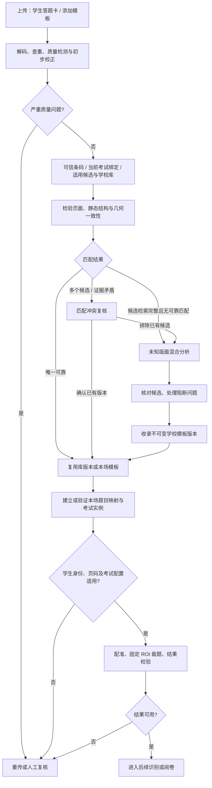

# 答题卡识别、模板收录与复用设计

核对日期：2026-10-16。状态：设计基线，已开始分批实现。原设计保留用于核对范围；当前已交付能力、实现调整和未完成项见[首批实施记录](answer-sheet-hybrid-implementation.md)，不能把下文全部拟议能力视为已经完成或上线。

产品主线：**上传新答题卡 → 系统识别和分流 → 核对新模板 → 收录学校模板库 → 下次自动识别并复用。**

用户只区分“上传学生答题卡”和“添加答题卡模板”两种业务用途，不选择已知/未知、OpenCV/模型等技术选项。已收录且适用的模板自动使用；未匹配、多个候选冲突、身份或页码不明分别处理。新模板必须核对后收录，不能把模型候选直接应用到整批学生。

## 1. 与现有项目的对应关系

| 当前事实 | 代码依据 | 本次设计的处理 |
| --- | --- | --- |
| 模板编辑器已经支持多文件合并、图片和扫描 PDF、全套页码、区域编辑 | [`mergeAnswerSheetSources.ts`](../../apps/web-admin/src/features/answer-sheet-template/editor/mergeAnswerSheetSources.ts)、[`useTemplatePreview.ts`](../../apps/web-admin/src/features/answer-sheet-template/editor/useTemplatePreview.ts) | 继续使用现有入口和画框编辑器，不重新建设一套模板编辑界面 |
| “开始识别区域”是浏览器闭合线框检测 + PDF 文字层/本地 Tesseract | [`useRegionSuggestion.ts`](../../apps/web-admin/src/features/answer-sheet-template/editor/useRegionSuggestion.ts)、[`answerSheetImageRegions.ts`](../../apps/web-admin/src/features/answer-sheet-template/editor/answerSheetImageRegions.ts)、[`answerSheetOCR.ts`](../../apps/web-admin/src/features/answer-sheet-template/editor/answerSheetOCR.ts) | 保留为本地快速分析或服务不可用时的辅助；新增的后台混合分析不能描述成已经接入 |
| 已有人工框不会被自动建议覆盖；部分页失败会继续；未关联框暂存在前端内存 | [`useRegionSuggestion.ts`](../../apps/web-admin/src/features/answer-sheet-template/editor/useRegionSuggestion.ts)、[`unassignedAnswerSheetRegions.ts`](../../apps/web-admin/src/features/answer-sheet-template/editor/unassignedAnswerSheetRegions.ts) | 保留这些规则，新增候选持久化和刷新恢复 |
| 保存带 `expected_revision`；确认流程是保存、锁定、绑定考试，跨接口执行 | [`saveTemplateDraft.ts`](../../apps/web-admin/src/features/answer-sheet-template/editor/saveTemplateDraft.ts)、[`useTemplateLifecycle.ts`](../../apps/web-admin/src/features/answer-sheet-template/editor/useTemplateLifecycle.ts)、[`useTemplateBinding.ts`](../../apps/web-admin/src/features/answer-sheet-template/binding/useTemplateBinding.ts) | 复用版本冲突和部分成功恢复语义；增加审核事实，不把保存当成审核 |
| 正式答题卡模板绑定 `exam_id/exam_paper_id`，ROI 引用本场 `question_id`；克隆仍在同一考试 | [`types.go`](../../services/api-gateway/internal/paper/types.go)、[`store_postgres_configuration.go`](../../services/api-gateway/internal/paper/store_postgres_configuration.go) | 必须新增跨考试的学校模板库；不能把现有考试模板列表直接当成可复用库 |
| `exam_template` 保存考试科目、时长、分段和分值方案 | [`templates.go`](../../services/api-gateway/internal/exam/templates.go) | 不复用这个实体存答题卡 ROI，避免两种模板混淆 |
| 正式布局及编辑器都要求每题一个 ROI，全模板跨页判重 | [`template_validation.go`](../../services/api-gateway/internal/paper/template_validation.go)、[`templateLayoutReducer.ts`](../../apps/web-admin/src/features/answer-sheet-template/editor/templateLayoutReducer.ts) | 一期维持此协议；多块和跨页同题列为后续协议升级，不能只在界面放开重复题号 |
| 后台已有 OpenCV 质量测量、有限纠偏、ORB/AKAZE 配准、已有模板匹配和固定 ROI 裁题 | [`engine.py`](../../services/image-quality-worker/image_quality/engine.py)、[`geometry.py`](../../services/image-quality-worker/image_quality/geometry.py)、[`registration.py`](../../services/page-processing-worker/page_processing/registration.py)、[`runner.py`](../../services/page-processing-worker/page_processing/runner.py) | 复用算法和运行设施，为模板来源新增分析任务；不伪造学生提交来触发这些能力 |
| 匹配已有 `matched/unknown/ambiguous`；候选限本场最多 8 个锁定模板，并按已知页码取页 | [`template_match_store_postgres.go`](../../services/api-gateway/internal/capture/template_match_store_postgres.go) | 保留状态语义；学校库检索和未知页码匹配需新增，不能宣称现有匹配已经覆盖全库和乱序分页 |
| 文档模型配置、多供应商图片传输和异步解析设施已有，但试卷解析不是 ROI 接口 | [`document_model_selection.go`](../../services/api-gateway/internal/modelgovernance/document_model_selection.go)、[`document_visual_loader.go`](../../services/api-gateway/internal/paper/document_visual_loader.go)、[`paper_visual.py`](../../ai-services/grading_agent/paper_visual.py) | 复用模型选择、传输和任务可靠性；新增独立模板分析 schema 和提示词，不把试卷解析结果当题框 |

现有技术细节另见[答题卡能力地图](answer-sheet-capability-map.md)。该文档的历史测试记录不作为本设计已经通过验证的证明。

## 2. 两个业务入口与收录体验

### 2.1 添加答题卡模板

学校有权限的用户上传空白卡或已填写的示例卡。上传完成后自动开始查重、质量分析和模板识别，不再要求点击“已知/未知”或选择算法。

1. 若精确命中已有库版本，展示已有模板及版本，直接复用，避免重复创建。
2. 若视觉匹配存在多个候选，展示差异页与匹配证据，先解决冲突；不自动新建模板。
3. 若确认未匹配，建立持久化分析草稿，自动执行几何候选、语义关联和精修。
4. 用户在现有预览上核对题号、完整空白作答区、身份区和问题清单；不可靠的候选可以改框、关联或删除。
5. 点击“确认并收录模板库”，生成不可变的学校库版本。收录成功后显示库名称和版本，可继续“用于当前考试”。

允许独立于考试添加模板。此时先识别题号和区域槽位，不要求存在考试 `question_id`。也允许把本场已核对的考试模板收录到库，收录时转换成槽位，不携带旧考试题目 ID。

收录与本场考试启用是两个结果。收录成功、启用失败时保留库版本，重试只继续实例化或绑定，不重新上传、识别和收录。

### 2.2 上传学生答题卡

沿用现有采集、质量、身份、模板匹配、配准与裁题链。正常同版答卷自动处理，不逐页调用多模态模型。

未找到适用模板时，暂停依赖该模板的页面，系统可生成候选分析并提示核对。同版未知页面应合并提示，不能每个学生都弹出一次建模流程。在允许修改本场配置、模板实例已准备完成的前提下，只恢复这些受阻页面，不重复处理已完成页面。

这里有一项当前项目的限制：`collecting/grading` 没有退回准备态的路径。已经进入采集或阅卷才发现新模板时，一期可以分析并收录学校库，但不能承诺立即把新模板加入本场后自动恢复。运行中受控补模板列为 P1；该能力交付前，相关页面保留阻断原因，不能通过改数据库状态绕过冻结。

用途来自入口和已有业务上下文；图像判断只提供 `blank/written/uncertain` 辅助证据。“模板资料”不保证图片空白，“学生答题卡”也可能未作答。整页书写状态与逐题空白状态分别记录。

## 3. 自动分流规则

添加模板只执行到收录；没有当前学生或考试时不执行身份校验和裁题。学校库命中只证明版面候选，不自动证明本场题目映射成立。

| 优先级 | 规则与输出 | 失败或冲突处理 |
| --- | --- | --- |
| 1 | 可信签名条码可给出模板、页码或学生身份候选，仍验证版面 | 普通条码或印刷模板文字只作弱线索；可信声明与版面矛盾记录冲突，不静默替换身份 |
| 2 | 检查当前考试绑定的不可变模板版本和内容 hash | 条码不可读不构成未知；绑定模板仍需通过静态结构与配准检验 |
| 3 | 检索当前考试其他适用的锁定模板，再检索本校已收录且可匹配的库版本 | 先粗筛，再对有界候选做几何验证；达到候选上限但检索不完整记 `search_incomplete`，不冒充 `unknown` |
| 4 | 唯一可靠匹配记 `matched`；多个相近候选或可信证据矛盾记 `ambiguous` | 人工只处理歧义；图像相似不允许覆盖已有考试绑定或学生身份 |
| 5 | 检索充分、质量可分析、没有可靠候选才记 `unknown` | 发起一次候选模板分析；网络错误、缺页、页码不明、低质量分别保留原因，不能都归为未知 |

全套文件应聚合版本证据；不同页不能未经确认混用不同版式版本。现有按页号匹配是一项前提：缺少可信页号时，一期只在受控上传顺序/已核对页序下继续，其余转页序复核。任意乱序多学生分册不在一期范围。

### 3.1 决策器形式与重试限制

在 Go 采集领域新增可测试的规则决策器：输入已有证据快照，输出 `next_action/reason_codes/blockers/policy_version`。它不直接调用模型或修改模板，由现有领域事务安排下一任务。上传路径不提供技术开关。

可配置项限于候选数、几何阈值、时限、重试和费用预算；权限、考试冻结、身份冲突和新模板审核要求不能通过阈值配置关闭。策略变更产生新版本，运行中的任务继续使用冻结的版本。

一期初始限制建议：每页至多一次重新校正、一次重新匹配；模型至多一次整页分析和一次针对明确问题的局部分析。具体数值通过基线评测定版。传输重试另设总上限，所有尝试共用 deadline 和费用预算。记录动作及结果指纹；证据没有改善就停止，避免“校正→匹配→未知→重新匹配”循环。

## 4. 学校模板库与本场实例分离

以下均为拟新增结构，名称可在正式契约评审时调整。

| 实体 | 核心内容 | 约束 |
| --- | --- | --- |
| `answer_sheet_library_template` | 学校范围、名称、科目/年级标签、可用状态、当前推荐版本 | 默认本校共享；沿用租户和学校访问范围，不自动开放跨校检索 |
| `answer_sheet_library_version` | 不可变版本号、结构 hash、参考资产 hash、页数/尺寸、印刷特征、槽位布局、审核快照、算法和 schema 版本 | `draft → published → retired`；已发布内容不能原地改，调整生成新版本；停用不改写历史结果 |
| `template_slot` | 稳定 `slot_id`、显示题号、题号路径、页号、归一化 ROI、可选选项区 | 不存旧考试 `question_id`、答案或评分标准；题型只可作建议 |
| `template_analysis_job/stage` | 来源、用途、输入快照、generation、阶段状态、候选、问题、进度、费用 | 输入和结果可恢复；模型输出只写候选 |
| `template_review` | 审核者/时间、审核范围、候选和布局 hash、问题处置、来源和 generation | 修改相关几何、来源或题目映射后，旧审核不能继续授权该版本 |
| 现有 `answer_sheet_template` 扩展来源字段 | `library_version_id`、库结构 hash、槽位映射及映射 hash | 保持现有 `exam_id/exam_paper_id/question_id`，继续供配准、裁题和考试绑定使用 |

一期槽位也维持一题一个矩形；数据 schema 必须带版本，为后续 `segments[]` 升级留出迁移路径，但不提前声称现有运行链支持它。

### 4.1 下次如何自动复用

例：库版本保存 `slot-17 → 显示题号17 → 第2页ROI`。下一场考试的第17题有新的正式 ID，系统生成 `slot-17 → 新question_id` 映射，再建立本场实例，后续 worker 仍消费现有 layout。

自动映射必须满足：本场题目结构已确认、规范化题号路径唯一、所需槽位完整对应、题型与选项结构兼容、版面验证通过。重复题号、选做题、子题层级或题型不一致均记录冲突，不按列表下标猜关联。新考试无需继承旧答案和 Rubric。

已审核且几何不变的库版本可继承几何审核事实。映射完全确定时，系统生成本场映射验证事实；几何或映射有变化才要求针对变化重新核对。因此正常已知模板复用无需教师再次选择模板或逐题画框。

实例化还必须建立本场参考资产关系。现有配准通过 `answer_sheet_template.exam_paper_id → exam_paper.file_asset_id` 读取底图；一期为本场创建或复用 `purpose=answer_sheet` 的来源记录，引用库版本有权使用的干净参考资产，再创建考试模板实例。引用共享资产时校验学校范围、hash 和生命周期，删除某场考试不能误删库参考图。仅新增 `library_version_id` 字段不能让现有 worker 自动找到底图。

实例化必须满足现有考试可修改边界：当前代码只允许 `draft/configured` 修改模板。[现有考试状态机](../../services/api-gateway/internal/exam/status.go)允许 `ready → configured`，但 `collecting/grading` 没有返回准备态的转换。`ready` 阶段可按有权限的配置修订流程调整并重新确认就绪；采集或阅卷阶段一期只保留库命中与映射候选，等待 P1 的受控补模板能力。不得为自动复用绕过冻结，也不在学生批次处理中静默换绑。本场已存在冲突绑定时先复核。

### 4.2 收录什么，不收录什么

库保存可复用的**印刷结构和完整作答空间**。单张已作答卡只包住现有笔迹的小框，不能作为下一位学生的通用 ROI。

- 空白参考经确认后，才可标为 `blank_verified`。已写原图不能直接成为模板库公共预览或 OMR 空白差分参考。
- 已写原件留在受控来源证据中；入库的预览和自动匹配参考应使用有权使用且处理过身份/学生内容的图。不能可靠形成参考图时，可仅收录几何，标记 `matching_ready=false`；补齐经核对的可用参考前不参加全自动视觉匹配，也不能直接进入现有配准裁题链。
- “可收录几何”“可自动匹配”“可做 OMR 差分”是三个独立条件。图库收录成功不代表 OMR 校准已批准；跨考试实例化默认重新验证参考、profile、题目映射和校准适用性。
- 相同文件 hash 只说明上传重复；版面指纹只用于候选检索；几何、参考和槽位的规范化内容 hash 用于版本身份。不能用一个感知 hash 同时承担去重和正式版本校验。

## 5. 未知版面的混合分析

| 情况 | 一期路径 | 后续能力或回退 |
| --- | --- | --- |
| 空白、有清晰印刷框 | CV 框/分隔线候选；OCR/文字层读取题号；歧义时调用多模态 API；精修后核对 | 无框与不可靠框保留问题，不虚构完整边界 |
| 已写、印刷框清晰 | CV 提取印刷结构；多模态关联题号、区域用途；标记疑似越界；核对可复用作答区 | 学生笔迹边界与通用模板边界分别保存 |
| 空白、无框或复杂分栏 | 可输出语义和文字锚点粗建议；需要人工画框 | 二期增加文字块/留白布局；空白留白没有可靠像素边缘时，CV 不能凭空恢复精确边界 |
| 已写、框被覆盖或自由作答 | 只提供辅助分析和问题证据，一期转人工 | 二期结合文字行、多样本印刷结构；三期升级多区域/跨页协议 |
| 题号无法辨认、答案混写 | 用题目清单辅助，保留 `uncertain` | 无法确定时人工关联；允许记录材料本身不足以判断 |

### 5.1 阶段及部署位置

继续使用 Go API、现有 Python worker、`ai-services` 与现有任务运行时，一期不新增独立推理服务。

1. **来源解码**：复用 `decode_document`、资产上传和资源限制，为库资料增加独立来源和回调。现有 `layout` 处理器明确只接受 `paper_import_job`，必须新增路由，不能把模板资料登记成试卷导入或学生提交。
2. **质量/初步校正**：在 image-quality worker 增加模板分析来源，复用纯图像函数。当前仅保证 EXIF 方向和满足条件的有限纠偏；严重透视、裁断和弯曲转复核，不承诺任意页面自动矫正。
3. **几何与文字候选**：page-processing worker 新增模板几何处理器；OCR worker 如被使用，也增加模板来源。输出框、分隔线、文字锚点和证据 ID，不直接写正式模板。
4. **语义关联**：在 Go 新增独立模板语义执行器，借鉴 `ParseTaskExecutor` 的快照、租约和心跳模式，调用 `ai-services` 的新操作。它不复用试卷导入创建正式题目的生命周期。
5. **精修/验证**：page-processing worker 在有原始几何证据的前提下吸附边界、去重和检测冲突；返回原候选与精修差异。没有可靠证据时保留粗框和待核对状态，不强行吸附最近线条。
6. **审核/收录**：Go 原子校验审核和来源版本，生成库版本；只有明确收录操作才能发布。学生页任务只有在本场状态允许、实例和参考资产均可用后才能恢复；运行中才新增模板受第 2.2 节限制。

可新增 `template_geometry/template_semantic` 任务类型；质量与 OCR 复用原 task type、增加来源类型。正式实现须同步修改 Go 校验、数据库 CHECK、服务身份/队列白名单、source activation、资产权限和回调范围。不能只在 Python 的 handlers 字典中增加名称。

### 5.2 模型调用契约

新增内部操作 `answer_sheet_template_analysis`，包含独立 schema、提示词版本和用量 feature。复用学校文档模型选择及供应商适配，不使用 `primary_a/primary_b/arbiter` 评分角色。

当前文档模型的文本结构化检测不能证明图像输入可用；新增绑定配置版本和适配器的 `vision_structured` 实图探测。首次配置验证图片输入和 schema 能力；真实定位质量仍由样本评测决定。模型不可用时保留几何候选并转人工，不自动切换未经允许的供应商。

输入：受控页面图、候选 ID 与几何证据、文字锚点、当前槽位/已确认题目清单，以及版本信息。输出以引用候选 ID 和题号证据为主；必要时返回明确坐标系中的粗区域，不要求模型直接产生正式像素裁剪。

输出至少包括：`page_no/candidate_id/printed_question_label/role/evidence_refs/proposed_bbox/association_status/reason_codes`。`role` 区分答题区、身份栏、说明和其他；无法确定返回 `uncertain`。题号映射由服务端校验，不能让模型创造正式题目 ID。

无效 JSON、未知候选 ID、未知页号、非有限/越界坐标、重复或歧义关联均不能成为已确认布局。置信度是辅助分流证据，不作为“正确率”显示，也不单独授权发布。

### 5.3 坐标协议

正式考试 layout 沿用现有左上角原点、`x/y/width/height ∈ [0,1]` 的页面比例坐标。页号从 1 开始。模型若使用 0～1000 或像素坐标，只能在声明过单位的适配层转换一次，不能靠数值大小猜单位。

每页记录三个空间：来源的显示页 `S`、质量校正图 `N`、模型实际输入图/局部图 `M`；保存各自尺寸、旋转/crop、缩放/补边和可逆矩阵。点坐标映射满足 `p_M = T_N_to_M × T_S_to_N × p_S`，再按来源显示页尺寸归一化。

一期不替换已有模板来源图。精修结果逆映射回来源显示页；旋转矩形需投影四角，转现有矩形时使用保守包围框并检测邻题/身份区冲突。不能只逆变换左上角后照抄宽高。严重透视或包围框会串题时阻断并人工调整。

EXIF 只能应用一次；PDF 渲染需核对 rotation、crop box 与浏览器预览方向一致。后台像素尺寸与 PDF 逻辑尺寸不必相同，但归一化后的可见页面必须一致。精修裁剪取整若采用向外取整，应限定在新候选处理器；现有 `crop_regions` 使用 round，本设计不暗示它已经改变。

## 6. 审核、版本与失败恢复

分析处理状态建议为 `queued/running/completed/failed/cancelled/superseded`；审核状态为 `pending/approved/rejected`。`completed` 仅表示候选生成完成。部分页完成通过逐页状态表达，不把失败页计成完成。

### 6.1 发布与锁定门禁

库发布必须在同一领域事务中校验：当前 generation/输入 hash、来源页和顺序、布局及审核 hash、槽位唯一性、未解决问题为零、审核操作者权限。新模板的每个有效候选须有接受/调整/丢弃事实；漏题、区域冲突、疑似裁断和多区域不支持等 blocker 需有实际处理结果，不能仅点“忽略”。

本场实例锁定需校验当前 revision、内容 hash、库版本/几何审核事实和本场题目映射。现有 `LockTemplate` 没有接收已复核 revision，需新增兼容的版本校验契约；模板锁定和 `question.answer_area` 同事务的保证继续保留。现有题目全覆盖主要在 readiness 检查，新增审核流程还需在锁定前检查。

旧的已锁定模板不回写“已经逐题审核”的虚构历史。新草稿、克隆及改框不得复用不适用的审核记录；已发布库版本的几何审核可在几何完全相同时继承，本场映射另验。服务端记录的是核对声明和证据，不宣称能证明人工判断一定正确。

### 6.2 并发和恢复规则

- 冻结来源 asset/hash、页序、库版本、题目清单签名（有考试时）、模型配置身份、CV/提示词/schema/策略版本。作业去重键按学校、来源及输入版本建立；视觉相似页面只能合并为候选组，不能未经确认认为同版。
- 任务 payload 只存引用，不塞学生正文、完整 OCR 或凭据。由受控上下文按来源和当前租约读取。回调同时核对 task、stage、generation、lease、worker 身份和结果 hash。
- 候选落库、下一阶段派发、runtime 回执和可原子归集的用量在事务中提交；不要先调用通用 complete 再保存领域结果。重复相同回执幂等，不同结果 hash 拒绝。
- 缓存已完成阶段，同输入在途作业合并，局部失败只重跑失败阶段；模型超时可能已经计费，不能承诺外部 API 恰好调用一次。记录每次尝试、供应商 request ID、已知用量及未知费用状态，成功和失败都纳入成本。
- 审核以 CAS 校验 revision/hash。用户改框后旧候选可以展示比较，但不能静默覆盖；前端切换学校、考试、来源、模板、权限或取消作业后，迟到结果不能写入当前编辑器。
- 收录、实例化、锁定和绑定分别返回实际完成状态。部分成功保留已完成事实，使用幂等键继续；绑定保留现有独立 revision 游标，不因解绑归零。
- 发布事件若要求与发布事实原子，使用领域事务内事件/outbox。当前 HTTP 层成功后写审计不能被描述成已有事务审计保证。

## 7. 学生裁题结果的边界

已知模板通过配准不代表身份、页号和答案完整性都通过。页面结果记录实际模板版本/hash、配准证据和裁剪版本；缺页、重复页、错页、身份冲突阻止对应材料进入后续阅卷。未知模板处理完成后也经过这些门禁。

逐题空白状态独立记录 `NON_BLANK/BLANK/UNCERTAIN`；印刷框/题号存在不等于有作答，OCR 未读到文字也不等于空白。没有空白参考或充分证据时保留 `UNCERTAIN`，不因空白分类直接判零分。

学生越界作答应建立 `submission_page + source_revision + template_hash + crop_revision` 的单页覆盖层，保留原 ROI、建议扩裁、证据及确认人；不改变学校库和永久 `question.answer_area`。单纯“不与邻题矩形重叠”不足以证明内容归属。一期只给疑似越界提示并转原页人工复核，问题未解决时阻断相关题段；人工扩裁与覆盖层一起进入 P1，自动扩裁还需验证完整性和串题风险。

同题多块或跨页时，后续正式协议应保存有序 `segments[]` 和页关系，保证 OCR、证据、评分和阅卷界面能读取全部题段。完成该升级前，不把多块合成跨题大矩形，也不让现有 reducer 删除旧题段后声称支持续答。

这里的“结果可用”指允许进入后续识别/阅卷；成绩发布仍沿用独立业务流程，不能由模板识别任务触发。

## 8. 拟新增接口

以下是设计名称，尚未注册路由。权限沿用现有学校/考试管理能力并增加资源 scope；学生上传不因此获得模板发布权限。

| 接口 | 用途 |
| --- | --- |
| `GET/POST /api/v1/answer-sheet-template-library` | 查询本校模板库、建立上传草稿；上传资产完成后自动安排识别 |
| `GET/PATCH /api/v1/answer-sheet-template-library/{id}/draft` | 恢复/修改库草稿和槽位，写操作带 `expected_revision` |
| `POST /api/v1/answer-sheet-template-library/{id}/analyses` | 发起或返回相同输入的分析作业；相同已完成输入复用结果，避免再次发起语义分析；费用按实际尝试记录 |
| `GET /api/v1/answer-sheet-template-analyses/{id}` | 读取进度、逐页结果、候选、问题与实际完成状态 |
| `POST /api/v1/answer-sheet-template-analyses/{id}/retry`、`/cancel` | 在预算和来源版本允许时重试/取消 |
| `PUT /api/v1/answer-sheet-template-library/{id}/review` | 提交当前版本核对和问题处置，不发布 |
| `POST /api/v1/answer-sheet-template-library/{id}/publish` | 校验审核快照并幂等生成不可变库版本，即“确认并收录” |
| `POST /api/v1/exams/{examId}/answer-sheet-template-library-versions/{versionId}/instantiate` | 校验槽位映射，生成或返回本场考试实例；正常可确定场景由系统执行 |
| `POST /api/v1/internal/template-analysis-stages/{stageId}/result`、`/failure` | 按 worker 来源和租约原子提交阶段结果 |

自动匹配不要求浏览器提交 `known/unknown`，也不要求教师选择一个模板 ID。现有确认锁定/考试绑定接口继续使用，增加所需版本与审核校验。自动匹配到库版本时，系统调用同一实例化领域逻辑，不另写绕过门禁的内部捷径。

## 9. 分期实施清单

全部为**待实施**。下列模块是改动落点，不是已完成文件清单；新文件使用“拟新增”标明。每项交付同步核对附近注释，按[注释标准](commenting-standard.md)解释坐标、状态、权限、版本和失败恢复。

| 项目 | 范围及文件落点 | 依赖 | 验收 |
| --- | --- | --- | --- |
| P0-1 库与槽位契约 | `paper/` 拟新增 `template_library_types.go/library_*.go`；正式 OpenAPI；新增 SQL 迁移和学校访问范围 | 无 | 独立上传可建草稿；库不携带考试题目 ID；学校隔离；同输入去重；发布版本不可改 |
| P0-2 分析与审核事实 | `paper/` 拟新增 `template_analysis_*.go/template_review_*.go`；参考现有 parse input/commit/executor；扩展 `workerruntime` | P0-1 | 候选/问题可恢复；取消、迟到、租约过期、重复回执和部分成功有明确结果 |
| P0-3 后台混合分析 | `page_processing/runner.py` 拟新增几何模块；`image_quality/runner.py`、`ocr_worker/runner.py` 增模板来源；`grading_agent/` 拟新增独立模板分析契约/操作；模型视觉探测 | P0-2 | 空白有框与已写有框可给候选；题号/身份栏分离；坐标逆映射一致；模型错误不写正式 layout |
| P0-4 审核及自动启动界面 | 复用 `AnswerSheetTemplatePage.tsx` 和 `features/answer-sheet-template/`；拟新增任务 hook/模板库入口；让编辑器支持槽位草稿与考试实例 | P0-1～3 | 两个业务入口；上传后自动识别；无已知/未知选择；可恢复候选、改框、关联、核对和收录 |
| P0-5 收录和跨考试复用 | 库发布/实例化；本场 `exam_paper` 与库参考资产桥接；`store_*_configuration.go`、`useTemplateLifecycle.ts`、`useTemplateBinding.ts`；模板 provenance 字段 | P0-1～4 | 新模板收录后可在下一考试复用；参考可供现有 worker 读取；旧 ID 不泄漏；唯一映射自动完成；冲突转复核；冻结不绕过 |
| P0-6 自动匹配与受阻页恢复 | `capture/template_match_store_postgres.go`、`registration_store_postgres.go`；拟新增决策器/库候选检索；前端处理队列提示 | P0-5 | 条码失败继续匹配；matched/unknown/ambiguous 分开；检索不完整不新建；同版未知页去重提示；已有可用实例时仅恢复受阻任务；冻结后缺实例则保留阻断 |
| P0-7 验证与试点 | worker/Go/前端定向回归、数据库事务集成、独立布局评测；更新对应部署配置/运行说明 | 全部 P0 | 完整走通“上传→识别→核对→收录→下次自动复用→裁题”；新模板不可跳过审核 |
| P1 无框和越界 | 文字块/留白候选、多样本印刷结构、单页覆盖层、受控自动扩裁 | P0 实测 | 复杂场景分别报告质量与人工耗时，不修改公共模板容纳单个学生答案 |
| P1 运行中受控补模板 | 设计独立配置修订快照、权限/审核、受影响页面集合、参考和题目映射；联动采集路由与重排队 | P0-5/6 及冻结协议评审 | 不改写已完成页面或已冻结评分证据；新模板只对明确授权的受阻范围生效；失败保留旧配置，可追溯恢复 |
| P2 多区域和跨页 | 版本化 `segments[]`；Go/TS 类型、DB、编辑器、crop/OCR/评分证据/阅卷展示联动 | P1 及协议评审 | 同页多块、跨页续答完整保留；旧版本仍可读取；顺序和归属可追溯 |
| P3 专用检测模型 | 人工确认数据治理、布局检测模型训练/适配、独立版本与影子评测 | 足够合规数据 | 在冻结测试族上比较精度、成本、复核时间后决定启用，不把安装 YOLO 等同于可用 |

一期以有清晰印刷框为自动分析范围；其他场景能进入人工画框并完成有效的单 ROI 收录，但不承诺自动理解成功。P0-1/4/5 可先用现有本地候选验证收录复用链，P0-2/3 随后接混合分析；完整一期验收包含 P0-1～7。

### 9.1 契约与部署要求

- 权威接口源为 `services/api-gateway/openapi/edugrade-api.openapi.json`。更新后按现有脚本生成 SDK、检查 breaking baseline/路由覆盖/授权契约/schema 版本；不手改 `packages/sdk/src/generated/`，不以新增路由例外代替接口定义。
- 使用实施时下一个可用迁移号新增库、任务、审核、索引/去重和 task type CHECK；不修改历史迁移。既有 locked 模板保留历史含义。
- 任务变更同步 `workerruntime/validation.go`、`identity.go`、source activation/complete/fail 和 `server/routes_worker.go`；新库资源增加学校 scope。Go 内部执行器与 Python worker 的身份职责分别验证。
- 模板领域仍放在现有 API 模块；图片能力仍放现有 worker，避免在 Go HTTP handler 内做 CV 或长时间等待模型。模板分析是独立来源，不复用学生身份和评分事实。
- 现有代码存在不证明当前 Docker/服务器已启动相应 worker 或加载真实 OCR 模型；交付需检查服务配置、队列消费者、健康探测、资产访问和真实图片调用。

## 10. 验证计划与通过条件

### 10.1 工程回归

扩展现有 `useRegionSuggestion.scan.test.tsx`、`useTemplateEditor.scanFlow.test.tsx`、`useTemplateLifecycle.test.tsx`、`useTemplateBinding.test.tsx`；后台复用配准、decoder、template match、模板 validation/binding 和租约边界测试，新增库、审核与实例化的事务集成测试。

必须覆盖以下业务场景：

1. 新空白卡上传后自动识别，候选核对收录；下一场考试生成新题目映射，复用 ROI 且不再调用模板语义 API。
2. 重复上传命中已有库版本；视觉相近但不相同的版本进入冲突；搜索被截断或 API 失败不创建新模板。
3. 已写卡的笔迹框不能替代完整作答区；疑似越界不改库；未经确认的原图不成为公共预览或空白 OMR 参考。
4. 切换学校/考试/来源、取消后重开、保存 revision 冲突、租约失效、旧 generation 回执不覆盖当前编辑或审核。
5. 部分页失败、刷新恢复、API 超时重试、重复收录/实例化请求不制造重复版本；收录成功但绑定失败可继续。采集中收录成功不绕过 `ErrExamFrozen`，没有适用本场实例的受阻页不得假报恢复成功。
6. 审核后再次改框、修改题目映射、克隆或换来源使相关审核失效；旧审核不能锁定新内容。
7. 模板命中但身份不明、缺页/重复页/页码冲突、不同版本混页时不流转到正常阅卷；可信条码与版面矛盾先复核。
8. EXIF、PDF 旋转/crop、分析缩放、局部模型图和纠偏回映后，预览、保存、裁剪同一位置；极小边界、越界和非有限数被正确处理。
9. 已知模板批处理继续固定 ROI 配准裁题；已有考试绑定游标、权限及冻结规则不退化。
10. 一期遇到同题多区域/跨页不丢旧区域、不假装已支持；给出明确阻断或人工处理路径。

### 10.2 布局评测

现有 `tests/ai-evaluation` 比较评分记录，`lab/src/evaluators` 也主要评估评分 schema/证据，均不能直接证明 ROI 质量。新增独立布局 Gold、预测契约和 evaluator，复用数据来源、版本/hash、盲标与裁决方法，不把 ROI 硬塞入 grading schema。

Gold 分两层：可复用的印刷模板作答区，以及本张学生页必须保留的实际答案范围。双人独立标注，分歧裁决；无法判断归属允许 `ambiguous`。按 `template_family_id` 隔离开发/验证/测试，同版空白、不同学生、扫描增强及跨页全部同组。

首轮可用 100 页、空白/已写各 50 页，建议覆盖至少 20 个独立模板族，按有框/无框、单/双栏、遮挡、越界、缺页分层报告。现有福建仿真只有一个版式且 OCR 使用真值模拟，只能作为回归材料，不能计作真实泛化证据。

对照 A：OpenCV + 同一 OCR；B：同一多模态 API 直接给区域；C：OpenCV 候选 + 同一 API 关联 + CV 精修。保持相同输入、题目清单可见性和预处理。另测已收录版本在不同学生页上的批量复用，分别核算首次建模成本和后续成本。

| 指标 | 口径 |
| --- | --- |
| 题区召回 | 同页几何一对一匹配，报 Recall@IoU 0.5/0.75；漏检进入分母，不先按题号过滤 |
| 题号关联 | 同时报告已匹配区域准确率、全部 Gold 题段的端到端正确率 |
| ROI IoU | 模板区和学生实际内容分别评估，报分布，避免仅包住少量笔迹取得虚假的好成绩 |
| 答案完整保留 | 必保留的文字、公式、图形及细小符号是否完整落入正确题框；同时统计覆盖率和整题完整率 |
| 串题与复核 | 邻题答案污染、严重裁断、错误中被提示的比例、不必要复核比例 |
| 时间/费用 | 人工复核秒数、修改次数；每次 API 尝试、已知费用、超时/重试率、P50/P95 延迟 |
| 复用收益 | 首次收录后的命中率、题目映射正确率、每学生页语义 API 次数和处理成本 |

结果报告分子/分母、模板族宏平均和题段微平均；空样本为 `not_evaluated`。超时、无效结果与拒答计入端到端失败，不能从准确率分母移除。

一期先以“未审核发布为零、错误题号/严重串题/严重裁断有可复现阻断”为工程门禁。质量百分比与费用上限在基线测量后冻结；100 页实验只用于验证可行性和进入人工确认试点，不能据此承诺无人值守或 99.9% 可靠。

### 10.3 数据范围

在 `lab/` 实施时必须遵循 [`lab/AGENTS.md`](../../lab/AGENTS.md)：不使用真实学生私人数据；合成标记 `synthetic=true`，模拟输出标记 `mock=true` 并含 `MOCK_OUTPUT`。模板上传、审核、发布和本场工作流不放进 lab。

真实扫描的授权、用途和脱敏单独治理。文字敏感词扫描不能证明图片里的姓名、学号、条码或 EXIF 已脱敏；报告只放计数、hash 和错误码，原图不提交仓库。模型供应商调用遵循已有学校配置和资产访问规则。

## 11. 研究依据及结论边界

[DocLayout-YOLO 论文](https://arxiv.org/abs/2410.12628)研究专用文档布局检测的速度和精度；[Qwen3-VL 官方仓库](https://github.com/QwenLM/Qwen3-VL#cookbooks)提供文档解析与二维定位示例。这些支持把专用检测器、视觉 API 纳入候选方案，不能推出它们在本项目答题卡上哪个更准。

“CV 提供几何证据，多模态辅助语义归属”是本设计待验证的工程假设。项目首要交付是可恢复的**识别、审核、收录、再次自动复用**闭环；真实识别质量通过上述同数据对照实验确定。

本次实际核对限定于文中所引的模板编辑、模型配置/传输、模板保存绑定、worker 及评测相关实现与调用。没有开展全仓逐文件整理，没有执行或新增业务测试，没有调用真实答题卡模型；未涉及的模块不计作已审读。
